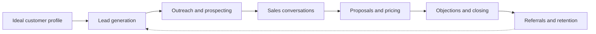

# Client acquisition

Finding people and organizations who need what you offer and turning them into paying, returning clients: targeting, lead generation, outreach, sales conversations, proposals, closing and retention. This skill belongs to [Hard skills](../README.md). The notes focus on services, freelancing and B2B. Retail customers are covered in [e-commerce](../e-commerce/README.md).

## Notes in reading order

1. [Client acquisition fundamentals](client-acquisition-fundamentals.md): definitions, the funnel, inbound and outbound, the process and unit economics.
2. [Ideal customer profile](ideal-customer-profile.md): building an ICP from your best clients, buyer personas, triggers and disqualifiers.
3. [Lead generation](lead-generation.md): inbound and outbound sources, lead magnets, landing pages, qualification and scoring.
4. [Outreach and prospecting](outreach-and-prospecting.md): research, warm paths, writing outreach messages, follow-up and the law in the EU, Poland and the US.
5. [Sales conversations](sales-conversations.md): discovery calls, the SPIN research, active listening and ethics.
6. [Proposals and pricing](proposals-and-pricing.md): proposal structure, cost-plus, market and value-based pricing, options, scope and payment terms.
7. [Objections and closing](objections-and-closing.md): handling objections, advances and closing without pressure.
8. [Referrals and retention](referrals-and-retention.md): drivers of retention, measuring churn, getting referrals, and the evidence behind popular retention claims.

## Map of the skill

The notes follow a client from first contact to repeat work and referrals, which feed new leads.

## How to learn it

Start with notes 1 and 2 and write your ICP. Set a small weekly routine of lead generation and outreach (notes 3 and 4) and track the funnel. Practice discovery calls with a colleague using note 5 and record them. Use notes 6 and 7 for every proposal, and note 8 after every finished project. Related skills: [copywriting](../copywriting/README.md), [personal branding](../personal-branding/README.md) and [LinkedIn for professionals](../social-media/linkedin-for-professionals.md).

## Navigation

- Back to [Hard skills](../README.md).
