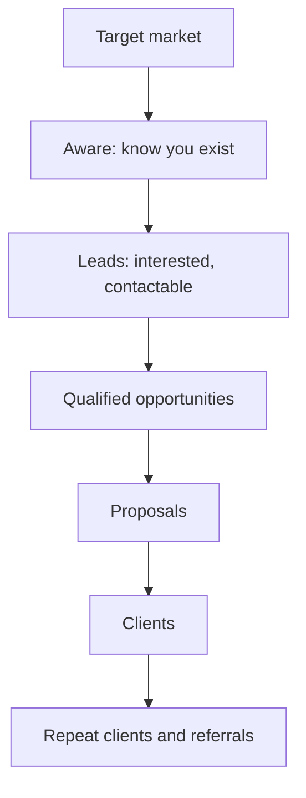

# Client acquisition fundamentals

## Summary

Client acquisition is the process of finding people or organizations who need what you offer, starting a relationship with them and turning them into paying clients. It covers marketing (making the right people aware and interested), sales (conversations, proposals, closing) and the handover to delivery. For freelancers, agencies, consultants and B2B companies it is often the skill that decides whether the business survives. The process can be described as a funnel from target market to leads, qualified opportunities and clients, and measured by conversion between stages, the cost of acquiring a client and the value a client brings over time. Most failures come from targeting the wrong clients, inconsistent activity and weak follow-up, not from a lack of clever techniques.

## Prerequisites

None. This note is the entry point to [client acquisition](README.md). Useful context: [copywriting fundamentals](../copywriting/copywriting-fundamentals.md) and [content marketing fundamentals](../content-marketing/content-marketing-fundamentals.md).

## Core concepts

### Definition

*Client acquisition* (also customer acquisition) is the set of activities that turn people who do not yet know or buy from you into paying clients. In this library, "client" is used for business and service relationships (freelance, agency, B2B, professional services), and "customer" for retail. The principles overlap.

Key terms:

- *Lead:* a person or organization that has shown interest or fits your target and can be contacted.
- *Qualified lead* or *opportunity:* a lead with a real need, budget, authority and timing for what you sell.
- *Pipeline:* the set of opportunities at different stages.
- *Conversion rate:* the share that moves from one stage to the next.
- *Customer acquisition cost* (CAC): what it costs on average to win one new client.
- *Customer lifetime value* (CLV or LTV): the value a client brings over the whole relationship.

*Analogy.* Client acquisition is like farming more than hunting. Hunting (chasing any deal, any client) brings an occasional meal and an empty larder between hunts. Farming means choosing the right field (target market), preparing the soil (reputation, content, network), sowing regularly (outreach and marketing), tending (follow-up) and harvesting in season (closing), year after year. The analogy breaks because crops do not choose the farmer, while clients compare you with others and can walk away at any stage.

### The funnel

The diagram shows the stages from the whole target market to clients and referrals. At each stage fewer people remain. Improving the conversion at any stage, or the number entering the top, increases the number of clients.

The funnel is a simplification. B2B purchases involve several people and non-linear research. Gartner's research on B2B buying, often cited (checked 2026-10 only through secondary summaries), found that buyers spend only about 17% of the buying process meeting potential suppliers, and much of the rest researching independently. Being findable and credible during that independent research matters.

### Inbound and outbound

| | Inbound | Outbound |
| --- | --- | --- |
| How it works | Prospects find you through content, search, referrals, social media | You contact prospects first: email, calls, messages, events |
| Strengths | Warm leads, compounding, lower cost per lead over time | Control over who you reach, faster start, predictable volume |
| Weaknesses | Slow to start, less control over who comes | Low response rates, reputational and legal risk if done badly |
| Notes | [Content marketing](../content-marketing/README.md), [SEO](../search-engine-optimization/README.md), [social media](../social-media/README.md) | [Outreach and prospecting](outreach-and-prospecting.md) |

Most businesses combine both. Referrals and repeat clients are often the cheapest source of all (see [referrals and retention](referrals-and-retention.md)).

### The acquisition process

1. **Define the ideal client** (see [ideal customer profile](ideal-customer-profile.md)).
2. **Generate leads** through inbound and outbound channels (see [lead generation](lead-generation.md) and [outreach and prospecting](outreach-and-prospecting.md)).
3. **Qualify** leads to focus on those who can and want to buy.
4. **Discover** needs in sales conversations (see [sales conversations](sales-conversations.md)).
5. **Propose** a solution and a price (see [proposals and pricing](proposals-and-pricing.md)).
6. **Handle objections and close** (see [objections and closing](objections-and-closing.md)).
7. **Onboard and deliver**, then **retain and earn referrals**.

### Unit economics

- **CAC** = acquisition spend (marketing, sales time, tools) in a period / new clients in that period. For a freelancer, include the value of your own time.
- **LTV** = average contribution per client per period × average client lifetime.
- **Payback period** = time until a client's contribution repays their acquisition cost.

The commonly cited target of LTV at least three times CAC is a rule of thumb from practice, not a research finding. The underlying logic is sound: acquisition must pay for itself with margin, and channels with a high CAC suit only clients with high lifetime value.

### Activity and consistency

Acquisition is cumulative. Many service businesses alternate between "feast" (busy delivering, no prospecting) and "famine" (no work, frantic prospecting). The remedy is a small, fixed weekly routine of acquisition activities regardless of workload, tracked with a simple pipeline.

## Worked example

A freelance copywriter wants a steady flow of B2B clients (invented numbers).

**Target:** software companies with 20 to 200 employees that sell to small businesses and have a marketing team of one to three people.

**Weekly routine (4 hours):**

- 2 hours: personal outreach to 10 companies that fit the target (see [outreach and prospecting](outreach-and-prospecting.md)).
- 1 hour: one LinkedIn post and comments on prospects' posts (see [LinkedIn for professionals](../social-media/linkedin-for-professionals.md)).
- 1 hour: follow-ups and pipeline review.

**Funnel after three months:**

| Stage | Number | Conversion |
| --- | --- | --- |
| Companies contacted | 120 | |
| Replies | 18 | 15% |
| Discovery calls | 9 | 50% of replies |
| Proposals | 6 | 67% of calls |
| Clients won | 3 | 50% of proposals |
| Inbound leads (from posts and referrals) | 5 | |
| Clients from inbound | 2 | 40% |

**Economics:** 5 new clients. Time invested about 52 hours, valued at 300 PLN an hour: 15,600 PLN. CAC about 3,100 PLN. Average client spends 4,000 PLN a month for 6 months with a contribution of about 60%: LTV about 14,400 PLN. LTV to CAC about 4.6.

**Decision:** keep the outreach routine, add a referral request at the end of each project.

## Trade offs and when to use it

- **Inbound versus outbound.** Inbound compounds and takes time. Outbound starts fast and needs persistence and skill. Combine them.
- **Niche versus broad.** A narrow target makes every message more relevant and limits the market. Most small service businesses grow faster with a niche.
- **Volume versus personalization.** Mass outreach reaches more people with lower response and higher legal and reputational risk.
- **Founder-led sales versus a sales team.** Founders sell with credibility and limited time. Hiring salespeople requires a repeatable process first.

## Common mistakes

- **Selling to anyone.** Fix: define the ideal client and say no to poor fits.
- **Prospecting only when work runs out.** Fix: a fixed weekly routine.
- **No follow-up.** Fix: plan several touches and track them.
- **Ignoring existing clients.** Fix: ask for referrals and repeat work.
- **Not measuring the funnel.** Fix: track numbers at each stage.

## Practice

1. Define lead, qualified lead, pipeline, CAC and LTV in one sentence each.
2. Compare inbound and outbound acquisition for a business you know.
3. Calculate CAC and LTV for: 40 hours of acquisition at 200 per hour, 4 new clients, each paying 3,000 a month for 5 months at 50% contribution.
4. Design a weekly acquisition routine of three hours for a service business.

Hints: question 3: CAC 2,000, LTV 7,500.

## Further reading

- Rackham, N. (1988). *SPIN Selling*. McGraw-Hill. Research on what distinguishes successful large sales.
- Gartner. The B2B buying journey. [gartner.com](https://www.gartner.com/en/sales/insights/b2b-buying-journey). B2B buyers' time with suppliers (source of the 17% figure).
- Blank, S., & Dorf, B. (2012). *The Startup Owner's Manual*. K&S Ranch. Customer development and acquisition for new businesses.
