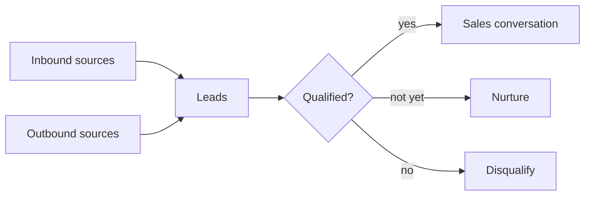

# Lead generation

## Summary

Lead generation is creating a steady flow of potential clients who have shown interest or fit your target and can be contacted. Leads come from inbound sources (content, search, social media, events, referrals) that attract people to you, and from outbound prospecting where you contact them first. The key tools are a clear offer worth responding to, lead magnets and landing pages that turn visitors into contacts, and qualification that separates people who can and want to buy from those who cannot. Lead quality matters more than lead volume: a hundred contacts who will never buy cost time and can damage reputation, while a few qualified leads fill the calendar.

## Prerequisites

[Client acquisition fundamentals](client-acquisition-fundamentals.md) and [ideal customer profile](ideal-customer-profile.md).

## Core concepts

### Definition

*Lead generation* is the set of activities that identify and attract potential clients and collect their contact details or permission to talk. A *lead* is a contactable person or organization with some interest or fit. Practitioners distinguish:

- *Marketing qualified lead* (MQL): has engaged with marketing (downloaded a guide, attended a webinar) and fits the profile.
- *Sales qualified lead* (SQL): has been assessed as ready for a sales conversation.

*Analogy.* Lead generation is like setting up a stall at a trade fair. Some visitors walk past, some stop to look, some pick up a leaflet, and a few ask for a meeting. A good stall attracts the right visitors (not just anyone who wants free sweets), has a reason to leave contact details, and someone who quickly sees who is serious. The analogy breaks because online the "stall" is open day and night in many places, and most visitors leave no trace unless you give them a good reason.

### Inbound sources

| Source | How it produces leads |
| --- | --- |
| Content and SEO | Useful articles with a related lead magnet or offer (see [content marketing fundamentals](../content-marketing/content-marketing-fundamentals.md)) |
| Social media | Posts that show expertise, profile with a clear offer, conversations (see [LinkedIn for professionals](../social-media/linkedin-for-professionals.md)) |
| Webinars and events | Registration collects contacts, the event builds trust |
| Partnerships | Partners with the same clients recommend you or co-host content |
| Referrals | Existing clients recommend you (see [referrals and retention](referrals-and-retention.md)) |
| Directories and marketplaces | Profiles on platforms where clients look for providers |
| Paid ads | Lead forms or landing pages promoted to a target audience (see [paid social advertising](../social-media/paid-social-advertising.md)) |

### Outbound sources

Researched lists of organizations that match the ICP, contacted by email, phone, social messages or at events. See [outreach and prospecting](outreach-and-prospecting.md), including the legal limits.

### Lead magnets and landing pages

A *lead magnet* is something useful offered in exchange for contact details: a checklist, template, calculator, short course, audit, sample or free consultation. A good lead magnet:

- solves a specific, small problem of the ICP,
- is closely related to what you sell, so those who want it are potential clients,
- delivers value quickly.

A *landing page* is a page with one purpose: getting the visitor to take the offer. It states the benefit, shows what is included, gives proof, asks for only necessary details and has one call to action (see [calls to action and risk reversal](../copywriting/calls-to-action-and-risk-reversal.md)).

In the EU, collecting contact details requires transparency about how they will be used, and sending marketing emails afterwards generally requires consent (see [email marketing](../content-marketing/email-marketing.md#consent-and-law)). Making the download conditional on consent to marketing can raise questions about whether consent is freely given. Separate the two where possible.

### Qualification

Qualification decides which leads deserve sales time. Common frameworks:

- **BANT:** Budget, Authority, Need, Timeline. Widely attributed to IBM.
- **MEDDIC:** Metrics, Economic buyer, Decision criteria, Decision process, Identify pain, Champion. Used in complex B2B sales.
- **CHAMP:** Challenges, Authority, Money, Prioritization. A variant that starts with the problem.

For small service businesses a simple version works: Do they have the problem we solve? Can they afford the solution? Is the person we talk to involved in the decision? Do they want to solve it soon?

Leads from both kinds of sources pass through qualification before they get sales time:

### Lead scoring

*Lead scoring* assigns points to leads based on fit (industry, size, role) and behavior (pages visited, content downloaded, emails clicked) to prioritize follow-up. It needs enough data and periodic checks that high scores actually predict sales.

### Speed and follow-up

Leads cool quickly. Practitioners consistently recommend contacting inbound leads within hours, not days. Follow-up after the first contact is where many opportunities are won or lost: plan several useful touches rather than a single message.

## Worked example

An accounting firm for small online shops builds a lead generation system (invented numbers).

1. **Lead magnet:** "VAT checklist for selling to other EU countries" (a two page PDF), directly related to its service.
2. **Landing page:** headline "Selling to Germany or France? Check your VAT in 10 minutes", three bullet points of what the checklist covers, a sample page image, a form with name and email, and a separate optional checkbox for the newsletter.
3. **Traffic:** an article on OSS registration ranks in search (see [SEO content and blogging](../search-engine-optimization/seo-content-and-blogging.md)), LinkedIn posts by the founder, a webinar with an e-commerce platform partner.
4. **Qualification:** a short follow-up email asks two questions: annual revenue and countries they sell to. Leads with cross-border sales above the OSS threshold get an offer of a free 20 minute call.
5. **Results after three months:** 420 downloads, 160 newsletter sign-ups, 70 answers to the qualification questions, 31 calls, 9 new clients.

The system shows that most downloads do not become clients, and that the qualification step saves time by focusing calls on those who need the service.

## Trade offs and when to use it

- **Volume versus quality.** Broad lead magnets bring more leads and fewer clients. Specific ones bring fewer, better leads.
- **Gated versus free content.** Requiring an email increases leads and reduces reach and sharing. Gate content that is valuable enough and close to the purchase.
- **Automation versus personal follow-up.** Automation scales. Personal follow-up converts better for high-value services.
- **Paid lead generation** is fast and can bring low-quality leads. Measure cost per client, not cost per lead.

## Common mistakes

- **Lead magnets unrelated to the offer.** Fix: solve a small part of the problem you are paid to solve.
- **Long forms.** Fix: ask only what is needed.
- **No follow-up.** Fix: a planned sequence of useful contacts.
- **Treating all leads equally.** Fix: qualify.
- **Bundling consent.** Fix: separate download and marketing consent.

## Practice

1. Distinguish an MQL from an SQL.
2. Design a lead magnet for a service you know and explain why its takers are likely clients.
3. Write the four BANT questions in natural language for a discovery call.
4. Why should lead generation be measured by cost per client rather than cost per lead?

## Further reading

- Regulation (EU) 2016/679 (GDPR), Article 7 and Recital 43. [EUR-Lex](https://eur-lex.europa.eu/eli/reg/2016/679/oj). Conditions for freely given consent.
- Rackham, N. (1988). *SPIN Selling*. McGraw-Hill. Qualification and discovery in larger sales.

TODO: Find a primary source for the origin of BANT at IBM and research on the effect of lead response time.
