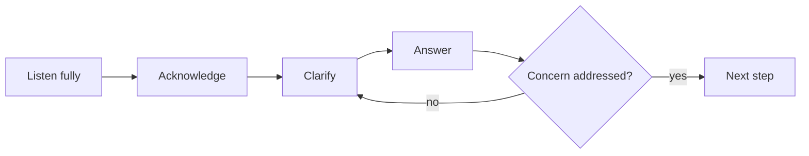

# Objections and closing

## Summary

An objection is a reason a prospect gives for not buying, or not yet: price, timing, trust, priority, fit or the need to consult someone. Most objections are requests for information or reassurance rather than final refusals, and the best way to handle them is to listen, clarify the real concern, answer it honestly and check whether it is resolved. Closing is asking for a decision and agreeing the next step, not a trick at the end. Research on large sales found that pressure-based closing techniques tend to backfire, while clear next steps and commitments the buyer can make move deals forward.

## Prerequisites

[Sales conversations](sales-conversations.md) and [proposals and pricing](proposals-and-pricing.md).

## Core concepts

### Definitions

- An *objection* is a stated concern or reason not to proceed.
- A *stall* is a delay without a clear reason ("Let me think about it"), which often hides an unstated objection.
- *Closing* is asking the prospect to make a decision or commit to a next step.
- An *advance* (Rackham's term) is an action that moves the sale forward, such as agreeing to a trial, a meeting with the decision maker or a pilot. A *continuation* is a meeting that ends without a concrete next step.

*Analogy.* Handling objections is like a mountain guide answering a hiker's doubts at the trailhead. "Is it too steep?" "Will the weather hold?" "Is my equipment good enough?" A good guide does not argue or rush. They ask what worries the hiker most, give honest facts, suggest a shorter route if needed, and sometimes say that today is not the right day. The analogy breaks because the guide has no financial interest in whether the hiker goes, while a seller does, which is why buyers test objections and why honesty matters even more.

### Why objections arise

Objections usually reflect one of:

- **Missing information:** the buyer does not understand something.
- **Risk:** fear of making a wrong decision, wasting money or looking bad.
- **Real misfit:** the offer does not suit them.
- **Priorities:** the problem is real but not urgent.
- **Process:** others must be involved.

Distinguishing these decides the response. A misfit should be accepted. The others can often be addressed.

### A method for handling objections

1. **Listen fully** without interrupting.
2. **Acknowledge** the concern ("That is a fair question").
3. **Clarify** what is behind it ("When you say it is expensive, compared with what?" or "What would need to be true for this to be worth it?").
4. **Answer** the real concern with facts, examples, options or risk reversal.
5. **Check** ("Does that address your concern?").

Practitioner variants include LAER (listen, acknowledge, explore, respond) and "feel, felt, found". They share the same logic.

The five steps for handling an objection. If the check fails, clarify again.

### Common objections and responses

| Objection | What it may mean | Possible response |
| --- | --- | --- |
| "It's too expensive." | Value not clear, budget limit, or comparing with a cheaper alternative | Clarify the comparison. Restate the value from discovery. Offer a smaller scope option. Never just cut the price |
| "Not right now." | Not a priority, or hidden concern | Ask what would make it a priority. Quantify the cost of waiting. Agree a date to revisit |
| "We need to think about it." | Unstated objection or someone else involved | "Of course. What would you be weighing up?" |
| "I need to talk to my partner or boss." | Decision process | Offer to join the conversation or prepare a one-page summary for them |
| "We are already working with someone." | Switching cost or loyalty | Ask what works and what does not. Offer a small comparison project |
| "I am not sure it will work for us." | Risk | Case studies from similar clients, a pilot, a guarantee (see [calls to action and risk reversal](../copywriting/calls-to-action-and-risk-reversal.md)) |

### Preventing objections

Many objections can be handled before they arise: discover the budget and decision process early, address common concerns in the proposal, include proof for the most likely doubts, and offer options. Recurring objections are also feedback about the offer, the targeting or the messaging.

### Closing

Closing is asking for a decision. Approaches that respect the buyer:

- **Direct:** "Shall we go ahead with the recommended option?"
- **Summary:** restate the problem, the value and the plan, then ask.
- **Next step:** in complex sales, ask for an advance (a pilot, a meeting with the decision maker, a signed scope) rather than the whole deal.
- **Mutual action plan:** a shared list of steps and dates both sides commit to until a decision.

Rackham's research on large sales found that the use of classic closing techniques (such as the "assumptive close" or "alternative close") was negatively related to success in larger sales, while in small, one-call sales they could work. Buyers in larger purchases recognize and resent pressure.

### When the answer is no

A clear "no" is better than a long stall. Ask what led to the decision, thank the person, and keep the relationship if it makes sense (a newsletter, a check-in after a few months). Lost deals are a source of learning.

### Ethics and law

Pressure tactics, false deadlines and exaggerated claims are unethical and, in consumer sales, can be aggressive or misleading commercial practices under EU law (Directive 2005/29/EC). In B2B, misrepresentation can lead to contract disputes and damage reputation.

## Worked example

A prospect for a monthly SEO service says, after a proposal: "It's too expensive."

- **Clarify:** "I understand. Too expensive compared with what you expected, or with another offer?" "We got an offer for half the price."
- **Explore:** "What does that offer include?" "Monthly reports and some keyword tracking."
- **Answer:** "Ours includes fixing technical issues and two pieces of content a month. In discovery you said organic orders fell by about 15,000 PLN a month after the redesign. The other offer would report on that, ours is aimed at recovering it. Would it help to see how a similar shop recovered after three months?"
- **Option:** "If budget is the constraint, we could start with a three-month technical fix package without content, at 60% of the price."
- **Check and close:** "Which would suit you better, the full service or starting with the technical package?"

Prices and figures are invented.

## Trade offs and when to use it

- **Persistence versus respect.** Following up and addressing concerns is helpful. Pushing after a clear no damages trust.
- **Discounts versus options.** A discount solves the objection now and weakens your pricing. Scope options keep value intact.
- **Asking for the whole deal versus an advance.** In complex sales, small commitments are more realistic and more effective.

## Common mistakes

- **Arguing with objections.** Fix: clarify and answer.
- **Treating every objection as price.** Fix: ask what is behind it.
- **Pressure closing in complex sales.** Fix: agree next steps.
- **Ending meetings without an advance.** Fix: propose a concrete next step.
- **Ignoring patterns.** Fix: record objections and improve offer and targeting.

## Practice

1. Write the five steps of the objection handling method.
2. Distinguish an advance from a continuation, with an example of each.
3. Prepare responses to the three objections you hear most in your work.
4. What did Rackham find about classic closing techniques in large sales?

## Further reading

- Rackham, N. (1988). *SPIN Selling*. McGraw-Hill. Objections, advances and closing in large sales.
- Fisher, R., Ury, W., & Patton, B. (2011). *Getting to Yes* (3rd ed.). Penguin. Separating interests from positions.
- Directive 2005/29/EC on unfair commercial practices. [EUR-Lex](https://eur-lex.europa.eu/eli/dir/2005/29/oj). Aggressive practices in consumer sales.

TODO: Confirm the details of Rackham's findings on closing techniques from the book.
