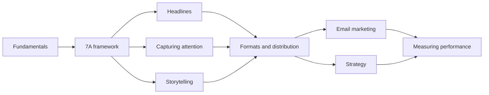

# Content marketing

Creating and distributing useful content so that a defined audience pays attention, builds a relationship with a business or person, and takes action. This skill belongs to [Hard skills](../README.md).

## Notes in reading order

1. [Content marketing fundamentals](content-marketing-fundamentals.md): definition, history, audience groups, content across the buyer journey, owned, earned and paid media.
2. [7A framework](seven-a-framework.md): Brian Clark's seven qualities of effective content.
3. [Headlines](headlines.md): benefit, curiosity and what headline tests show.
4. [Capturing attention](capturing-attention.md): images, design, speed and social proof, with the evidence behind them.
5. [Storytelling](storytelling.md): narrative transportation, story structure and customer stories.
6. [Content formats and distribution](content-formats-and-distribution.md): choosing formats, distribution plans and repurposing.
7. [Email marketing](email-marketing.md): list building, consent, deliverability, automations and metrics.
8. [Content marketing strategy](content-marketing-strategy.md): goal, audience, pillars, channels and metrics in one plan.
9. [Measuring content performance](measuring-content-performance.md): metrics by goal, tracking, attribution and incrementality.

## Map of the skill

The notes move from principles to a single piece of content, then to distribution, strategy and measurement.

## How to learn it

Read notes 1 and 2, then write one piece for a real audience using notes 3 to 5. Plan its distribution with note 6 before publishing. Build an email list early (note 7). After a month, write a one-page strategy (note 8) and set up measurement (note 9). Persuasive writing is in [copywriting](../copywriting/README.md), search visibility in [search engine optimization](../search-engine-optimization/README.md).

## Navigation

- Back to [Hard skills](../README.md).
