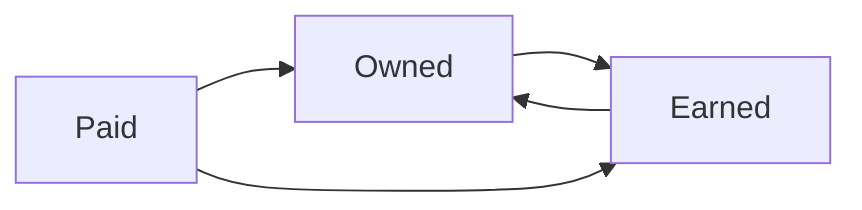

# Content formats and distribution

## Summary

A content format is the form a piece takes (article, video, podcast, newsletter, tool, template, case study), and distribution is how it reaches its audience: through owned channels such as a website and email list, earned channels such as shares, links and press, and paid channels such as ads. Format should follow the audience's question and the channel where they look for answers, not the marketer's preference. Distribution is usually the weaker half of content marketing: many pieces are published and never seen. Planning one core piece and adapting it for several channels, called repurposing, is the most efficient way to cover several formats with limited resources.

## Prerequisites

[Content marketing fundamentals](content-marketing-fundamentals.md), especially owned, earned and paid media.

## Core concepts

### Definitions

- A *content format* is the type and shape of a piece of content: long article, short post, video, audio, image, interactive tool, downloadable template, course.
- A *channel* is the route by which content reaches people: search engines, social platforms, email, partners, communities, events.
- *Distribution* is the planned activity of getting content in front of the intended audience through channels.
- *Repurposing* is adapting one piece into other formats for other channels.

*Analogy.* Content and distribution are like a bakery and its delivery. A bakery can bake excellent bread, but if nobody knows where it is and it does not deliver to the shops where people buy, the bread goes stale on the shelf. Different customers want different forms (a loaf, a sandwich, a slice with coffee) from the same dough. The analogy breaks because bread goes stale in a day, while good content can keep finding readers for years if search engines keep sending them.

### Formats and what they are good for

| Format | Good for | Costs and limits |
| --- | --- | --- |
| Long-form article or guide | Search traffic, depth, authority | Takes time to write. Readers scan |
| Short social post | Reach, conversation, testing ideas | Short life, platform dependent |
| Video (short) | Demonstration, emotion, social reach | Production effort. Platform algorithms decide reach |
| Video (long) or webinar | Teaching, trust, B2B leads | Viewers drop off. Needs strong presenter |
| Podcast | Loyal audience, long attention, interviews | Slow growth, hard to measure |
| Newsletter | Owned relationship, repeat contact | Needs consistency and a list (see [email marketing](email-marketing.md)) |
| Case study | Proof for buyers in consideration and decision stages | Needs customer permission and data |
| Original research or data | Links, press, authority | Expensive, needs method |
| Tool, calculator, template | Utility, links, leads | Development and maintenance |
| Infographic or chart | Explaining data quickly, sharing | Weak alone for search. Must stay accurate |

### Matching format to question

Start with the reader's question and the place they ask it:

- "How do I fix X?" asked on Google: a clear article or short video that answers fast.
- "Which tool should I use?" asked by a team: comparison page, case study, webinar.
- "What is changing in my field?" for professionals: newsletter, podcast, report.
- "Show me" questions (how a product looks or works): video or images.

### Owned, earned and paid distribution

| Type | Examples | Strength | Weakness |
| --- | --- | --- | --- |
| Owned | Website, blog, email list, app, own community | Control, no cost per contact, data | Must be built first |
| Earned | Search rankings, shares, links, press, word of mouth | Credibility, free reach | Not controllable, slow |
| Paid | Search ads, social ads, sponsored newsletters, influencer posts | Fast, targetable, measurable | Stops with budget. Must be labeled as advertising |

A common pattern: use paid and earned channels to reach new people, move them to owned channels (subscribe, follow, create an account), and use owned channels to build the relationship.

Owned, earned and paid channels support each other: paid and earned reach bring people to owned channels, where the relationship continues.

### Distribution plan for a piece

Before publishing, answer:

1. **Who exactly should see this,** and where do they spend time?
2. **What is the primary channel** (search, newsletter, a specific community)?
3. **What are two or three secondary channels,** and what adapted format does each need?
4. **Who could share it?** People quoted in the piece, partners, communities, colleagues.
5. **Is a paid boost justified,** and with what budget and goal?
6. **What is the follow-up?** Updates, internal links from new pieces, a re-share after some months.

### Repurposing

One core piece can produce many derived pieces. For example, a 3,000 word guide can become: a 10 minute video, five short clips, a carousel post with key points, a newsletter issue, a checklist download and a talk at a meetup. Repurposing saves research time and reaches people who prefer different formats. It fails when the derived pieces are copied without adapting to the channel: a long paragraph pasted into a social post, or a horizontal video posted where vertical video is the norm.

### Cadence and consistency

*Cadence* is how often you publish. Consistency matters more than volume: an audience learns when to expect something, and a team learns a sustainable rhythm. A small team that publishes one excellent piece a month and distributes it well usually does better than one that publishes daily and distributes nothing. This is practitioner experience, not a measured rule.

### Communities

Communities (forums, groups, Discord or Slack spaces, professional associations) are a distribution channel with rules. Members react badly to self-promotion from people who do not contribute. The workable approach is to be a genuine member: answer questions, share others' work, and share your own when it answers a real question. Read and follow each community's rules on promotion.

### Labeling and law

Paid distribution must be recognizable as advertising. In the EU, the Unfair Commercial Practices Directive lists as always unfair the use of editorial content to promote a product when the trader has paid for it without making that clear. In the US, the FTC treats undisclosed paid content and endorsements as deceptive (see [influencer marketing](../social-media/influencer-marketing.md)).

## Worked example

A B2B software company publishes a report "The state of invoicing for small agencies 2026" based on a survey of 400 agency owners.

| Derived piece | Channel | Purpose |
| --- | --- | --- |
| Full report page with summary and download | Website (owned) | Search, lead capture (email for the PDF) |
| 6 chart images with one finding each | LinkedIn, company and founder accounts | Reach, conversation |
| Webinar with two agency owners discussing results | Email list, LinkedIn event | Leads, trust |
| Press release with three headline findings | Trade media (earned) | Links, credibility |
| Newsletter issue with one surprising finding | Email list (owned) | Engagement, re-share |
| Sponsored post in a newsletter for agency owners | Paid | Reach beyond own audience |
| Short article per finding over 3 months | Blog | Long-tail search, internal links to the report |

Measurement: downloads, webinar registrations, links earned and leads that became customers within six months. The survey and numbers are invented for the example.

## Trade offs and when to use it

- **Many formats versus doing a few well.** Small teams should master one or two formats and channels before adding more.
- **Platform reach versus ownership.** Platforms give reach today and can take it away tomorrow. Always offer a path to owned channels.
- **Paid boosts.** Useful to test a piece or reach a new segment. They do not fix content that people do not want.
- **Repurposing versus original thinking.** Repurposing multiplies a good idea. It cannot replace having one.

## Common mistakes

- **Publish and pray.** Fix: write the distribution plan before the content.
- **Format by habit.** Fix: start from the reader's question and channel.
- **Copy-paste repurposing.** Fix: adapt length, format and opening to each channel.
- **Self-promotion in communities.** Fix: contribute first, follow rules.
- **Unlabeled paid content.** Fix: label it clearly.

## Practice

1. Name three owned, three earned and three paid channels you could use for a product you know.
2. Write a distribution plan with the six questions above for a piece you plan to write.
3. Turn one long article into five derived pieces for different channels, and say what changes for each.
4. Why does a community often react badly to a link to your article, and how should you share it instead?

## Further reading

- Content Marketing Institute. What is content marketing? [contentmarketinginstitute.com](https://contentmarketinginstitute.com/what-is-content-marketing/). Definitions and introductory material on distribution.
- Directive 2005/29/EC on unfair business-to-consumer commercial practices, Annex I. [EUR-Lex](https://eur-lex.europa.eu/eli/dir/2005/29/oj). The ban on undisclosed paid editorial content.

TODO: Add research on content format effectiveness (for example studies of video versus text in specific contexts). The format table is based on practitioner experience.
