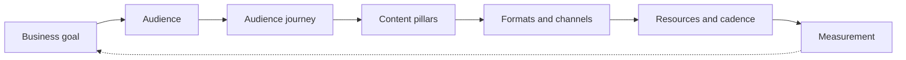

# Content marketing strategy

## Summary

A content marketing strategy is a short written plan that answers five questions: what business goal the content serves, for which audience, with which kind of content, through which channels, and how success will be measured. Without it, content becomes a stream of unconnected posts whose effect nobody can judge. The strategy is a hypothesis that the team updates as results come in, not a fixed document.

## Prerequisites

[Content marketing](content-marketing-fundamentals.md) and the [7A framework](seven-a-framework.md). The measurement part uses [A/B testing](../copywriting/ab-testing.md).

## Core concepts

### Definition

A *content marketing strategy* is the set of decisions that connects content to a business goal: whom the content is for, what problem it addresses, what form it takes, where it is published and promoted, how often, and which numbers show whether it works. An *editorial calendar* is the schedule that puts the strategy into practice. The strategy decides what and why. The calendar decides when and who.

*Analogy.* A strategy is like a route plan for a road trip. It says where you are going, roughly which roads you take and how you will know you are on track. The calendar is the list of daily stages. The analogy breaks because a destination on a map does not move, while an audience and a market change during the trip, so the plan must be revised.

### The problem it solves

Teams without a strategy tend to publish what is easy to make or what a manager likes, measure what is easy to count (page views) and stop after a few months because "content does not work". A written strategy makes the bet explicit, so it can be tested and improved.

### Components

1. **Business goal.** One primary goal per program: for example, generate leads for a service, reduce support requests, or build an email list for a product launch. The goal decides what counts as success.
2. **Audience.** A specific group with a specific problem. Many teams write a short *persona*, a description of a typical reader built from interviews and data, not from imagination.
3. **Audience journey.** What the reader needs at each stage: discovering a problem, comparing solutions, deciding, and using the product. Content for each stage differs. A guide to a problem serves discovery. A comparison serves the decision. A tutorial serves use.
4. **Content pillars.** Three to five topics where the company has real expertise and the audience has real need. Pillars keep the program focused.
5. **Formats and channels.** Articles, videos, podcasts, newsletters, tools or templates, published on owned media and distributed through search, social networks, partners and paid promotion (see [owned, earned and paid media](content-marketing-fundamentals.md#owned-earned-and-paid-media)).
6. **Resources and cadence.** Who writes, edits, designs and promotes, and how often. A cadence that the team can keep for a year is better than an ambitious one it abandons in a month.
7. **Measurement.** A small set of metrics tied to the goal, defined before publishing.

The seven components build on each other. Measurement feeds the next revision of the plan.

### Metrics by stage

| Stage | Question | Example metrics |
| --- | --- | --- |
| Reach | Did people see it? | Impressions, visits, search rankings |
| Engagement | Did they consume it? | Scroll depth, time on page, video completion, replies |
| Conversion | Did they take the next step? | Email sign-ups, demo requests, downloads, purchases |
| Retention | Did they come back or stay? | Returning visitors, email open rate over time, churn |

*Vanity metrics* are numbers that grow without saying anything about the goal, such as total page views for a lead generation program. They are not useless, but they are not success.

### The strategy as a hypothesis

The agile principle of the 7A framework applies here: start with a simple hypothesis ("small shop owners need clear VAT guidance, and a newsletter will turn them into consultation requests"), publish, measure and adjust. Review the strategy every quarter: keep the pillars that work, drop the ones that do not, and look at what the audience asks for.

## Worked example

A one-page strategy for a small bike repair shop.

- **Goal:** increase booked services by 20% in 12 months.
- **Audience:** city commuters who ride daily, know little about maintenance, and live within 5 km of the shop.
- **Pillars:** basic maintenance, seasonal preparation, choosing parts.
- **Formats:** short videos (under 2 minutes) and a monthly email with one tip and a seasonal offer.
- **Channels:** the shop's website (home base), a local social media group, and the shop's Google Business profile.
- **Cadence:** two videos per month, one email per month. The owner films, an apprentice edits.
- **Metrics:** email subscribers (target 500), bookings that came from email links (tracked with a booking code), and video views as a secondary signal.
- **Review:** every three months.

After six months the data show that seasonal preparation videos lead to bookings, while part selection videos get views but no bookings. The shop keeps part selection as a minor pillar and doubles seasonal content before spring and autumn.

All targets and results are invented to show the structure.

## Trade offs and when to use it

- **A short written plan beats a long one.** One or two pages are read and used. Fifty pages are not.
- **Focus versus coverage.** Few pillars build authority faster but may miss opportunities. Review quarterly to correct.
- **Attribution is imperfect.** Readers touch many pieces before converting. Use simple tracking (codes, links with campaign parameters) and accept that some effect will not be measured.
- **When not to write a full strategy:** for a one-off piece or a short experiment. Then a single hypothesis and a single metric are enough.

## Common mistakes

- **Choosing metrics after publishing.** Fix: define the metric before the first piece.
- **Personas made up in a meeting.** Fix: base them on interviews, support tickets and data.
- **A cadence the team cannot sustain.** Fix: plan for the time you have, not the time you wish you had.
- **Never revisiting the plan.** Fix: schedule a quarterly review.

## Practice

1. Name the seven components of a content marketing strategy.
2. What is a vanity metric? Give an example for an email list building program.
3. Write a one-page strategy for a product or project you know.

Hints: question 2 asks for a number that grows without saying anything about subscribers.

## Further reading

- Content Marketing Institute. What is content marketing? [contentmarketinginstitute.com](https://contentmarketinginstitute.com/what-is-content-marketing/). Definition and introductory material on documented strategy.

TODO: This note is based on practitioner knowledge. Add primary sources, for example the CMI annual benchmark research on documented strategies, and check the components against them.
