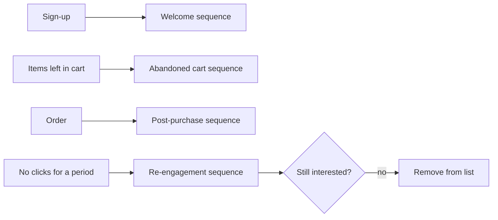

# Email marketing

## Summary

Email marketing is the use of email to build a relationship with people who have given you permission to contact them, and to lead them to actions such as reading, buying or renewing. An email list is the classic owned channel: no algorithm decides whether your subscribers see your message, although spam filters do. Doing it well takes three things: a lawful, consent-based list, emails that are worth opening, and technical deliverability, which since 2024 includes strict authentication and complaint rules at Gmail and Yahoo. Open rates became unreliable after Apple's 2021 privacy change, so clicks and conversions are the better measures.

## Prerequisites

[Content marketing fundamentals](content-marketing-fundamentals.md) for owned media. [Copywriting fundamentals](../copywriting/copywriting-fundamentals.md) for the writing.

## Core concepts

### Definition

*Email marketing* is sending commercial or relationship-building email to a list of recipients who have agreed to receive it. Main types:

- *Newsletters*: regular editorial emails with useful content.
- *Promotional emails*: offers, launches, sales.
- *Automated sequences* (also called flows or drip campaigns): series triggered by an action, such as a welcome sequence after sign-up or an abandoned cart reminder.
- *Transactional emails*: order confirmations, password resets. These are service messages, not marketing, and have different legal and technical treatment.

*Analogy.* An email list is like a subscriber list of a local newspaper that you print and deliver yourself. Readers asked to receive it, you decide what is in it and when it arrives, and nobody can take your readers away. The analogy breaks because between your printing press and the reader's door stands a postman (the mailbox provider) who reads the envelope, checks your identity and may throw the paper away if too many readers have complained before.

### Building a list

A list is built by offering something in exchange for an email address:

- a newsletter worth reading,
- a *lead magnet*: a checklist, template, guide, sample or discount,
- an account or order (with a separate, optional marketing consent).

*Double opt-in* means the subscriber confirms by clicking a link in a confirmation email. It reduces fake and mistyped addresses and gives evidence of consent. It costs some sign-ups that are never confirmed.

### Consent and law

- **EU.** Under the ePrivacy Directive (2002/58/EC, Article 13), electronic marketing to individuals generally requires prior consent. A narrow exception allows a seller to email existing customers about its own similar products if they were given a clear chance to object when their address was collected and in every message. Consent must meet the GDPR standard: freely given, specific, informed and unambiguous, with no pre-ticked boxes, and as easy to withdraw as to give. National laws implement these rules. In Poland, since 10 November 2024, Article 398 of the Electronic Communications Law (Prawo komunikacji elektronicznej) requires prior consent for direct marketing by electronic means, and commentators read it as applying to business recipients too.
- **US.** The CAN-SPAM Act (2003) does not require prior consent for commercial email but requires accurate headers, a non-deceptive subject, identification as an advertisement where applicable, a physical postal address and a working opt-out honored within 10 business days.

This note is educational and is not legal advice.

### Deliverability

*Deliverability* is the share of emails that reach the inbox rather than the spam folder or nowhere. Mailbox providers decide based on:

- **Authentication.** *SPF* lists the servers allowed to send for your domain. *DKIM* signs messages cryptographically. *DMARC* tells providers what to do when SPF or DKIM checks fail and requires that one of them aligns with the domain in the visible From address.
- **Reputation.** Complaint rates, bounce rates, sending history and engagement.
- **Content and list hygiene.** Sending to old, unengaged or purchased lists damages reputation.

Since February 2024, Google and Yahoo require *bulk senders* (around 5,000 or more messages a day to their users) to authenticate with SPF, DKIM and DMARC, to support *one-click unsubscribe* in message headers (the mechanism defined in RFC 8058) for marketing mail and honor it within two days, and to keep the user-reported spam rate below 0.3%, with 0.1% recommended. Smaller senders are expected to authenticate as well. Checked 2026-10 against summaries of the providers' requirements.

### Writing emails

- **Sender name** people recognize, ideally a person at a brand.
- **Subject line** that states a specific benefit or opens a real curiosity gap (see [headlines](headlines.md)). Avoid misleading subjects, which are also illegal under CAN-SPAM.
- **Preview text** that complements the subject.
- **One main purpose and one primary call to action** per email.
- **Plain, mobile-friendly layout.** Many emails are read on phones.
- **Consistent schedule** so subscribers know what to expect.

### Automations

Automated sequences are often the most effective emails because they arrive when the reader is most interested. Common sequences:

| Sequence | Trigger | Typical content |
| --- | --- | --- |
| Welcome | Sign-up | Deliver the lead magnet, introduce the brand, set expectations, best content |
| Abandoned cart | Items left in cart | Reminder, answer common objections, possibly an incentive |
| Post-purchase | Order | How to use the product, request for a review, related products |
| Re-engagement | No clicks for a period | Ask whether they still want emails, then remove non-responders |

The four automations from the table, each started by a trigger:

### Metrics

| Metric | Meaning | Caveat |
| --- | --- | --- |
| Delivery rate | Share accepted by receiving servers | Does not mean inbox |
| Open rate | Share of recipients whose email client loaded a tracking pixel | Inflated since Apple Mail Privacy Protection (see below) |
| Click rate | Share of recipients who clicked a link | More reliable than opens |
| Conversion rate | Share who completed the target action | Needs tracking on the website |
| Unsubscribe rate | Share who opted out | Normal at a low level. Spikes signal a problem |
| Spam complaint rate | Share who marked the email as spam | Critical for deliverability |

In September 2021 Apple introduced *Mail Privacy Protection* in iOS 15 and macOS. When enabled, Apple's servers preload remote content, including tracking pixels, so the email is recorded as "opened" whether the person read it or not. Open rates for lists with many Apple Mail users became inflated and open-based tests and automations unreliable. Use clicks and conversions instead.

## Worked example

A small online tea shop sets up email marketing.

1. **Sign-up.** A form on every guide offers a printable brewing chart. Consent text: "Send me the brewing chart and a weekly email about tea. Unsubscribe any time." Double opt-in.
2. **Technical setup.** SPF, DKIM and DMARC (policy `p=none` at first, with reports) on the shop's domain through the email service provider. One-click unsubscribe enabled.
3. **Welcome sequence.** Day 0: the chart. Day 2: the story of the shop (see [storytelling](storytelling.md)). Day 5: the three most-read guides. Day 9: a tasting set with a first-order discount.
4. **Weekly newsletter.** One tea, one recipe, one link to the shop.
5. **Measurement after three months (invented numbers).** 1,200 subscribers, click rate 4.5%, unsubscribe 0.3% per email, spam complaints 0.02%, 85 first orders attributed to email links with campaign parameters. Open rate 52%, which the shop ignores because about half its readers use Apple Mail.
6. **Clean-up.** Subscribers who have not clicked in six months get a re-engagement email. Those who do not respond are removed, which protects deliverability.

## Trade offs and when to use it

- **Owned but slow to grow.** A list is valuable once it exists and takes months to build.
- **Frequency.** More emails bring more clicks in the short term and more unsubscribes and complaints. Test frequency and watch complaints.
- **Discounts in sequences** convert but train subscribers to wait for discounts.
- **Purchased lists** are illegal to use without consent in the EU and damage deliverability everywhere. Never use them.

## Common mistakes

- **No authentication.** Fix: set up SPF, DKIM and DMARC before sending.
- **Judging by open rate.** Fix: use clicks and conversions.
- **Pre-ticked consent or consent bundled with terms.** Fix: separate, active, specific consent.
- **Hiding the unsubscribe link.** Fix: make it easy, as the law and providers require.
- **Never cleaning the list.** Fix: re-engage or remove inactive subscribers.

## Practice

1. Name the four main types of marketing-related email and how transactional emails differ.
2. What do SPF, DKIM and DMARC do?
3. What did Google and Yahoo require of bulk senders from February 2024?
4. Why did open rates become unreliable in 2021, and what should you measure instead?
5. Design a four email welcome sequence for a product you know.

## Further reading

- Directive 2002/58/EC (ePrivacy Directive), Article 13. [EUR-Lex](https://eur-lex.europa.eu/eli/dir/2002/58/oj). Consent for electronic marketing in the EU.
- Regulation (EU) 2016/679 (GDPR), Articles 4(11) and 7. [EUR-Lex](https://eur-lex.europa.eu/eli/reg/2016/679/oj). The conditions for valid consent.
- Federal Trade Commission. CAN-SPAM Act: A compliance guide for business. [ftc.gov](https://www.ftc.gov/business-guidance/resources/can-spam-act-compliance-guide-business). US rules for commercial email.
- Google. Email sender guidelines. [support.google.com](https://support.google.com/a/answer/81126). Gmail's requirements for senders.
- RFC 8058 (2017). Signaling one-click functionality for list email headers. [rfc-editor.org](https://www.rfc-editor.org/rfc/rfc8058). The one-click unsubscribe standard.
- RFC 7489 (2015). Domain-based Message Authentication, Reporting, and Conformance (DMARC). [rfc-editor.org](https://www.rfc-editor.org/rfc/rfc7489). The DMARC specification.

TODO: Read the Google and Yahoo sender pages directly (the requirements were checked in several vendor summaries, 2026-10) and the text of Article 398 of the Polish Electronic Communications Law.
