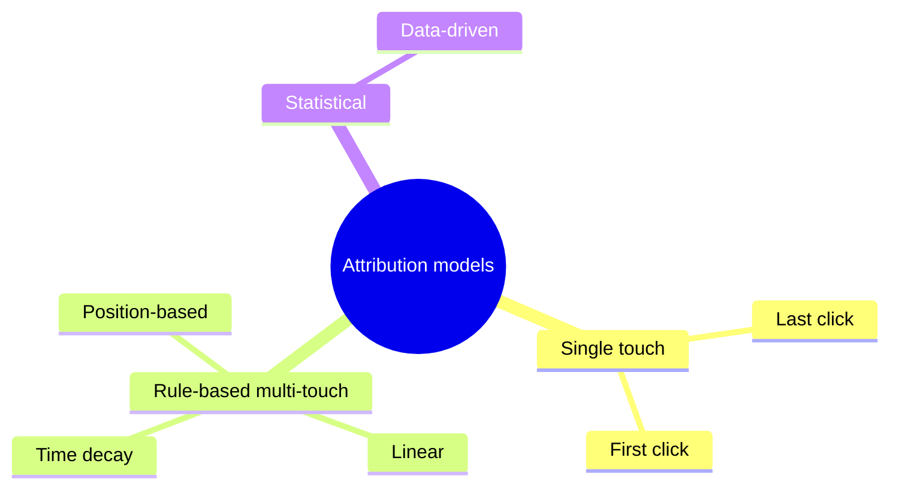

# Measuring content performance

## Summary

Measuring content performance means connecting what people do with content (find it, read it, share it, sign up, buy) to the goal the content was made for. It needs three things: metrics chosen before publishing and matched to the goal, tracking that records where visitors came from and what they did, and a way to decide how much credit each piece deserves when a buyer touched many pieces, called attribution. Every attribution method is a model with blind spots, so the most reliable answers come from comparing groups that did and did not see the content. Numbers that grow without affecting the goal, such as raw page views for a lead generation program, are vanity metrics.

## Prerequisites

[Content marketing strategy](content-marketing-strategy.md) for goals and metrics by stage. [A/B testing](../copywriting/ab-testing.md) for controlled comparisons.

## Core concepts

### Definition

*Content performance measurement* is the process of defining, collecting and interpreting data about how content contributes to a business goal. A *metric* is a quantity you track (visits, sign-ups). A *key performance indicator* (KPI) is a metric chosen to judge success against a target. *Attribution* is the assignment of credit for a conversion to the touchpoints that preceded it.

*Analogy.* Measuring content is like judging which players won a football match. Goals are easy to count and credit to the scorer, but the scorer rarely wins alone: someone passed, someone defended, the goalkeeper started the attack. Last-touch attribution credits only the scorer. The analogy breaks because in football every touch is on camera, while online many touches are invisible (a recommendation from a friend, a podcast heard in the car, a visit on another device), so attribution works with a partial recording.

### Metrics by goal

| Goal | Primary metrics | Supporting metrics |
| --- | --- | --- |
| Reach new audiences | New users, impressions in search, referral traffic | Rankings, share of voice |
| Engage | Engaged sessions, scroll depth, time on content, video completion | Returning visitors, comments, replies |
| Generate leads | Sign-ups, downloads, demo requests from content | Lead quality (share that becomes customers) |
| Drive sales | Revenue or orders from sessions that included content | Assisted conversions, time to purchase |
| Retain and expand | Usage of help content, churn of readers vs non-readers | Support tickets avoided |

### Tracking basics

- **Web analytics.** Tools such as Google Analytics 4 (GA4), Matomo or Plausible record sessions, sources and events. GA4 replaced Universal Analytics, which stopped processing data on 1 July 2023 for standard properties. GA4 is event-based: every interaction (page view, scroll, click, sign-up) is an event.
- **Conversions** (called key events in GA4) are the events that matter for your goal, such as `sign_up` or `purchase`.
- **Campaign parameters** (UTM parameters) are tags added to links you share so analytics can tell where the visit came from: `utm_source` (newsletter), `utm_medium` (email), `utm_campaign` (spring-guide), optionally `utm_content` and `utm_term`.
- **Search data.** Google Search Console reports impressions, clicks and average position for queries in Google Search (see [measuring SEO](../search-engine-optimization/measuring-seo.md)).
- **Platform analytics** for social networks, newsletters and video platforms.

In the EU, analytics cookies and similar tracking generally require prior consent under the ePrivacy rules, so data will be incomplete for visitors who decline. Some analytics tools are configured to work without cookies in ways that national regulators may accept. Check the guidance of your data protection authority.

### Attribution models

| Model | How credit is assigned | Bias |
| --- | --- | --- |
| Last click | All credit to the last touchpoint before conversion | Undervalues early content (awareness guides) |
| First click | All credit to the first touchpoint | Undervalues content that closes |
| Linear | Equal credit to every touchpoint | Treats a glance like a deciding visit |
| Time decay | More credit to recent touchpoints | Similar to last click |
| Position-based | Most credit to first and last, rest shared | Arbitrary weights |
| Data-driven | Credit estimated statistically from paths with and without each touchpoint | Opaque, needs volume, still based on observed paths only |

In 2023 Google removed (announced in April 2023, completed later that year) the first click, linear, time decay and position-based models from GA4 and Google Ads, leaving data-driven and last click (paid and organic) as the available models. All models only see tracked touchpoints and cannot prove that a piece caused a conversion. A visitor who would have bought anyway still gives credit to the content they happened to see.

The attribution models differ in which touchpoints get credit:

### Incrementality

The question that matters is *incrementality*: how many conversions happened because of the content that would not have happened otherwise. The most reliable way to estimate it is a controlled comparison:

- **Holdout test.** Randomly withhold a newsletter or content sequence from a share of subscribers and compare their conversion rate with those who received it.
- **Geographic test.** Run a content campaign in some regions and not others, comparing similar regions.
- **Before and after with a control,** for example comparing traffic to pages you updated with similar pages you did not update.

These designs follow the logic of [A/B testing](../copywriting/ab-testing.md). They are harder to run than reading a dashboard, but they answer the causal question.

### Leading and lagging indicators

Content results arrive late: an article may take months to rank, and a lead may take months to buy. *Leading indicators* (search impressions, engaged readers, subscriber growth) show early whether things are moving. *Lagging indicators* (revenue, customers) show the final result. Track both, and judge new content first by leading indicators.

### Qualitative signals

Numbers miss some value. Sales teams hearing "I read your guide", customers quoting your content, replies to newsletters and the questions people ask in calls are evidence too. A simple question in sign-up or checkout forms ("How did you hear about us?") captures sources that analytics cannot see, such as podcasts and word of mouth. It relies on memory, so treat it as one signal among others.

### Reporting

A useful report is short and tied to decisions:

1. The goal and the KPI with its target.
2. Current value, trend and comparison with the previous period.
3. Top and bottom performing pieces, with a hypothesis for why.
4. Decisions: what to do more of, less of, or test.

## Worked example

A software company publishes a monthly guide for small agencies. Goal: demo requests.

**Setup.**

- Key event `demo_request` on the demo form.
- All links in the newsletter and social posts tagged, for example `?utm_source=newsletter&utm_medium=email&utm_campaign=2026-10-guide`.
- Demo form asks "How did you hear about us?" (optional).

**After six months (invented numbers).**

| Measure | Value |
| --- | --- |
| Visits to guides | 48,000 |
| Newsletter sign-ups from guides | 1,150 |
| Demo requests where a guide was the last click | 21 |
| Demo requests from sessions that included a guide at any point (data-driven attribution) | 64 |
| "How did you hear" answers naming a guide or the newsletter | 38 |

**Incrementality test.** For two months, a random 20% of new subscribers did not receive the guide newsletter. Demo request rate: 2.9% among those who received it, 2.1% in the holdout. The difference suggests the newsletter caused roughly a quarter of demo requests among recipients (0.8 of 2.9 percentage points). With these sample sizes the confidence interval is wide, so the team repeats the test.

**Decision.** Last-click reporting alone (21 demos) would have suggested the guides were a weak channel. The fuller picture supports continuing, with the newsletter as the main conversion path.

## Trade offs and when to use it

- **Simplicity versus accuracy.** Last click is simple and biased. Data-driven models are less biased but opaque. Holdouts are the most reliable and the most effort.
- **Consent and privacy reduce data.** Plan for incomplete tracking and use aggregate and qualitative signals.
- **Measuring too much.** Dozens of metrics hide the few that matter. Pick one KPI per goal.
- **Short-term bias.** Monthly reports undervalue content that pays off over a year. Report leading indicators and long-term trends separately.

## Common mistakes

- **Choosing metrics after the results.** Fix: define KPIs with the strategy.
- **Untagged links.** Fix: tag every link you control with campaign parameters.
- **Treating attribution as causation.** Fix: run holdout tests for important channels.
- **Reporting vanity metrics.** Fix: tie every reported metric to a goal.
- **Ignoring consent rules.** Fix: configure analytics in line with ePrivacy and GDPR requirements.

## Practice

1. Choose primary and supporting metrics for a content program whose goal is retaining existing customers.
2. Write a tagged link for a LinkedIn post promoting a webinar.
3. Explain why last-click attribution undervalues awareness content.
4. Design a holdout test for a welcome email sequence and state what result would make you stop sending it.

## Further reading

- Google Analytics Help. [GA4] Get started with attribution. [support.google.com](https://support.google.com/analytics/answer/10596866). Attribution in GA4.
- Google Ads Help. First click, linear, time decay, and position-based attribution models are going away. [support.google.com](https://support.google.com/google-ads/answer/13427716). The 2023 change to attribution models.
- Kohavi, R., Tang, D., & Xu, Y. (2020). *Trustworthy Online Controlled Experiments*. Cambridge University Press. [doi:10.1017/9781108653985](https://doi.org/10.1017/9781108653985). Controlled experiments as the basis for causal claims.
- Directive 2002/58/EC (ePrivacy Directive), Article 5(3). [EUR-Lex](https://eur-lex.europa.eu/eli/dir/2002/58/oj). Consent for storing information on users' devices.
