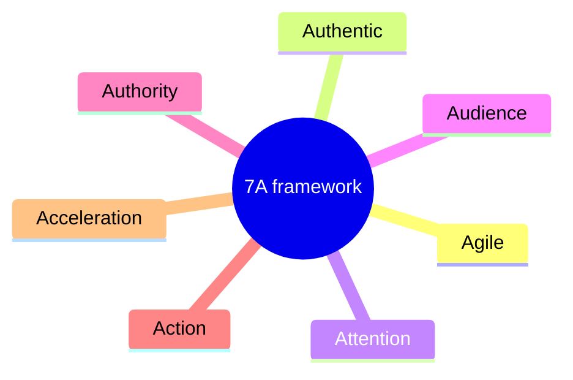

# 7A framework

## Summary

The 7A framework is a checklist of seven qualities for content marketing, attributed to Brian Clark, the founder of Copyblogger: agile, authentic, attention, audience, authority, action and acceleration. It describes content that starts from a hypothesis, sounds like a real person, earns attention, builds a relationship with an audience, gains trust, leads to a measurable action and opens unplanned opportunities. It is a practitioner framework that organizes good advice. It has not been tested as a model in research.

## Prerequisites

[Content marketing](content-marketing-fundamentals.md) for the definition and the audience groups.

## Core concepts

### Origin and status

The framework appears in an ebook by Brian Clark, *The 7 A Framework for Effective Content Marketing*, published by Rainmaker Digital, and in the University of California, Davis content marketing course on Coursera, which asks students to apply it to their own content. The framework is a teaching device. Each "A" is a reminder, not a measured variable, and the order is not a strict sequence.

*Analogy.* The seven A's work like a pilot's preflight checklist. The checklist does not fly the plane, but it stops you from forgetting something that every good flight needs. The analogy breaks because a preflight checklist is backed by accident data, while the 7A list is backed by one practitioner's experience.

The seven qualities of the framework:

### Agile

*Agile* here means adapting instead of following a fixed plan. You start with a hypothesis about what the audience needs and a basic strategy, publish, look at the results and keep what works.

- Begin with a simple strategy and change it as you learn.
- Do not write an exhaustive roadmap before you have published anything.
- Use audience feedback and analytics to narrow your focus.

### Authentic

*Authentic* content has a real, human voice and is true to the values of the person or brand behind it. It replaces shallow corporate messaging with real stories and a recognizable point of view. The course describes this as "artisanal" content made with care.

A common misconception is that authenticity means oversharing personal details. It does not. It means being consistent with your values and voice.

### Attention

Attention is the precondition for everything else: content that nobody notices achieves nothing. The steps the framework names are:

1. Draw people in with a strong headline and opening (see [headlines](headlines.md)).
2. Keep their attention with content that is worth reading.
3. Move them from a first click to a deeper relationship, such as an email subscription or a downloaded report.

Traffic usually starts on search engines and social networks, which the company does not control. The framework recommends bringing that audience to a *content home base*: a site on your own domain, where you decide what readers see. The audience ecosystem includes advocates, critics and silent members, and all of them shape how content spreads.

### Audience

The audience is the core of the strategy. It is a mix of leads, customers, advocates and influencers, and the content marketer should listen to their concerns, successes and needs. Social media is described as a listening tool first and a broadcasting tool second. The goal is to move the relationship to a channel you own, such as a website or an email list.

### Authority

*Authority* is being seen as a credible expert who is also relatable. It is earned by teaching: solving the audience's problems with practical advice. The framework uses the image of a guide who lights the way. Authority is not arrogance. It is expertise shown in a way people can relate to, and it depends on the authentic voice described above.

### Action

*Action* is the point where the audience does something measurable because of the content: subscribes, buys or donates. Every piece needs a clear purpose and a clear call to action. The framework sends the reader to direct response copywriting for this step. In this library that is covered by [copywriting](../copywriting/copywriting-fundamentals.md) and [calls to action and risk reversal](../copywriting/calls-to-action-and-risk-reversal.md).

### Acceleration

*Acceleration* is the name for opportunities that content brings without being planned: partnerships, speaking invitations, collaborations or new businesses. You cannot schedule them, but you can make them more likely by keeping a wide network of capable people and by being ready to act. The career side of this idea is covered in [networking](../../../career/job-search/networking.md).

### Practical integration

| A | Question to ask about a piece or a program |
| --- | --- |
| Agile | What hypothesis does this test, and how will I know? |
| Authentic | Does this sound like us, and would we stand behind it? |
| Attention | Why would someone stop scrolling for this? |
| Audience | Which group is this for, and what did we hear from them? |
| Authority | What does the reader learn that they can use today? |
| Action | What is the one next step, and is it clear? |
| Acceleration | Who should see this, and who could we work with because of it? |

## Worked example

A freelance accountant starts a newsletter for owners of small online shops.

- **Agile.** The hypothesis is that shop owners struggle with value added tax (VAT) on sales to other EU countries. The first three issues test three topics: VAT, bookkeeping software and cash flow. The VAT issue gets the most replies, so the newsletter focuses on tax.
- **Authentic.** The accountant writes in the first person and tells real (anonymized) cases, including her own mistakes.
- **Attention.** The headline "The VAT rule that cost one shop 4,000 euros" draws readers in. The opening explains the case in two sentences.
- **Audience.** She invites replies and turns repeated questions into future issues.
- **Authority.** Each issue ends with a checklist the reader can apply that day.
- **Action.** The call to action is to book a free 20 minute review call.
- **Acceleration.** A bookkeeping software company notices the newsletter and invites her to run a webinar for its customers.

The figures and the case are invented for illustration.

## Trade offs and when to use it

- **Useful as a review list.** It is quick to apply to a single piece or to a whole program and catches common gaps, such as missing calls to action.
- **Not a strategy.** It does not tell you which audience to choose, how much to spend or how to measure results. For that, see [content marketing strategy](content-marketing-strategy.md).
- **Overlapping categories.** Authentic and authority, or attention and audience, overlap. Do not spend time deciding which "A" an idea belongs to.
- **Weak evidence.** The framework rests on practitioner experience. Treat it as structured advice, not as a validated model.

## Common mistakes

- **Treating the list as a fixed sequence.** Fix: use it as a set of checks that all apply at once.
- **Confusing authenticity with confession.** Fix: share values and voice, not private details.
- **Building attention without action.** Fix: every piece has a purpose and a next step.
- **Waiting for acceleration.** Fix: invest in relationships continuously, without expecting a specific return.

## Practice

1. List the seven A's and give a one-line question for each.
2. Why does the framework recommend moving the audience to a content home base?
3. Take one article you wrote or read recently and mark which A's it satisfies and which it lacks.

Hints: question 2 relates to who controls the channel.

## Further reading

- Clark, B. *The 7 A Framework for Effective Content Marketing*. Rainmaker Digital (ebook, about 40 pages). The original description of the framework (not read for this note).
- University of California, Davis. Content Marketing (online course on Coursera). [coursera.org](https://www.coursera.org/learn/content-marketing). The course module that teaches the framework.

TODO: Find the publication year of the Rainmaker Digital ebook and read it to confirm the definition of each A. The definitions here follow the course.
