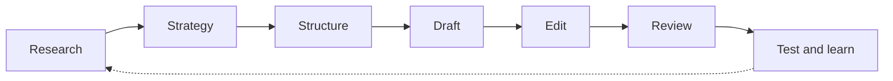

# Copywriting fundamentals

## Summary

Copywriting is writing whose purpose is to make a specific reader take a specific action: buy, sign up, reply, book a call. It is a craft with a long, measurable history, because direct response advertisers have tested what makes people act for more than a century. Good copy comes mostly from research, not from clever phrasing: it describes the reader's problem in the reader's words, makes a specific promise, proves it, removes doubt and asks for one clear next step. The work follows a repeatable process of research, strategy, drafting, editing and testing, inside legal limits on what may be claimed.

## Prerequisites

None. This note is the entry point to [copywriting](README.md). The audience concepts in [content marketing fundamentals](../content-marketing/content-marketing-fundamentals.md) are useful context.

## Core concepts

### Definition

*Copy* is the text of marketing and sales material: advertisements, product pages, landing pages, emails, scripts, packaging, buttons. *Copywriting* is the skill of writing it so that a defined reader takes a defined action. Two branches are usually distinguished:

- *Direct response copywriting* asks for an immediate, measurable action ("Order now", "Book a free consultation") and is judged by the response rate.
- *Brand copywriting* aims to shape how people think and feel about a brand over time (slogans, brand campaigns) and is judged by indirect measures such as awareness or preference.

Copywriting differs from content writing in its primary goal. Content informs or entertains first and earns attention over time. Copy persuades first. In practice the two meet: a useful article ends with a call to action, and a good sales page teaches.

*Analogy.* A copywriter works like a good salesperson in a shop who listens before speaking. They learn what the customer needs, show the one product that fits, answer the worry the customer has not voiced yet, and point to the till. The analogy breaks because the written salesperson cannot hear the customer's answer. All the listening must happen before writing, through research, and the page has to anticipate every objection at once.

### The problem it solves

A product does not sell itself, even when it is good, because buyers have limited attention, many alternatives and reasons to wait. Copy closes the gap between what a product can do and what a buyer understands and believes about it. Without copy, buyers who would benefit never find out, or do not trust what they see.

### A short history of measured persuasion

Copywriting is one of the few writing crafts with a long tradition of measurement:

- **Claude Hopkins**, *Scientific Advertising* (1923), argued that advertising exists to sell and should be judged by results, which he measured with coupons and keyed addresses that showed which advertisement produced each order.
- **John Caples**, *Tested Advertising Methods* (1932), reported the results of headline tests in mail order advertising.
- **Eugene Schwartz**, *Breakthrough Advertising* (1966), argued that copy cannot create desire, only channel existing desire, and that the right message depends on how aware the reader is of their problem and of the solution (see [customer research](customer-research.md#awareness-levels)).
- **David Ogilvy**, *Confessions of an Advertising Man* (1963) and *Ogilvy on Advertising* (1983), combined research with brand thinking and claimed that, on average, five times as many people read the headline as the body copy. That figure is his estimate, not a published study.
- **Online experiments** today let any site compare versions with real visitors (see [A/B testing](ab-testing.md)).

The lesson of this history is humility: practitioners repeatedly found that their intuitions about what works were wrong, and that testing beat opinion.

### The copywriting process

1. **Research.** Understand the reader, the problem, the product and the competition. Collect the reader's own words (see [customer research](customer-research.md)).
2. **Strategy.** Decide who the page is for, what single action it asks for, what the main promise is and what proof supports it (see [value proposition and benefits](value-proposition-and-benefits.md)).
3. **Structure.** Choose an order of arguments that fits the reader's awareness and the medium (see [copywriting frameworks](copywriting-frameworks.md)).
4. **Draft.** Write fast, without editing, to get the argument down.
5. **Edit.** Cut, clarify and check every claim (see [writing for the web](writing-for-the-web.md)).
6. **Review.** Check the copy against legal rules and brand voice.
7. **Test and learn.** Publish, measure the action, and test important variations.

Most weak copy fails at step 1 or 2, not at the sentence level. A beautifully written page aimed at the wrong reader or the wrong promise does not convert.

The process is a loop: what testing teaches feeds the next round of research.

### The working principle: be obsessed with the customer

One word sums up the attitude of good copywriters: *obsessed*. As a working principle it means obsession with the customer and the product: reading reviews, support tickets and interview transcripts until you can describe the reader's situation better than they can. Many experienced copywriters describe research as the larger part of the job. This is practitioner experience, consistent with Schwartz's argument that copy channels existing desire.

### Elements of persuasive copy

| Element | Job | Note |
| --- | --- | --- |
| Headline | Make the right reader stop and read | [Headlines](../content-marketing/headlines.md) |
| Lead (opening) | Connect to the reader's situation and promise a payoff | Continue the headline's promise |
| Promise | State the main benefit | [Value proposition and benefits](value-proposition-and-benefits.md) |
| Proof | Make the promise believable | Data, demonstrations, testimonials, guarantees |
| Offer | Say exactly what the reader gets and on what terms | Price, bonuses, deadlines (only real ones) |
| Objection handling | Answer the reasons not to act | FAQs, comparisons, risk reversal |
| Call to action | Name the next step | [Calls to action and risk reversal](calls-to-action-and-risk-reversal.md) |

### Voice

The *voice* is the stable character of the writing: formal or casual, serious or playful, technical or plain. It should match the brand and the reader and stay consistent across pages and channels. Many companies write a short voice guide with three or four adjectives, each with "this, not that" examples ("confident, not arrogant"). Consistency is part of trust (see *authentic* in the [7A framework](../content-marketing/seven-a-framework.md#authentic)).

### Legal limits

Persuasion must stay truthful. In the EU, the Unfair Commercial Practices Directive (2005/29/EC) prohibits misleading actions and omissions and aggressive practices, and its Annex I lists practices that are always unfair, such as falsely claiming that a product is available only for a very limited time. In the US, Section 5 of the Federal Trade Commission Act prohibits deceptive acts, and the FTC expects advertisers to have a reasonable basis (substantiation) for objective claims before making them. Health, financial and environmental claims face additional rules (for example the EU rules on nutrition and health claims, Regulation 1924/2006). This note is educational and is not legal advice.

## Worked example

Brief: a product page for a refillable stainless steel water bottle, aimed at office workers.

**Research findings (invented for the example).** Reviews of competing bottles mention leaking in bags (repeated complaint), water warming up by afternoon and bottles not fitting car cup holders. Office workers in interviews say they buy bottled water at lunch "because mine is warm by then".

**Strategy.**

- Reader: office workers who already carry a bottle but are unhappy with it (problem aware, solution aware).
- Action: buy the 750 ml bottle.
- Main promise: cold water all day, in a bottle that never leaks in your bag.
- Proof: a 24 hour temperature test with a published method, a leak test video, reviews.

**Weak copy:** "Our revolutionary premium bottle is the best on the market. Order now."

Problems: no reader, no specific benefit, an unsupported superlative, and a call to action before the reader knows anything.

**Revised copy:**

> **Still cold at your 4 pm meeting. Never a wet laptop bag.**
>
> If your bottle is warm by lunch, you end up buying water again. Our 750 ml double-walled steel bottle keeps water below 10 °C for 24 hours in our room temperature test (method on the page), and its screw lid passed 1,000 upside-down shakes without a drop.
>
> Fits standard cup holders. Dishwasher-safe lid. 4.7 of 5 from 1,240 reviews.
>
> **Order today.** If it leaks in the first two years, we replace it.

Check against the elements: headline with two specific benefits taken from customer complaints, a lead that names the reader's situation, a promise with proof (method, test, reviews), objection handling (cup holders, cleaning), a call to action with risk reversal. All figures are invented and on a real page would need evidence. Under EU law, the replacement promise must also be clear about how it relates to the legal guarantee of conformity.

## Trade offs and when to use it

- **Long or short copy.** Expensive, unfamiliar or risky purchases need more explanation and proof. Cheap, familiar ones need less. Test rather than assume.
- **Direct response or brand.** Direct response is measurable and fast. Brand building is slower and harder to measure but affects how well all later messages work. Most businesses need both.
- **Formulas versus voice.** Frameworks prevent gaps but can make copy generic. Use them to check a draft, not to write it.
- **Copy cannot fix a bad product or offer.** If research shows the product does not solve the problem, change the product, the price or the audience.

## Common mistakes

- **Writing before researching.** Fix: collect the reader's words and objections first.
- **Writing about the company.** Fix: count sentences that start with "we" or "our" and turn them toward the reader.
- **Features without benefits, or benefits without proof.** Fix: link each feature to a benefit and each benefit to evidence.
- **Several actions on one page.** Fix: choose one primary action.
- **Claims you cannot substantiate.** Fix: have evidence before publishing, or cut the claim.

## Practice

1. Distinguish direct response from brand copywriting and give an example of each from your own environment.
2. Name the seven steps of the copywriting process. At which step does most weak copy fail?
3. What did Claude Hopkins use coupons for, and why does that matter for copywriting today?
4. Rewrite a product description you find online using the elements table, and mark which claims would need proof.

Hints: question 3 concerns measuring which advertisement produced which response.

## Further reading

- Hopkins, C. C. (1923). *Scientific Advertising*. Lord & Thomas. The case for measuring advertising by results.
- Caples, J. (1932). *Tested Advertising Methods*. Harper & Brothers. Results of headline and copy tests in mail order.
- Schwartz, E. M. (1966). *Breakthrough Advertising*. Prentice-Hall. Awareness levels and channeling existing desire.
- Ogilvy, D. (1983). *Ogilvy on Advertising*. Crown. Research-based advertising practice.
- Directive 2005/29/EC on unfair business-to-consumer commercial practices. [EUR-Lex](https://eur-lex.europa.eu/eli/dir/2005/29/oj). EU rules on misleading and aggressive practices.
- Federal Trade Commission. Advertising FAQs: A guide for small business. [ftc.gov](https://www.ftc.gov/business-guidance/resources/advertising-faqs-guide-small-business). The US rules on truthful advertising and substantiation.

TODO: Check the first edition details of Caples (1932) and the exact wording of Ogilvy's headline claim.
