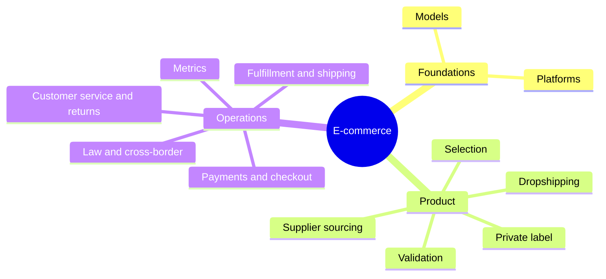

# E-commerce

Selling goods and services online: business and transaction models, platforms, choosing and validating products, sourcing them, payments, fulfillment, customer service, metrics and the law. This skill belongs to [Hard skills](../README.md). The notes include the EU and US rules that changed online selling between 2021 and 2026.

## Notes in reading order

**Foundations**

1. [E-commerce models](e-commerce-models.md): definition, B2B, B2C, C2C, C2B and administration, the parts of an online business and the size of the market.
2. [E-commerce platforms](e-commerce-platforms.md): marketplaces, hosted and self-hosted platforms, headless commerce and multichannel selling.

**Product**

3. [Product selection](product-selection.md): criteria of a winning product, niches and unit economics with break-even ROAS.
4. [Product validation](product-validation.md): methods ordered by strength of evidence, and why stated intent is weak.
5. [Supplier sourcing](supplier-sourcing.md): finding and evaluating suppliers, samples, Incoterms and quality control.
6. [Dropshipping](dropshipping.md): order flow, levels, responsibility toward customers and cross-border rules.
7. [Private label](private-label.md): selling under your own brand, samples, honest demand tests and the manufacturer's obligations.

**Operations**

8. [Payments and checkout](payments-and-checkout.md): cart abandonment, checkout design, payment methods, strong customer authentication and PCI DSS.
9. [Fulfillment and shipping](fulfillment-and-shipping.md): fulfillment models, shipping strategies, packaging and inventory.
10. [Customer service and returns](customer-service-and-returns.md): service standards, the EU right of withdrawal and legal guarantee, returns economics.
11. [E-commerce metrics](e-commerce-metrics.md): the revenue equation, contribution margin, CAC, LTV and cohorts.
12. [E-commerce law and cross-border](e-commerce-law-and-cross-border.md): EU consumer rules, data protection, product safety, accessibility, VAT, customs and selling to the US.

## Map of the skill

The three groups of notes follow the life of an online shop: the model, the product and the daily operations.

## How to learn it

Read notes 1 and 2, then work through notes 3 to 7 with one real or imagined product, calculating its unit economics. Before launching, read notes 8 to 10 and 12 and set up the metrics in note 11. Traffic comes from [search engine optimization](../search-engine-optimization/README.md), [social media](../social-media/README.md) and [content marketing](../content-marketing/README.md). Product pages are written with [copywriting](../copywriting/README.md).

These notes are educational. They describe rules in general terms and are not legal or tax advice.

## Navigation

- Back to [Hard skills](../README.md).
