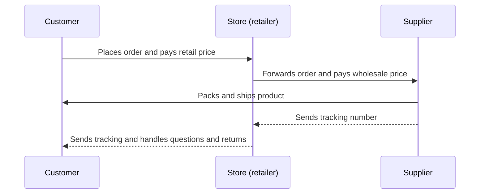

# Dropshipping

## Summary

Dropshipping is a retail model in which the seller advertises and sells products without holding stock: when a customer orders, the seller passes the order to a supplier, who packs and ships it directly to the customer. It lowers the money needed to start, because nothing is bought before it is sold, but it leaves the seller with thin margins, little control over quality and delivery, and full legal responsibility toward the customer. Since 2021 in the EU and 2025 in the US, the end of tax and duty exemptions for small imported parcels has made the classic model of shipping cheap goods from China slower to undercut on price.

## Prerequisites

[Product selection](product-selection.md), [product validation](product-validation.md) and [supplier sourcing](supplier-sourcing.md).

## Core concepts

### Definition

*Dropshipping* is a fulfillment method in which a retailer sells a product that it does not keep in stock. The retailer runs the store, the marketing and the customer service. A third party, the *supplier*, stores, packs and ships the product. The customer pays the retailer, and the retailer pays the supplier the wholesale price.

*Analogy.* A dropshipper is like a travel agent. The agent sells you a hotel room they do not own, the hotel provides the room, and the agent keeps the difference or a commission. If the hotel is dirty, you complain to the agent. The analogy holds for responsibility: in consumer law the seller is answerable to the buyer, whoever ships the goods. It breaks because a hotel booking is confirmed instantly, while a dropshipped product can be out of stock at the supplier after the customer has already paid.

### How an order flows

The diagram shows that the retailer never touches the product, but stays the customer's only contact.

The source notes describe the process in six steps: research and select reliable suppliers, choose products that fit the brand and audience, negotiate terms (price, delivery time, returns), list the products with good descriptions and photos, forward orders for fulfillment, and handle customer service, including complaints and returns. Good communication with suppliers is what the model depends on.

### Levels of dropshipping

The source notes describe three levels, which correspond to growing control and cost:

1. **Common suppliers.** Products from general marketplaces and dropshipping platforms (the source lists AliExpress, Zendrop, Spocket and dropshipping.com). Easy to start, but delivery from overseas warehouses can take weeks, products are generic and competitors sell the same items.
2. **Sourcing agent.** Once the store has steady customers, an agent near the manufacturers (often in China) handles relations with factories, quality checks and shipping. This allows branded packaging, lower costs and faster, consolidated shipping.
3. **Local fulfillment.** Stock is held in or near the customers' country, in your own warehouse or with a third-party logistics provider. Products are more expensive and you must buy stock in advance, but delivery is faster and quality is easier to control. At this level the business is close to ordinary retail or to [private label](private-label.md).

### How to start

1. **Pick a niche.** A store that sells whatever is trending does not build a loyal audience, because people are only briefly interested. A specific category (the source's example is beauty and self-care) lets you understand the audience and offer related products. Familiarity with the niche helps predict tastes.
2. **Pick a target country.** The source notes list target markets used in the course they follow: the United States and Canada, the United Kingdom, Australia and New Zealand, Germany, Austria and Switzerland, France, the Netherlands, Belgium, Italy, Mexico, Spain, Portugal, Poland, Sweden, Norway, Denmark and Finland. The list has no stated criteria. Useful criteria are purchasing power, the cost of advertising, language, delivery times from your suppliers, and the consumer, tax and customs rules of the country.
3. **Choose products and suppliers,** validate demand with test ads, then build the store.

### Unit economics

Margins in dropshipping are usually thinner than in stock-based retail, because the supplier's price per unit is higher than a bulk price and advertising is often the main cost. Use the break-even ROAS calculation in [product selection](product-selection.md#unit-economics) before launching. Include refunds for lost or damaged parcels, which the seller usually pays first and then tries to recover from the supplier.

### Responsibility toward customers

The retailer, not the supplier, is the seller in the eyes of the customer and the law.

- **EU.** Consumers buying online generally have 14 days to withdraw without giving a reason, and the legal guarantee of conformity lasts at least two years (Directive 2011/83/EU and Directive (EU) 2019/771). The seller must deliver within the agreed time or, if none was agreed, within 30 days. Since 13 December 2024 the General Product Safety Regulation (Regulation (EU) 2023/988) requires, among other things, that many consumer products sold in the EU have a responsible economic operator established in the EU, and it sets obligations for online sellers and marketplaces.
- **US.** The FTC's Mail, Internet, or Telephone Order Merchandise Rule requires a reasonable basis for any stated shipping time (or shipping within 30 days if none is stated), and an option to agree to a delay or cancel for a prompt refund when the seller cannot ship on time.

This note is educational and is not legal advice.

### Cross-border rules

Classic dropshipping relied on cheap parcels shipped from Asia to consumers. Several rule changes made that harder. The full treatment of cross-border law is in [e-commerce law and cross-border](e-commerce-law-and-cross-border.md); the points that matter most for dropshipping are:

- **EU VAT, July 2021.** The exemption from import VAT for goods worth up to 22 euros was abolished on 1 July 2021. VAT is now due on all imported goods. The optional *Import One-Stop Shop* (IOSS) lets sellers of consignments worth up to 150 euros collect VAT at checkout and declare it in one EU country. Non-EU sellers generally need an EU intermediary to use it.
- **EU customs duty, July 2026.** Goods under 150 euros were exempt from customs duty. Since 1 July 2026 a temporary flat duty of 3 euros applies per item category in a low-value parcel, until the exemption is removed permanently as part of the EU customs reform (expected around 2028).
- **US de minimis, 2025.** The United States allowed duty-free entry of shipments worth up to 800 dollars. The exemption was suspended for goods from China and Hong Kong from 2 May 2025 and for all countries from 29 August 2025 (Executive Order 14324), so duties now apply to small parcels.

Checked 2026-10 through search summaries of official and professional sources. These rules change often.

## Worked example

A seller runs a store for camping accessories, targeting Germany, using a level 1 supplier.

- A customer in Munich orders a folding lantern for 29 euros including VAT. The price without German VAT (19%) is 24.37 euros.
- The supplier charges 9 euros for the product and shipping from a warehouse in China. Delivery takes 12 to 18 days. Because the order is under 150 euros, the seller collects VAT at checkout and declares it through IOSS. From July 2026 a 3 euro customs duty also applies to the parcel.
- Payment fees are about 1 euro. The margin before advertising is 24.37 - 9 - 3 - 1 = 11.37 euros, so the break-even ROAS on the price without VAT is about 2.1 (24.37 / 11.37).
- On day 20 the customer writes that the lantern has not arrived. The seller, not the supplier, has to answer, track the parcel and, if it is lost, send a replacement or refund.
- The customer could also withdraw within 14 days of receiving it. The seller's return policy must say where returns go. Returning a 29 euro item to China is often more expensive than refunding without a return.

All prices and times are invented. The VAT rate and the duty are as described above for 2026.

## Trade offs and when to use it

- **Low starting capital and risk per product,** because nothing is bought before it is sold. Product tests are cheap compared with buying stock.
- **Thin margins and high advertising cost,** because competitors can sell the same items.
- **Little control** over quality, packaging and delivery time, while carrying full responsibility toward customers.
- **Long delivery times** from overseas suppliers lead to complaints, chargebacks and poor reviews.
- **Rising compliance costs** from product safety, VAT and customs rules.
- **Wrong choice** for products that need fast delivery, careful quality control, or that are heavy, fragile or regulated (electronics, cosmetics, toys, food).

## Common mistakes

- **Treating the supplier as responsible for customers.** Fix: the store handles all customer contact and complaints.
- **Hiding long delivery times.** Fix: state realistic delivery times on the product page.
- **Selling unsafe or non-compliant products.** Fix: check certifications (for example CE marking in the EU) and the responsible person rules before listing.
- **Ignoring import VAT and duties.** Fix: include them in the price and margin calculation.
- **Selling random trending items.** Fix: build a niche store.

## Practice

1. Who is responsible to the customer for a late or defective dropshipped product, and why?
2. Describe the three levels of dropshipping and what changes between them.
3. Which EU rule change in July 2021 affected low-value imports, and what is IOSS?
4. Recalculate the worked example's margin if the supplier raises the price to 11 euros.

Hints: question 4: the margin falls to 9.37 euros and the break-even ROAS rises to about 2.6.

## Further reading

- Directive 2011/83/EU on consumer rights. [EUR-Lex](https://eur-lex.europa.eu/eli/dir/2011/83/oj). Withdrawal right and delivery time in the EU.
- Regulation (EU) 2023/988 on general product safety. [EUR-Lex](https://eur-lex.europa.eu/eli/reg/2023/988/oj). Product safety obligations for sellers and marketplaces since December 2024.
- European Commission. VAT e-commerce package. [taxation-customs.ec.europa.eu](https://taxation-customs.ec.europa.eu/taxation/vat/vat-e-commerce_en). The 2021 VAT rules and IOSS.
- European Commission (2026). Ensuring fairness and safety: 3 euro customs duty on low value parcels. [commission.europa.eu](https://commission.europa.eu/news-and-media/news/ensuring-fairness-and-safety-eur3-customs-duty-low-value-parcels-2026-06-29_en). The temporary duty from July 2026.
- Executive Order 14324, Suspending duty-free de minimis treatment for all countries. *Federal Register*, 90(167), 2 September 2025. [govinfo.gov](https://www.govinfo.gov/content/pkg/FR-2025-09-02/html/2025-16802.htm). The end of the US de minimis exemption.
- U.S. Federal Trade Commission. Mail, Internet, or Telephone Order Merchandise Rule. [ftc.gov](https://www.ftc.gov/legal-library/browse/rules/mail-internet-or-telephone-order-merchandise-rule). Shipping time obligations in the US.

TODO: Verify the 2026 status of the US de minimis suspension (one secondary source mentions further executive orders in February 2026) and the planned end date of the EU 150 euro duty exemption, against official sources.
TODO: The supplier platforms and target countries come from the source notes. Check that the platforms still operate before relying on the list.
