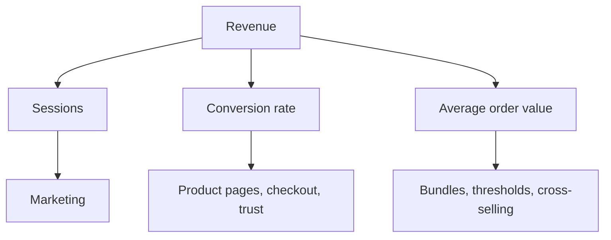

# E-commerce metrics

## Summary

E-commerce metrics turn a shop's activity into numbers that show whether it is healthy and where to act. Revenue is the product of traffic, conversion rate and average order value, so each can be improved separately. Profitability depends on contribution margin per order and on what it costs to acquire a customer (CAC) compared with what that customer is worth over time (customer lifetime value, CLV). Cohort analysis shows whether customers come back. A small set of these metrics, calculated consistently, is more useful than a large dashboard, and every metric can mislead when its definition or time frame is not clear.

## Prerequisites

[Product selection](product-selection.md#unit-economics) for contribution margin and break-even ROAS. [Measuring content performance](../content-marketing/measuring-content-performance.md) for analytics and attribution.

## Core concepts

### Definition

An *e-commerce metric* is a defined, repeatable measure of some part of an online business: visitors, orders, revenue, costs, customers. A *key performance indicator* (KPI) is a metric chosen to judge progress toward a goal. *E-commerce analytics* is the use of these data to improve sales and customer experience.

*Analogy.* Metrics are the instruments in a car. The speedometer (revenue) tells you how fast you go, the fuel gauge (cash and margin) whether you can keep going, the engine temperature (returns, complaints) whether something is about to break. Watching only the speedometer can drive you into a breakdown. The analogy breaks because car instruments are calibrated by the manufacturer, while business metrics are defined by you, and a badly defined metric shows a wrong reading without any warning light.

### The revenue equation

revenue = sessions × conversion rate × average order value

- *Sessions*: visits to the store in the period.
- *Conversion rate*: orders divided by sessions.
- *Average order value* (AOV): revenue divided by orders.

The equation shows three separate levers: more traffic (marketing), more of it buying (product pages, checkout, trust), and larger orders (bundles, thresholds, cross-selling).

The equation as a tree. Each lever has its own set of actions:



### Funnel metrics

| Step | Metric |
| --- | --- |
| Visit | Sessions, by source |
| View product | Product view rate |
| Add to cart | Add-to-cart rate |
| Start checkout | Checkout start rate |
| Purchase | Conversion rate, cart abandonment rate |

Comparing step rates over time and by device or source shows where people drop out.

### Profitability metrics

- **Gross margin** = (revenue − cost of goods sold) / revenue.
- **Contribution margin per order** = order revenue − product cost − shipping and packaging − payment fees − other variable costs (before marketing and fixed costs).
- **Return on ad spend (ROAS)** = revenue attributed to ads / ad spend. Break-even ROAS = 1 / contribution margin ratio (see [product selection](product-selection.md#unit-economics)).
- **Marketing efficiency ratio (MER)**, a practitioner term = total revenue / total marketing spend. It avoids attribution disputes by looking at the whole business.

In the EU, consumer prices include VAT. Calculate margins on revenue without VAT.

### Customer metrics

- **Customer acquisition cost (CAC)** = marketing and sales spend in a period / new customers acquired in that period.
- **Repeat purchase rate** = share of customers who order more than once in a period.
- **Customer lifetime value (CLV or LTV):** the contribution a customer brings over their relationship with the business. A simple historical version: average contribution per order × average number of orders per customer over a period (for example 24 months). More rigorous models discount future cash flows and model the probability that a customer is still active.
- **LTV to CAC ratio:** practitioners often cite 3:1 as a healthy target. This is a rule of thumb without a research basis, and it depends on how LTV is calculated.
- **Churn** (for subscriptions): share of subscribers who cancel in a period.

### Cohort analysis

A *cohort* is a group of customers who share a starting point, usually the month of their first order. A cohort table shows, for each cohort, what share ordered again in month 1, 2, 3 and so on, or cumulative revenue per customer. It answers questions that averages hide: are newer customers less loyal than older ones? Did a discount campaign bring customers who never return?

### Operational and experience metrics

- Return rate and return reasons (see [customer service and returns](customer-service-and-returns.md)).
- Delivery time and share of on-time deliveries.
- Stockout rate (see [fulfillment and shipping](fulfillment-and-shipping.md)).
- Customer satisfaction and review ratings.
- Contacts per 100 orders.

### Pitfalls

- **Averages hide distributions.** An AOV of 100 may come from many 40 orders and a few 600 orders.
- **Attribution.** Platform-reported ROAS often double counts conversions claimed by several channels. Compare with total revenue and total spend.
- **Time windows.** CAC and LTV depend on the period chosen. State it.
- **Revenue is not profit.** A discount campaign can raise revenue and lower profit.
- **Seasonality.** Compare with the same period last year, not only the previous month.

## Worked example

A shop's monthly figures (invented, revenue without VAT):

| Metric | Value |
| --- | --- |
| Sessions | 40,000 |
| Orders | 720 |
| Revenue | 50,400 EUR |
| Product cost | 18,000 EUR |
| Shipping, packaging and payment fees | 7,900 EUR |
| Marketing spend | 9,000 EUR |
| New customers | 450 |

```python
# Python 3.13. Core e-commerce metrics for one month (invented numbers).
sessions, orders, revenue = 40_000, 720, 50_400
product_cost, variable_costs, marketing, new_customers = 18_000, 7_900, 9_000, 450

conversion = orders / sessions
aov = revenue / orders
contribution = revenue - product_cost - variable_costs
cac = marketing / new_customers
mer = revenue / marketing
print(f"conversion {conversion:.2%}, AOV {aov:.2f}")
print(f"contribution {contribution} ({contribution / revenue:.1%}), per order {contribution / orders:.2f}")
print(f"CAC {cac:.2f}, MER {mer:.2f}, profit after marketing {contribution - marketing}")
```

Output:

```text
conversion 1.80%, AOV 70.00
contribution 24500 (48.6%), per order 34.03
CAC 20.00, MER 5.60, profit after marketing 15500
```

Before fixed costs (salaries, rent, software), the month made 15,500 EUR. If customers order on average 1.8 times in two years, the historical LTV in contribution is about 34.03 × 1.8 ≈ 61 EUR against a CAC of 20 EUR. Checking the cohort table would show whether recent customers reorder as often as older ones.

## Trade offs and when to use it

- **Few metrics or many.** A handful of KPIs reviewed weekly drives action. Detailed metrics are for diagnosis.
- **Simple or rigorous LTV.** Simple historical LTV is easy and backward-looking. Predictive models are better for young businesses and subscriptions but need data and skill.
- **Platform numbers or own calculations.** Platforms report generously for themselves. Reconcile with your own revenue and spend.

## Common mistakes

- **Optimizing revenue without margin.** Fix: track contribution margin.
- **Trusting ad platform ROAS alone.** Fix: compare with MER and incrementality tests.
- **Using averages only.** Fix: look at distributions and cohorts.
- **Changing definitions silently.** Fix: document how each metric is calculated.
- **Calculating margins on prices with VAT.** Fix: use net revenue.

## Practice

1. Write the revenue equation and name one action that improves each lever.
2. Calculate CAC, MER and contribution per order for: revenue 30,000, orders 500, product cost 12,000, variable costs 4,500, marketing 6,000, new customers 300.
3. Why can a discount campaign raise revenue and lower profit?
4. Sketch a cohort table for a shop and explain what it would reveal that average repeat rate does not.

Hints: question 2: CAC 20, MER 5, contribution 13,500 (27 per order).

## Further reading

- Fader, P. S., & Hardie, B. G. S. (2009). Probability models for customer-base analysis. *Journal of Interactive Marketing*, 23(1), 61-69. [doi:10.1016/j.intmar.2008.11.003](https://doi.org/10.1016/j.intmar.2008.11.003). An introduction to models of customer lifetime value.
- Gupta, S., Hanssens, D., Hardie, B., Kahn, W., Kumar, V., Lin, N., Ravishanker, N., & Sriram, S. (2006). Modeling customer lifetime value. *Journal of Service Research*, 9(2), 139-155. [doi:10.1177/1094670506293810](https://doi.org/10.1177/1094670506293810). Review of CLV modeling approaches.

TODO: Verify the DOIs of Fader and Hardie (2009) and Gupta et al. (2006) (the volume and pages of Fader and Hardie are confirmed). Find a source for the origin of the 3:1 LTV to CAC rule of thumb, or keep it marked as practitioner convention.
