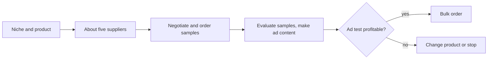

# Private label

## Summary

A private label product is made by a manufacturer but sold under your own brand, with your own design, logo and packaging. Unlike dropshipping, where you resell a supplier's generic product, private label creates an asset you own: a brand that competitors cannot copy by finding the same supplier. The cost is a much larger upfront investment in design, samples and a minimum order of stock, and the risk of losing it if the product does not sell. That is why demand must be tested before the bulk order, and why the test must stay honest toward the customers who take part in it.

## Prerequisites

[Dropshipping](dropshipping.md) for the contrast, [supplier sourcing](supplier-sourcing.md) for finding and checking manufacturers, and [product validation](product-validation.md).

## Core concepts

### Definition

*Private label* (also *white label* when an existing generic product is only rebranded) is a product manufactured by a third party and sold under the retailer's brand. The retailer decides the specification, design, branding and packaging. The manufacturer produces it, usually in batches with a *minimum order quantity* (MOQ), the smallest number of units the factory accepts per order.

*Analogy.* Private label is like having a tailor make a suit to your design and sewing your own label inside, instead of buying a suit off the rack and reselling it. The suit is yours and nobody else can sell the same one, but you pay for the fabric and the tailoring before anyone has bought it. The analogy breaks because a tailor makes one suit, while a factory insists on hundreds or thousands of units at once.

### Private label compared with dropshipping

| Aspect | Dropshipping | Private label |
| --- | --- | --- |
| Product | Supplier's generic product | Your design and brand |
| Stock | None, supplier ships per order | You buy a batch in advance |
| Upfront cost | Low | High: design, samples, MOQ, shipping, compliance |
| Risk if it does not sell | Small | Large: unsold stock |
| Margin per unit | Usually thin | Usually higher |
| Differentiation | Weak, competitors sell the same item | Strong, the brand is yours |
| Compliance | Shared with supplier in practice, legally yours | Clearly yours, often as the manufacturer in the eyes of the law |

The last row matters: in the EU, a business that puts its own name or trademark on a product is generally treated as its *manufacturer* for product safety purposes, with the obligations that follow (technical documentation, conformity assessment, labeling, and under the General Product Safety Regulation a contact address on the product).

### Strategy in five steps

The process runs as follows:

1. **Pick a niche and a product.** Hire a product designer if you need help turning your idea into a specification, and create mockups.
2. **Find about five suppliers** on a sourcing platform such as Alibaba. If your exact product does not exist, search for similar ones that a factory could adapt.
3. **Negotiate with the suppliers and order samples.** Samples for an existing product with your branding are cheap. Practitioner courses put samples for a truly custom product anywhere from 50 to 100,000 dollars, because custom molds and tooling may be needed. The range is a rough practitioner figure, not a measured one.
4. **Evaluate the samples.** If you are satisfied, get custom ad content made (photos, video).
5. **Run paid ads** to see whether people want the product before placing the bulk order.

Additional points: design and test the product, locate suppliers and manufacturers, and start marketing early.

The five steps, with the ad test as the gate before the bulk order:

### Testing with ads

Ads are needed to see whether there is real demand. The test should run longer than a dropshipping test, because the money at stake is larger. A common course recommendation is to run ads for at least 7 days at 50 dollars per day (350 dollars in total) to get solid proof that the product is wanted. The key metric is whether the ROAS is above the break-even level (see [product selection](product-selection.md#unit-economics)). How such ad tests are set up and read is covered in [paid social advertising](../social-media/paid-social-advertising.md#testing-products-with-ads).

A common suggestion is that if the test is profitable, you can tell the customers who ordered during the test that there is a delay and proceed with the bulk order, or refund them. This needs care:

- **Taking orders for stock you do not have** is legal only under conditions. In the US, the FTC mail order rule requires a reasonable basis for the shipping time you state when you take the order, and when you cannot meet it, you must offer the buyer the choice to accept the delay or cancel for a prompt refund. In the EU, the trader must deliver within the agreed time or within 30 days, and the consumer can terminate the contract if the trader fails to deliver after an additional period.
- **Honest alternatives:** label the product as a pre-order with a realistic delivery date, collect sign-ups for a waiting list, or show a "coming soon" page with a price and measure clicks on the buy button. These test demand without misleading anyone.

A pre-order with a clear delivery date is the honest form of the same test.

### Costs to plan for

- design and mockups,
- samples, including several rounds,
- tooling and molds for custom products,
- the first batch at the MOQ,
- packaging with your brand,
- freight, import VAT and customs duty,
- testing and certification (for example CE marking in the EU, or specific rules for toys, cosmetics and electronics),
- trademark registration (for example with the national office or the EU Intellectual Property Office),
- photography and advertising.

### Quality control

Before paying the balance for a batch, many importers commission an independent pre-shipment inspection, which checks a sample of the finished goods against the specification. Trade assurance programs on sourcing platforms can help resolve disputes about quality or delivery. Check what each protects.

## Worked example

A seller wants to launch a branded yoga mat made from natural rubber.

1. **Samples.** Five suppliers quote between 9 and 14 dollars per mat at an MOQ of 500. Samples with a printed logo cost 40 to 80 dollars each including shipping. Two samples pass a home test for grip, smell and thickness.
2. **Content.** A photographer produces product photos and a short video for 600 dollars.
3. **Test.** A pre-order page offers the mat at 69 dollars with delivery "in about 10 weeks". Ads run for 7 days at 50 dollars per day (350 dollars). Result: 14 pre-orders, 966 dollars of revenue, ROAS 2.8.
4. **Unit economics.** With a landed cost (product, freight, duty) of about 18 dollars and fulfillment and fees of about 9 dollars, the margin before advertising is about 42 dollars, so the break-even ROAS is about 1.6 (69 / 42). The test is above break-even.
5. **Decision.** The seller orders 500 units, about 9,000 dollars landed, and books an inspection before shipment. The 14 pre-order customers receive regular updates and the option to cancel at any time.

All numbers are invented for illustration. A ROAS from 14 orders is a noisy estimate. A larger test would give more confidence before committing 9,000 dollars.

## Trade offs and when to use it

- **Higher margin and a real brand,** at the cost of capital tied up in stock.
- **Suitable** once demand is proven, for example after selling a similar product through dropshipping, or when you know a niche well.
- **Risky** when the first batch is large relative to your savings, when the product is regulated and you have not checked compliance, or when demand has not been tested.
- **Slower to change.** A design mistake lives in 500 units.

## Common mistakes

- **Skipping samples.** Fix: always test samples from more than one supplier.
- **Ordering the bulk batch before testing demand.** Fix: test with pre-orders or ads first.
- **Taking orders without a realistic delivery date.** Fix: label pre-orders clearly and follow the delay and refund rules.
- **Forgetting the manufacturer's obligations.** Fix: check product safety, labeling and certification rules for your country before ordering.
- **Not registering the brand.** Fix: check that the name is free and register the trademark in your main markets.

## Practice

1. Why is a private label seller usually treated as the manufacturer under EU product safety law?
2. List six costs of a private label launch that a dropshipper does not have.
3. A test campaign spends 350 dollars and brings 6 orders at 60 dollars. The margin before ads is 35 dollars per unit. Is the test above break-even?
4. Describe an honest way to test demand for a product you do not have in stock yet.

Hints: question 3: revenue is 360 dollars, so ROAS is about 1.03, and break-even ROAS is about 1.71.

## Further reading

- Regulation (EU) 2023/988 on general product safety. [EUR-Lex](https://eur-lex.europa.eu/eli/reg/2023/988/oj). Obligations of manufacturers, importers and online sellers.
- U.S. Federal Trade Commission. Mail, Internet, or Telephone Order Merchandise Rule. [ftc.gov](https://www.ftc.gov/legal-library/browse/rules/mail-internet-or-telephone-order-merchandise-rule). Shipping times, delays and refunds for orders.
- Directive 2011/83/EU on consumer rights, Article 18. [EUR-Lex](https://eur-lex.europa.eu/eli/dir/2011/83/oj). Delivery obligations in the EU.

TODO: Find a second source for the 7 day, 50 dollar per day ad test, which comes from practitioner courses.
