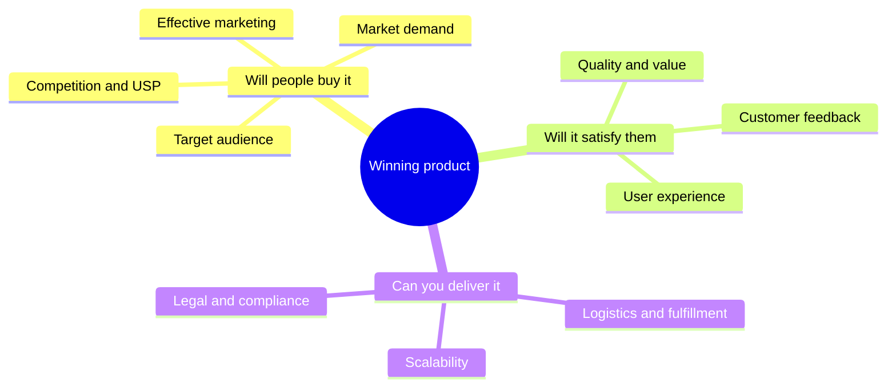

# Product selection

## Summary

Product selection is the decision of what to sell. A "winning product" in e-commerce has real demand from a defined audience, solves a problem or meets a strong want, can be shown convincingly in an ad or a photo, is hard to buy cheaply elsewhere, and leaves enough margin after product cost, shipping, fees and advertising. Most of these criteria can be checked before spending much money, and the margin check is simple arithmetic that many beginners skip. A product that looks popular but cannot pay for its own advertising is not a winning product.

## Prerequisites

[E-commerce models](e-commerce-models.md). Selection is followed by [product validation](product-validation.md).

## Core concepts

### Definition

A *product* is an item or service a company creates or resells to meet a customer's need or want. It can be physical (a toy, a book), digital (a template) or a service (a haircut, a repair). *Product selection* is choosing which products to offer, and in which niche.

A *niche* is a specific segment of a market defined by an audience and a need, such as "home espresso equipment for beginners" rather than "kitchen products". A niche lets a seller target a clear audience, build expertise and stand out.

*Analogy.* Choosing a product is like choosing a dish for a food stall at a busy market. It has to be something people want to eat today (demand), something you can make well and consistently (quality and supply), something the stall next door does not already sell cheaper (competition), and something whose ingredients cost much less than the price (margin). A dish that everyone loves but that costs more to make than people will pay ruins the stall. The analogy breaks because an online seller pays for every passer-by through advertising, while the market stall gets foot traffic for the price of the pitch.

### Criteria of a winning product

Practitioner guides list the criteria of a winning product in ten groups:

1. **Market demand.** A niche with enough demand and less saturation. A product in line with current trends has a better chance, but trends fade.
2. **Quality and value.** The product meets or exceeds quality expectations, and customers see good value for the price.
3. **Target audience.** You know who buys it and tailor the product to them. Products that solve a specific problem tend to sell.
4. **Effective marketing.** The product can be promoted through social media, search and email, and you can write a compelling description of its benefits.
5. **Scalability.** Supply can grow with demand, and related products can be added later.
6. **Competition.** You know the competitors' strengths and weaknesses and have a *unique selling proposition* (USP): a clear reason to buy from you (features, price, service or brand).
7. **Customer feedback.** Reviews and ratings build trust, and customer service turns one-time buyers into repeat customers.
8. **Logistics and fulfillment.** Reliable, reasonably fast shipping and inventory management that avoids stockouts.
9. **User experience.** A reliable, simple and secure store that works on mobile.
10. **Legal and compliance.** The product meets safety, labeling and other regulations in the countries where you sell.

The ten criteria grouped by the question they answer:



### Additional criteria from practice

Two more criteria are common in practitioner advice and are worth checking explicitly:

- **Demonstrability.** Can the benefit be shown in a short video or one photo? Products sold through social ads depend on this. A product whose benefit needs a long explanation suits search and content better.
- **Shipping profile.** Small, light, unbreakable products are cheaper to ship and return. Fragile, heavy, liquid or battery-containing products bring extra cost and rules.

### Unit economics

*Unit economics* is the profit or loss on a single order. The key figure is the *contribution margin* before advertising: the price minus the product cost, shipping, payment fees and other per-order costs. Advertising must be paid from this margin.

*Return on ad spend* (ROAS) is revenue divided by advertising cost. The *break-even ROAS* is the ROAS at which advertising consumes the whole margin:

break-even ROAS = price / contribution margin before advertising

If a campaign's ROAS is below this number, each sale loses money.

```python
# Python 3.13. Unit economics of one order (invented numbers).
price = 40.00            # selling price, euros
product_and_shipping = 14.00
payment_fee = 0.03 * price + 0.30   # an example card fee: 3% + 0.30
margin = price - product_and_shipping - payment_fee
print(f"margin before ads: {margin:.2f} ({margin / price:.0%})")
print(f"break-even ROAS: {price / margin:.2f}")

roas = 2.2               # what a test campaign achieved
ad_cost_per_order = price / roas
print(f"ad cost per order: {ad_cost_per_order:.2f}")
print(f"profit per order: {margin - ad_cost_per_order:.2f}")
```

Output:

```text
margin before ads: 24.50 (61%)
break-even ROAS: 1.63
ad cost per order: 18.18
profit per order: 6.32
```

The example leaves out returns, refunds, chargebacks, customer service time, platform subscriptions and taxes, all of which reduce the real profit. In the EU, the price shown to consumers includes VAT, so the margin must be calculated on the price without VAT.

### Research tools

These tools help check demand when selecting a product for dropshipping:

- **Marketplace listings** (for example AliExpress): reviews, prices and order counts. Reviews matter most for unfamiliar products, because they reveal quality problems.
- **Ad libraries and ad spy tools.** Tools that collect social media ads (for example AdSpy) show which products are being advertised and how people react. Meta's public Ad Library shows ads currently running on its platforms.
- **Google Trends** shows whether interest in a product is rising or falling. Avoid products whose popularity has already peaked.
- **A test ad** checks real demand. See [product validation](product-validation.md) and [paid social advertising](../social-media/paid-social-advertising.md#testing-products-with-ads).

## Worked example

A seller considers two products for a "home office comfort" niche.

| Criterion | Laptop stand (aluminum, foldable) | Heated desk mat |
| --- | --- | --- |
| Demand | Steady search interest, many competitors | Seasonal, higher in winter |
| Problem solved | Neck strain from looking down | Cold hands |
| Demonstrability | Good: before and after posture photo | Medium: warmth is hard to show |
| Competition | Very high, sold in many shops | Lower |
| Shipping profile | Light, hard to break | Contains electronics and a plug, needs electrical safety compliance (CE marking in the EU) and country-specific plugs |
| Price and cost | 35 euros, cost with shipping 13 euros | 45 euros, cost with shipping 22 euros |
| Break-even ROAS | about 1.6 | about 2.0 |

The laptop stand has better margins and fewer compliance problems, but strong competition means advertising may be expensive. The desk mat has less competition, but seasonality, safety compliance and a lower margin make it riskier. A reasonable decision is to test the laptop stand with a differentiated angle (for example, for people working from small apartments) and keep the desk mat for an autumn test.

All numbers are invented. Break-even ROAS is calculated without payment fees for simplicity.

## Trade offs and when to use it

- **Trending products** can sell fast and die fast. A niche with steady demand builds a lasting store.
- **Low competition** sometimes means low demand. Check both.
- **Cheap products** are easy to sell but leave little margin for advertising. Many practitioners prefer prices that leave room for an acquisition cost.
- **Familiarity helps.** Knowing the niche helps you predict what the audience likes, but it can also make you overestimate demand.

## Common mistakes

- **Choosing by personal taste.** Fix: check demand data and real customer behavior.
- **Skipping the margin calculation.** Fix: calculate break-even ROAS before the first ad.
- **Ignoring compliance.** Electrical products, toys, cosmetics and products for children have strict rules. Fix: check them before ordering stock.
- **Selling everything that trends.** Fix: pick a niche, so that customers have a reason to return.

## Practice

1. List five of the ten criteria of a winning product and say how you would check each.
2. A product sells for 30 euros. Product cost and shipping are 12 euros, and the payment fee is 1.20 euros. What is the break-even ROAS?
3. Why is a product with a high break-even ROAS risky to sell through paid social ads?
4. Choose a niche you know and propose one product. Write its USP in one sentence.

Hints: question 2: the margin is 16.80 euros, so break-even ROAS is about 1.79.

## Further reading

- Google Trends. [trends.google.com](https://trends.google.com/). Relative search interest over time and by region.
- Meta Ad Library. [facebook.com/ads/library](https://www.facebook.com/ads/library/). Public archive of ads running on Meta platforms.

TODO: The criteria come from practitioner advice. Add a research source on product success factors, for example the new product development literature.
