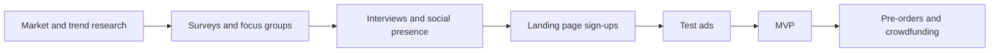

# Product validation

## Summary

Product validation is collecting evidence that people will actually pay for a product before investing heavily in making or stocking it. Methods range from cheap and weak (asking people if they like the idea) to more expensive and strong (taking pre-orders or real payments). The central lesson from research and practice is that what people say they will buy is a poor predictor of what they do buy, so the best validation methods measure behavior, ideally a commitment of money. Validation reduces risk, it does not remove it.

## Prerequisites

[Product selection](product-selection.md) for choosing what to validate. [A/B testing](../copywriting/ab-testing.md) for the statistics of comparing versions.

## Core concepts

### Definition

*Product validation* is the process of testing the assumptions behind a product idea (that a specific audience has the problem, that this product solves it, and that they will pay a price that leaves a margin) with evidence from real potential customers. A *minimum viable product* (MVP), a term popularized by Eric Ries in *The Lean Startup* (2011), is the smallest version of a product that lets you learn whether those assumptions hold.

*Analogy.* Validating a product is like testing whether a river can be crossed before building a bridge. You can ask people on the bank whether they would use a bridge (weak evidence), count how many people currently pay a ferry (better), or sell tickets for a bridge that does not exist yet (strong). The analogy breaks because a river does not change its mind, while customers' needs and the competition can change between your test and your launch.

### Why stated intent is weak evidence

When people are asked whether they would buy something, many say yes and do not buy. Research on purchase intentions finds that stated intentions do relate to later purchases, but imperfectly, and the gap depends on the product and the situation (Morwitz, Steckel and Gupta, 2007). The broader psychological literature calls this the *intention-behavior gap*. Sheeran (2002) pooled 10 meta-analyses covering 422 studies and found an average correlation of about .53 between intention and later behavior, so intentions explain only about a quarter of the variation in what people do. In customer interviews, compliments and hypothetical answers ("I would definitely buy that") are the least reliable signal. Rob Fitzpatrick's *The Mom Test* (2013) advises asking about the person's past behavior and current solutions instead of asking for opinions about your idea.

### Methods ordered by strength of evidence

| Method | What it measures | Cost | Evidence strength |
| --- | --- | --- | --- |
| Market research and competitor analysis | Whether similar products exist and sell | Low | Indirect |
| Search and trend data | Whether people look for the solution | Low | Indirect |
| Surveys | Stated preferences and problems | Low | Weak for purchase intent |
| Focus groups | Reactions and language of a group | Medium | Weak, group effects |
| Customer interviews | Real problems and past behavior | Low to medium | Medium when done well |
| Social media presence | Interest and engagement | Low to medium | Weak to medium |
| Landing page with sign-up | Willingness to give an email address | Low | Medium |
| Test ads | Click and purchase behavior of strangers | Medium | Medium to strong |
| MVP | Use of a basic version | Medium to high | Strong |
| Pre-orders and crowdfunding | Willingness to pay | Medium | Strongest before launch |

The methods from the table, ordered from weaker to stronger evidence of willingness to buy:

### Market research

Study the market: who the target audience is, what they need, which competitors sell similar products and how well these sell (reviews, order counts, rankings, how long the products have been on the market).

### Search and trend data

Google Trends shows the relative popularity of a search term over time and by region, on a scale from 0 to 100 where 100 is the peak in the selected period and region. The numbers are relative and based on a sample of searches, not absolute counts. A falling curve warns against a product whose popularity has passed. Keyword tools give approximate absolute volumes (see [keyword research](../search-engine-optimization/keyword-research.md)).

### Surveys

Surveys (made with tools such as Google Forms or SurveyMonkey) ask about pain points, preferences and interest. They are useful to learn what problems people have and how they describe them. They are weak for predicting purchases, for the reasons above. Ask about past behavior ("When did you last buy...?") rather than future intent.

### Customer interviews

One-to-one interviews allow in-depth conversations about needs, preferences and problems. Good practice from *The Mom Test*:

- Talk about their life and the problem, not about your idea.
- Ask about specifics in the past: "Tell me about the last time this happened."
- Ask what they do now, what it costs them and what they have already tried. If they have never looked for a solution, they may not buy yours.
- Treat compliments as noise. Steer back to facts.
- End with a commitment or a clear next step, such as a pre-order or an introduction.

### Focus groups

A focus group gathers a small group of the target audience to discuss a product. It shows reactions and vocabulary, but group dynamics (dominant participants, social desirability) can distort answers. Incentives help recruit participants.

### Landing pages and sign-up forms

A *landing page* describes the product and its benefits and asks for an action, such as joining a waiting list. The number of sign-ups relative to visitors is a signal of interest. It costs only an email address, so it is weaker than a payment. Say clearly that the product is not yet available.

### Test ads

An ad that sends people to a product page measures how strangers react: clicks, add-to-cart actions and purchases. This is the usual way to test dropshipping and private label products (see [private label](private-label.md#testing-with-ads)). Judge the result by cost per purchase compared with the margin, not by clicks alone.

### Minimum viable product

An MVP is a simplified version that tests the core value of the product with early users. Collect feedback on what resonates and what needs to change.

### Pre-orders and crowdfunding

Pre-orders and crowdfunding campaigns (on platforms such as Kickstarter or Indiegogo) ask people to pay before the product exists. They test willingness to pay and can fund production. Communicate the expected delivery time clearly. In the US, the FTC rule on mail, internet and telephone orders requires sellers to have a reasonable basis for the shipping time they state, and to offer a delay or refund option when they cannot meet it. In the EU, delivery must happen within the agreed time or within 30 days if none was agreed (Consumer Rights Directive 2011/83/EU, Article 18). Crowdfunding platforms have their own rules on backer rights.

### Partnerships

Collaborations with businesses in related fields can give access to their audience and to insights about it.

### Analytics and metrics

Web analytics tools track behavior on landing pages and stores: page views, click-through rates and *conversion rates* (the share of visitors who take the desired action). These numbers turn validation into something you can compare across tests.

### Iteration

Validation is a loop: test, learn, change the product, the price, the audience or the message, and test again. Be willing to *pivot* (change direction) when the evidence is against the original idea.

## Worked example

Idea: a reusable silicone food storage bag for people who prepare lunches.

1. **Interviews.** Ten interviews with people who take lunch to work. Seven describe a past problem with leaking containers. Three have already bought silicone bags and complain that they are hard to clean. This suggests both a real problem and a gap (easy cleaning).
2. **Trend data.** Interest in "silicone food bag" is stable over five years in Google Trends, not a passing spike.
3. **Landing page.** A page promising "the silicone bag you can clean in 10 seconds" gets 1,200 visitors from a small ad campaign, and 96 join the waiting list (8%).
4. **Pre-order.** The 96 people are offered a pre-order at 18 euros with delivery in 8 weeks. 22 pay (about 23% of the list, under 2% of visitors).
5. **Decision.** 22 paid pre-orders is evidence of demand but not of scale. The seller orders a small first batch and keeps testing ads before a larger order.

All numbers are invented. Notice how the numbers shrink at each step from interest to payment: that drop is what validation is meant to reveal.

## Trade offs and when to use it

- **Speed versus certainty.** More validation reduces risk but costs time, and competitors may move first.
- **Cheap tests are weak, strong tests cost more.** Use cheap tests to discard bad ideas and stronger tests before large commitments.
- **Small samples.** A few interviews or a few dozen sign-ups show direction, not market size.
- **False negatives.** A test can fail because of a bad ad or landing page, not a bad product. Test the message too.

## Common mistakes

- **Asking "Would you buy this?"** Fix: ask about past behavior and ask for a commitment.
- **Treating sign-ups as sales.** Fix: test willingness to pay with pre-orders or real purchases.
- **Testing only with friends and family.** Fix: test with strangers from the target audience.
- **Promising delivery dates you cannot meet.** Fix: state realistic times and follow the delay and refund rules.
- **Ignoring evidence that contradicts the idea.** Fix: decide in advance what result would make you stop or pivot.

## Practice

1. Why is a survey answer "I would buy this" weak evidence?
2. Order these methods from weakest to strongest evidence: landing page sign-up, pre-order, survey, test ad with purchases.
3. Rewrite the interview question "Would you use an app that tracks your plants' watering?" so that it asks about past behavior.
4. What do Google Trends values of 0 to 100 mean, and what do they not mean?

Hints: question 4 concerns relative and absolute numbers.

## Further reading

- Morwitz, V. G., Steckel, J. H., & Gupta, A. (2007). When do purchase intentions predict sales? *International Journal of Forecasting*, 23(3), 347-364. [doi:10.1016/j.ijforecast.2007.05.015](https://doi.org/10.1016/j.ijforecast.2007.05.015). When stated intentions predict purchases.
- Sheeran, P. (2002). Intention-behavior relations: A conceptual and empirical review. *European Review of Social Psychology*, 12(1), 1-36. [doi:10.1080/14792772143000003](https://doi.org/10.1080/14792772143000003). The intention-behavior gap.
- Fitzpatrick, R. (2013). *The Mom Test: How to Talk to Customers and Learn If Your Business Is a Good Idea When Everyone Is Lying to You*. Self-published. Practical rules for customer interviews.
- Ries, E. (2011). *The Lean Startup*. Crown Business. The minimum viable product and validated learning.
- Google Trends Help. FAQ about Google Trends data. [support.google.com](https://support.google.com/trends/answer/4365533). How the 0 to 100 index is calculated.
- U.S. Federal Trade Commission. Mail, Internet, or Telephone Order Merchandise Rule (16 CFR Part 435). [ftc.gov](https://www.ftc.gov/legal-library/browse/rules/mail-internet-or-telephone-order-merchandise-rule). Shipping time and delay rules.

TODO: Read Morwitz et al. (2007) in full, confirm its DOI and add its key findings with numbers. Lean Startup belongs to business and management; link to that note when it exists.
