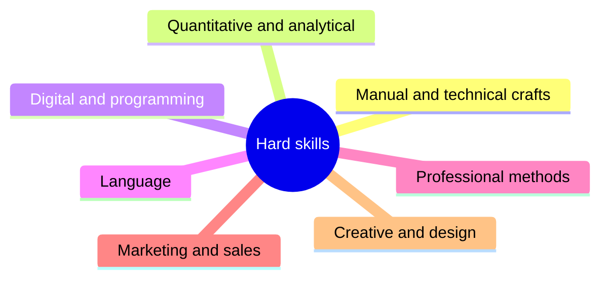
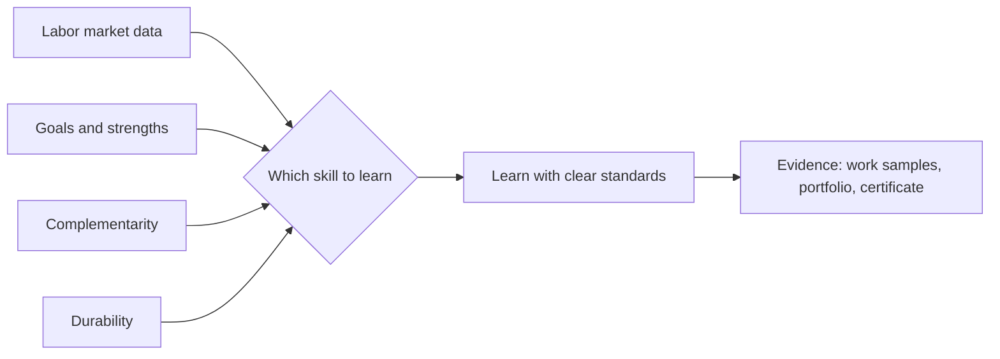

# Hard skills fundamentals

## Summary

Hard skills are learned abilities tied to a specific task, tool, method or field, whose results can be checked against a clear standard: writing SQL, welding, bookkeeping, translating, running an ad campaign. Because they are specific, they can be taught in a structured way, tested and certified, and their value on the labor market is relatively easy to see in job postings. Because they are tied to tools and methods, many of them lose value as technology changes, so a career built on hard skills needs a strategy for choosing which ones to learn, how deep to go and when to renew them.

## Prerequisites

[What is a skill](../what-is-a-skill.md). For planning, [skills inventory and gap analysis](../../career/self-assessment/skills-inventory-and-gap-analysis.md).

## Core concepts

### Definition

A *hard skill* is a learned, task-specific ability whose correct performance can be described by explicit criteria and checked by a test or a work product. Typical features:

- **Specific.** It belongs to a field, a tool or a method (accounting, Python, SEO, CNC machining).
- **Codifiable.** Much of it can be written down as rules, procedures and standards, so it can be taught in courses and books.
- **Testable.** There is a right or better way, so performance can be scored: the code passes tests, the weld holds, the balance sheet balances.
- **Certifiable.** Many hard skills have formal certificates or licenses (a driving license, a CPA, a cloud vendor certificate, a language level on the CEFR scale).

Hard skills are not purely mechanical. Every hard skill has a tacit part (see [what is a skill](../what-is-a-skill.md#declarative-and-procedural-knowledge)): an experienced accountant senses that a number is wrong before finding the error. And hard skills are always performed through soft skills: planning, communicating, managing frustration.

*Analogy.* A hard skill is like a recipe plus the hand that cooks it. The recipe (the codifiable part) can be written down, copied and tested: follow it and you get a cake. The hand (the tacit part) is what turns a correct cake into a good one, and it only comes from baking many cakes. The analogy breaks because recipes in a kitchen change slowly, while the "recipes" of many technical skills (software tools, platform rules) change every few years.

### Categories of hard skills

Hard skills cover a very wide range. A useful grouping:

| Category | Examples | Typical way of learning |
| --- | --- | --- |
| Manual and technical crafts | Welding, electrical installation, carpentry, hairdressing | Apprenticeship, vocational school, supervised practice |
| Quantitative and analytical | Statistics, data analysis, financial modeling, accounting | University courses, practice on real data |
| Digital and programming | Programming languages, databases, cloud platforms, cybersecurity | Courses, projects, documentation, certification |
| Language | Foreign languages, translation, interpreting | Immersion, structured courses, CEFR-level exams |
| Professional methods | Project management, legal drafting, clinical procedures, auditing | Professional education, licenses, supervised practice |
| Marketing and sales | Copywriting, SEO, content marketing, paid advertising, e-commerce operations | Practice with real audiences, courses, platform documentation |
| Creative and design | Graphic design, photography, video editing, UX design | Portfolio work, critique, tools training |

The notes in this library currently cover the marketing and sales group (see [Hard skills](README.md)). Other groups are planned or belong to other fields, for example programming practice to computer science.

The seven categories at a glance:

### How hard skills are learned

Hard skills follow the general path of [skill acquisition](../skill-acquisition.md): understanding the rules, practicing with feedback, then automatic performance. Their specific advantages for learning:

- **Clear standards.** It is usually possible to know whether an attempt was right, which allows fast feedback.
- **Structured curricula.** Courses, textbooks and documentation exist for most hard skills.
- **Objective practice tasks.** Exercises can be graded automatically (code tests, language exercises, accounting problems).

Common traps:

- **Tutorial loop.** Following tutorials feels productive, but copying is not retrieval. Real learning starts when you build something without step-by-step instructions (see [learning techniques](../learning-techniques.md)).
- **Tool versus principle.** Learning the buttons of one tool without the underlying principle makes the skill fragile. Learn why a tool works the way it does, then the tool.

### How hard skills are assessed

| Method | What it shows | Notes |
| --- | --- | --- |
| Work sample test | Performance on a realistic task | In the 2022 revision of selection research by Sackett and colleagues, work samples had a mean operational validity of about .33 for job performance |
| Job knowledge test | Knowledge needed for the job | Revised estimate about .40 |
| Certification or license | That a standard was met at one point | Varies widely in rigor. Some are legally required, others are vendor marketing |
| Portfolio | Real work products | Strong evidence if the work is genuinely yours and representative |
| Track record and references | Results over time | Hard to compare across contexts |

Validity figures from the revision by Sackett, Zhang, Berry and Lievens (2022) as reported in secondary summaries. They describe average predictive power across many jobs and studies, not the value of one test.

The four criteria from the section on choosing skills below feed one decision. Assessment methods then turn the learned skill into evidence.

### Depth and breadth

People who build careers on hard skills choose between depth and breadth:

- *Specialists* go deep in one skill and become the person others ask.
- *Generalists* combine several skills at a working level.
- The *T-shaped* profile, a practitioner term, combines one deep skill with a broad working knowledge of neighboring ones. A copywriter who also understands SEO and analytics can design, write and measure a page.

Combining two or three hard skills that are rarely found together can be more valuable than being one of many experts in a single skill. This is a strategic argument from practitioners, not a measured law.

### Skill obsolescence

Hard skills tied to specific tools or regulations lose value over time:

- Deming and Noray (2020) found, using online job postings from 2007 to 2019, that the skill content of jobs in technology-intensive fields changes faster than in other fields, and that the earnings advantage of graduates in such fields is largest at labor market entry and shrinks over the following years.
- The World Economic Forum's *Future of Jobs Report 2025* reports that employers expect 39% of workers' core skills to change by 2030, down from 44% in its 2023 survey.

Claims about a fixed "half-life" of skills (for example "five years") circulate widely but rarely have a traceable source. The safer conclusion is qualitative: tool-specific skills age faster than foundational ones (mathematics, writing, reasoning, domain principles), so invest in both.

### Choosing which hard skills to learn

A practical method combines four sources:

1. **Labor market data.** Count how often a skill appears in job postings for the roles you want. Occupational databases such as O*NET (US) and ESCO (EU) list skills by occupation.
2. **Your goals and strengths.** See [interests, values and strengths](../../career/self-assessment/interests-values-and-strengths.md).
3. **Complementarity.** Prefer skills that make your existing skills more valuable.
4. **Durability.** Prefer principles over tool-specific procedures, and plan to renew tool skills.

## Worked example

An office administrator wants to move into e-commerce operations within a year.

**Step 1: market check.** Twenty job postings for "e-commerce specialist" in the region list, among others: platform administration (Shopify or WooCommerce) in 16, product content writing in 14, Google Analytics in 13, paid social advertising in 11, SEO basics in 10, and Excel in 18.

**Step 2: current inventory.** Strong in Excel and organized data entry. No experience with platforms, analytics or advertising.

**Step 3: choice.** Focus on three skills with the best ratio of demand to effort and with complementarity: platform administration, product content writing and analytics. Postpone paid advertising, which needs a budget to practice.

**Step 4: learning plan.**

| Skill | Learning | Evidence for the portfolio |
| --- | --- | --- |
| Platform administration | Set up a test shop with 30 products, shipping and taxes | Screenshots and a short write-up |
| Product content | Write 30 product descriptions using [copywriting fundamentals](copywriting/copywriting-fundamentals.md) | Before and after examples |
| Analytics | Set up analytics on the test shop and build a weekly report | The report with explanation |

**Step 5: renewal.** Review the job postings again after six months to see whether demand has moved.

The posting counts are invented to show the method.

## Trade offs and when to use it

- **Certifications versus portfolio.** Certificates help pass filters. Portfolios show what you can actually do. In many digital fields employers weigh the portfolio more. Licenses are required by law in regulated professions.
- **Depth versus breadth.** Depth wins when a field rewards the very best. Breadth wins in small organizations and roles that connect functions.
- **Tool skills versus principles.** Tool skills get you hired now, principles keep you employable. Learn both.
- **Courses versus projects.** Courses give structure, projects give evidence and real problems. Combine them.

## Common mistakes

- **Collecting courses instead of building skill.** Fix: for each course, produce a work product without the tutorial.
- **Learning tools without principles.** Fix: ask what problem the tool solves and how it works underneath.
- **Ignoring soft skills.** Fix: practice explaining and selling your hard skill work to others.
- **Choosing by hype.** Fix: check demand in postings and your own fit.
- **Letting skills decay unnoticed.** Fix: review your skill inventory every six to twelve months.

## Practice

1. List four features that distinguish a hard skill from a soft skill and give an example of a hard skill with a large tacit part.
2. What did Deming and Noray (2020) find about earnings in technology-intensive fields over a career?
3. Why should you be skeptical of a claim that skills have a "half-life of five years"?
4. Do steps 1 to 3 of the worked example for a role you want.

Hints: question 3 concerns traceable sources and differences between kinds of skills.

## Further reading

- Sackett, P. R., Zhang, C., Berry, C. M., & Lievens, F. (2022). Revisiting meta-analytic estimates of validity in personnel selection: Addressing systematic overcorrection for restriction of range. *Journal of Applied Psychology*, 107(11), 2040-2068. [doi:10.1037/apl0000994](https://doi.org/10.1037/apl0000994). Validity of work samples and knowledge tests.
- Deming, D. J., & Noray, K. (2020). Earnings dynamics, changing job skills, and STEM careers. *Quarterly Journal of Economics*, 135(4), 1965-2005. [doi:10.1093/qje/qjaa021](https://doi.org/10.1093/qje/qjaa021). Skill change and obsolescence.
- World Economic Forum (2025). *The Future of Jobs Report 2025*, chapter 3: Skills outlook. [weforum.org](https://www.weforum.org/publications/the-future-of-jobs-report-2025/in-full/3-skills-outlook/). Employer expectations of skill change.
- O*NET Resource Center. The O*NET Content Model. [onetcenter.org](https://www.onetcenter.org/content.html). Skills and knowledge by occupation in the US.
- European Commission. ESCO. [esco.ec.europa.eu](https://esco.ec.europa.eu/). Skills and occupations in the EU.
- Council of Europe. Common European Framework of Reference for Languages (CEFR). [coe.int](https://www.coe.int/en/web/common-european-framework-reference-languages). An example of a standard scale for a hard skill.
