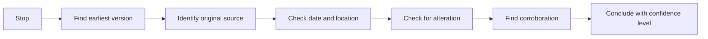

# Image and media verification

## Summary

Images and videos are among the most misleading content online, not usually because they are faked from scratch but because real material is shown out of context: an old photo presented as new, a picture from one place presented as another, or a cropped image that hides what matters. Verification asks where the material first appeared, when and where it was taken, and whether it was altered. The main tools are reverse image search (Google Lens, Bing Visual Search, TinEye, Yandex), checking metadata where it survives, geolocation from visible clues, and provenance standards such as C2PA Content Credentials. AI-generated images and audio make provenance checks more important and detection less reliable.

## Prerequisites

[Source evaluation](source-evaluation.md).

## Core concepts

### Definition

*Media verification* is the process of establishing the origin, date, location and integrity of an image, video or audio recording, and whether it supports the claim it accompanies. *Provenance* is the documented history of a piece of media: who created it, when, with what device, and how it was edited.

*Analogy.* Verifying a photo is like checking a painting offered at an auction. The question is not only whether the paint looks right, but where the painting has been: who owned it, when it was exhibited, whether there are records. A real painting with a false history is as misleading as a fake. The analogy breaks because a painting is a single object, while a digital image can be copied endlessly, so its "history" is scattered across many websites and the earliest copy is often the key evidence.

### Common forms of visual misinformation

| Form | Example |
| --- | --- |
| Miscaptioned or out of context | A 2015 flood photo shared as a flood happening today |
| Wrong location | A protest in one country presented as being in another |
| Selective cropping | Cutting out the part of a scene that changes its meaning |
| Edited images | Added or removed objects, altered text on signs or documents |
| Staged scenes | A real photo of a set-up situation presented as spontaneous |
| Synthetic media | AI-generated images, video or voice presented as real |

### Reverse image search

*Reverse image search* finds where an image, or similar images, appear online. It is the fastest way to find an earlier appearance.

- **Google Lens** (the camera icon in Google search or Google Images) accepts an upload, a URL or part of an image.
- **Bing Visual Search** and **Yandex Images** use different indexes and sometimes find results others miss.
- **TinEye** focuses on exact and modified copies and can sort results by the oldest appearance.

Tips: search with several engines, crop to a distinctive part of the image, and for video, search key frames (screenshots of important moments). Browser extensions such as InVID-WeVerify, developed for journalists, extract key frames and run searches on several engines.

### Metadata

Digital photos often carry *EXIF metadata*: camera model, date and time, sometimes GPS coordinates. It can help, with limits:

- Most social platforms strip metadata on upload.
- Metadata can be edited or wrong (for example a camera with an incorrect clock).
- Missing metadata proves nothing.

### Geolocation and chronolocation

*Geolocation* determines where an image was taken from visible clues: signs, languages, architecture, vegetation, road markings, mountains, shop names. Satellite imagery and street-level imagery (such as Google Street View) help confirm it. *Chronolocation* estimates when: weather records, shadows and sun position, events visible in the scene, the season of plants. Open source investigators such as Bellingcat publish detailed guides to these methods.

### Provenance standards

The *Coalition for Content Provenance and Authenticity* (C2PA), founded by companies including Adobe, Microsoft, BBC and Intel, publishes an open standard for attaching cryptographically signed provenance information to media, shown to users as *Content Credentials*. Some cameras, editing tools and AI image generators add such credentials. Absence of credentials does not prove manipulation, and credentials can be stripped, but their presence gives verifiable history.

### AI-generated media

Generated images, video and voice are increasingly realistic. Signs once used to spot them (malformed hands, garbled text) are becoming less reliable as models improve, and automated detectors have error rates. A more reliable approach is provenance and context: who first published it, is there independent footage from the same event, do credible outlets report it, does the scene match known facts. In the EU, the AI Act (Regulation (EU) 2024/1689) requires deployers of AI systems that generate deepfakes to disclose that the content is artificially generated or manipulated. These Article 50 duties apply from 2 August 2026. For the separate duty to mark generated content in a machine-readable way, a 2026 amendment (the Digital Omnibus) gives systems already on the market until 2 December 2026 (checked 2026-10 in secondary legal summaries).

### Verification workflow

1. **Stop** before sharing (see [source evaluation](source-evaluation.md#sift)).
2. **Find the earliest version** with reverse image search on several engines.
3. **Identify the original source:** who published it first, and are they credible?
4. **Check date and location** with metadata (if present), geolocation and chronolocation.
5. **Check for alteration:** compare versions, look for inconsistencies.
6. **Find corroboration:** other images or reports of the same event.
7. **Conclude** and say how confident you are.

The workflow ends with a confidence level, not a yes or no:

## Worked example

A dramatic photo of a flooded city street is shared with the caption "Kraków this morning".

1. **Reverse image search** with Google Lens and TinEye finds the same photo on a news site from 2021, captioned as a flood in another European city.
2. **Geolocation:** the shop signs in the photo are in German. Street View of the named street in the 2021 article matches the buildings.
3. **Corroboration:** Polish news sites and the city's official channels report heavy rain this morning but no flooding of that scale.
4. **Conclusion:** the photo is real but from 2021 and another city. The claim "Kraków this morning" is false.

The example is invented to illustrate the method.

## Trade offs and when to use it

- **Time versus stakes.** A full verification takes minutes to hours. Do it before sharing anything consequential, and before using images in your own content.
- **Tools versus judgment.** Tools find candidates. Judgment about sources and context decides.
- **Detection versus provenance.** Detectors of AI media are fallible. Provenance and corroboration are more reliable.

## Common mistakes

- **Searching only one engine.** Fix: use several.
- **Treating missing metadata as proof of manipulation.** Fix: remember platforms strip it.
- **Relying on "AI signs" alone.** Fix: check provenance and corroboration.
- **Sharing first, checking later.** Fix: stop before sharing.

## Practice

1. Name five forms of visual misinformation and an example of each.
2. Take an image from a recent viral post and find its earliest appearance with two reverse search engines.
3. What does C2PA provide, and what are its limits?
4. List five visual clues you could use to geolocate a street photo.

## Further reading

- Coalition for Content Provenance and Authenticity (C2PA). [c2pa.org](https://c2pa.org/). The provenance standard.
- InVID-WeVerify verification plugin. [weverify.eu](https://weverify.eu/verification-plugin/). Tools for verifying images and video.
- Bellingcat. Guides and resources. [bellingcat.com](https://www.bellingcat.com/category/resources/). Open source investigation methods.
- TinEye. [tineye.com](https://tineye.com/). Reverse image search.
- Regulation (EU) 2024/1689 (AI Act), Article 50. [EUR-Lex](https://eur-lex.europa.eu/eli/reg/2024/1689/oj). Transparency obligations for AI-generated content.
- Silverman, C. (Ed.) (2014). *Verification Handbook*. European Journalism Centre. [datajournalism.com](https://datajournalism.com/read/handbook/verification-1). A practical handbook for journalists.

TODO: Confirm the URL of the Verification Handbook and the formal adoption of the Digital Omnibus amendment in the Official Journal.
