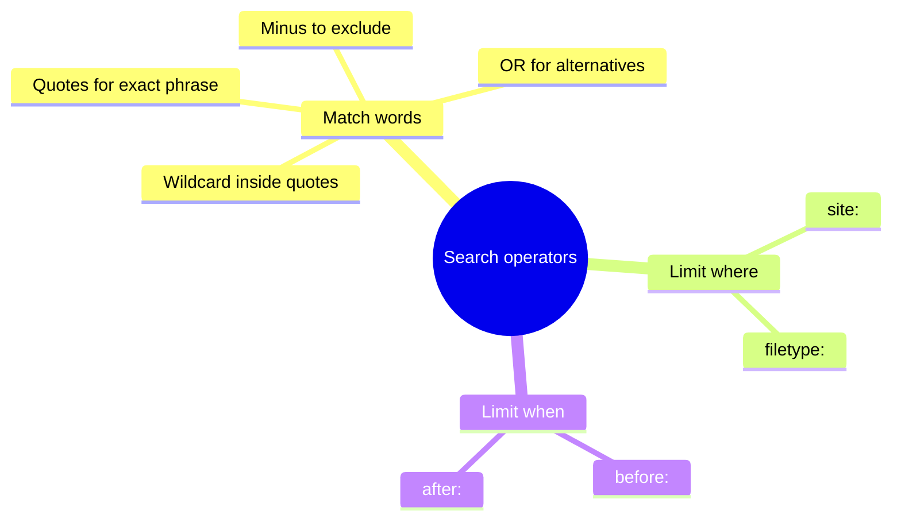

# Search operators

## Summary

Search operators are special characters and words that change how a search engine interprets a query: quotation marks for an exact phrase, a minus sign to exclude a word, `site:` to search one website, `filetype:` for documents, `before:` and `after:` for dates. They turn a vague search into a precise one and are the fastest practical improvement most people can make to their searching. Search engines change their features often: some operators described in older guides, such as `+`, `~` and `cache:`, no longer work, and convenience features like recipe filters come and go. This note covers what works in Google as of 2026, common search tips, and how to check the current state.

## Prerequisites

[Search strategy](search-strategy.md).

## Core concepts

### Definition

A *search operator* is a character or keyword that modifies a query, for example by requiring an exact phrase or restricting results to a domain. *Advanced search* forms offer the same functions through fields, for example Google's Advanced Search page.

*Analogy.* Operators are like the instructions you give a librarian. "Something about jaguars" gets a pile of books on cats, cars and football teams. "Jaguar, the animal, only from the zoo's own publications, written after 2020" gets the right shelf. The analogy breaks because a librarian understands intent and asks a follow-up question, while a search engine applies operators literally and silently ignores those it no longer supports.

### Operators that work in Google

Google's help page "Refine Google searches" lists these operators. Put the operator directly against the term, with no space: `site:nytimes.com` works, `site: nytimes.com` does not.

| Operator | Effect | Example |
| --- | --- | --- |
| `"..."` | Exact phrase, words in this order | `"how to fix a toaster"` |
| `-` | Exclude a word | `jaguar speed -car` |
| `site:` | Results only from a site or domain | `google site:time.com`, `vaccine site:gov` |
| `filetype:` | Only files of a type | `photoelectric effect paper filetype:pdf` |
| `before:` and `after:` | Pages by date, combinable into a range | `avengers endgame after:2019-03-01 before:2019-03-05` |
| `*` inside quotes | Wildcard for unknown words | `"* is thicker than water"` |
| `OR` | Either term (capital letters) | `marathon OR half-marathon training plan` |

Search engines may still return results that do not strictly match an operator, especially for broad queries.

### Common search tips

Several Google tips circulate widely. Here they are with their current status:

- **Quotes for an exact phrase.** Works. The example `"how fix toster"` shows a risk: an exact phrase with a typo returns only pages with the same typo. Quote only phrases you are sure of.
- **Asterisk within quotes for unknown words.** Works, useful for half-remembered lyrics or idioms.
- **Minus sign to exclude results** (`jaguar -car`). Works.
- **`site:` to search one website** (`Google site:TIME.com`). Works.
- **Google News Archive, back to the 1880s.** Google stopped adding newspapers to its News Archive (at `news.google.com/newspapers`) in 2011. The scanned papers remain searchable, coverage is fixed and uneven, and reports from 2011 describe about 60 million pages spanning roughly 250 years. National libraries are usually better for historical newspapers (see [specialized sources](specialized-sources.md#archives-and-historical-sources)).
- **Comparisons with "vs"** (`rice vs quinoa`). Often returns a comparison panel for foods and products. This is a display feature, not an operator, and may change.
- **Recipe filters under "Search tools"** (by ingredients, time, calories). Not available in the form described.
- **`DEFINE:` for meanings.** Often returns a dictionary box. It is a display feature rather than a documented operator.
- **Searching with images.** Now done through Google Lens (see [image and media verification](image-and-media-verification.md)).

The main operators grouped by what they do:



### Operators that no longer work

| Operator | Former use | Status |
| --- | --- | --- |
| `+word` | Force a word | Removed by Google in 2011. Use `"word"` instead |
| `~word` | Include synonyms | Removed |
| `cache:` | Show Google's cached copy of a page | Stopped working in September 2024. Use the Internet Archive's Wayback Machine |
| `related:` | Find similar sites | Reported as removed or unreliable |

Check the current help page before relying on any list of operators, including this one.

### Combining operators

Operators can be combined:

```text
"heat pump" efficiency site:gov.pl filetype:pdf after:2024-01-01
```

This finds PDF documents on Polish government sites that contain the exact phrase "heat pump" and the word efficiency, updated after 1 January 2024. Searching in the language of the source ("pompa ciepła") usually works better on Polish sites.

### Other search engines and tools

- **Bing** supports similar operators (`site:`, `filetype:`, quotes, `-`).
- **DuckDuckGo** supports many of the same operators.
- **Scholarly databases** support full Boolean syntax and field searches (author, title, journal) (see [specialized sources](specialized-sources.md)).
- **Site search** inside a website is sometimes better than `site:` for very new content.
- **Verbatim mode** (Tools, then All results, then Verbatim in Google) reduces automatic synonyms and spelling corrections.

## Worked example

Finding an official report on the number of electric cars in Poland.

1. Plain query: `electric cars poland` returns news articles and dealer pages.
2. Exact terms and an official domain: `"samochody elektryczne" site:gov.pl` returns ministry pages.
3. Documents only: add `filetype:pdf` and a date: `"samochody elektryczne" site:gov.pl filetype:pdf after:2025-01-01`. Returns reports and strategy documents.
4. Exclude noise: add `-przetarg` (tender) to remove procurement documents.
5. Cross-check with a statistics source: search the statistics office's own site (see [specialized sources](specialized-sources.md#official-statistics)).

## Trade offs and when to use it

- **Precision versus recall.** Operators narrow results and can exclude good pages. Start broad, then narrow.
- **Speed.** For everyday questions, a plain query is often enough. Use operators when results are noisy or you know where the answer should be.
- **Changing features.** Operators are reliable building blocks. Display features (comparisons, definitions) change without notice.

## Common mistakes

- **Spaces after operators.** Fix: `site:example.com`, not `site: example.com`.
- **Quoting long or uncertain phrases.** Fix: quote short phrases you are sure of.
- **Relying on old operator lists.** Fix: check the search engine's current help.
- **Searching only in English for local topics.** Fix: use the local language and domain.

## Practice

1. Write a query that finds PDF reports about urban heat islands on government sites, published after 2023.
2. Which operators from older guides no longer work in Google, and what replaces `cache:`?
3. Why does `"how fix toster"` return few or poor results?
4. Find a document on a specific site using `site:` and `filetype:` together.

Hints: question 1 combines `site:`, `filetype:` and `after:`.

## Further reading

- Google Search Help. Refine Google searches. [support.google.com](https://support.google.com/websearch/answer/2466433). The current list of supported operators.
- Schwartz, B. (2024). Google cache is dead. Search Engine Roundtable. [seroundtable.com](https://www.seroundtable.com/google-cache-dead-38112.html). The end of the cache operator.
- Internet Archive. Wayback Machine. [web.archive.org](https://web.archive.org/). Archived copies of web pages.

TODO: Recheck the current behavior of `define:`, `vs` comparisons and `related:`, and confirm the removal dates of `+` and `~` from a Google source.
