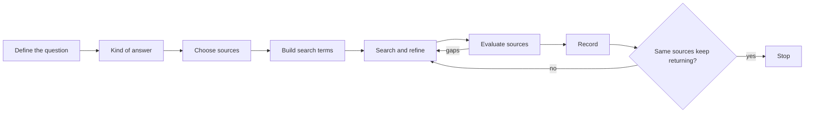

# Search strategy

## Summary

A search strategy is a deliberate plan for finding information: clarify the question, choose where to look, translate the question into search terms, search, assess what you find and refine. Most people type a few words into one search engine and take the first results. Skilled searchers iterate, use synonyms and specific vocabulary, switch sources when the general web is the wrong place, and keep track of what they have found. Information foraging theory explains why: people follow the "scent" of promising links and should leave a source when the expected gain drops. Good strategy saves time and, more importantly, reduces the chance of building a conclusion on a weak or misleading source.

## Prerequisites

None. This note is the entry point to [online research](README.md).

## Core concepts

### Definition

A *search strategy* is a structured approach to finding information that answers a defined question. It includes the formulation of the question, the selection of sources, the choice of search terms and operators, the evaluation of results and the decision when to stop. *Online research* is the skill of using internet sources to answer questions reliably.

*Analogy.* Searching is like looking for a specific book in a city with many libraries. A beginner walks into the nearest library and takes the first book with a matching word in the title. A skilled researcher first decides exactly what they need, knows which library holds that kind of book (a law library, a newspaper archive), uses the catalog properly, checks the author and edition, and goes to another library when the first one has nothing good. The analogy breaks because online, many "books" are written to look authoritative and to appear first, so the selection step matters even more than in a real library.

### Information foraging

Peter Pirolli and Stuart Card (1999) described *information foraging theory*: people search for information the way animals forage for food, following cues ("information scent") that suggest valuable content nearby and leaving a "patch" (a site, a set of results) when the expected gain from staying falls below the gain from moving elsewhere. Practical lessons:

- Strong cues (descriptive titles, clear snippets) guide better choices, so read results carefully before clicking.
- Recognize when a source is exhausted and switch.
- The cost of switching is low online, so do not cling to a poor source.

### The research process

1. **Define the question.** Turn a vague interest into a specific question. "Is intermittent fasting good?" becomes "In adults with overweight, does time-restricted eating lead to more weight loss than ordinary calorie restriction over at least 12 weeks?"
2. **Decide what kind of answer you need.** A fact, a definition, statistics, expert consensus, primary research, a legal text, an opinion, a product comparison.
3. **Choose sources** that hold that kind of answer (see [specialized sources](specialized-sources.md)): a general search engine, a scholarly database, an official statistics office, a legal database, a news archive.
4. **Build search terms:** key concepts, synonyms, specific terms the experts use, and terms in other languages if relevant.
5. **Search and refine** with operators and filters (see [search operators](search-operators.md)).
6. **Evaluate sources** before relying on them (see [source evaluation](source-evaluation.md)).
7. **Record** what you found, where and when.
8. **Stop** when new searches return the same sources and answers, or when the answer is good enough for the decision.

The research process. Evaluation can send you back to refine the search, and the stop rule ends the loop.



### Building search terms

- **Identify concepts:** split the question into two to four core concepts.
- **Synonyms and variants:** "time-restricted eating", "intermittent fasting", "16:8 diet".
- **Expert vocabulary:** professionals use specific terms. Find them in the first good source and reuse them.
- **Narrowing:** add a concept, use exact phrases, filter by date or site.
- **Broadening:** remove a concept, use synonyms joined with `OR`.

*Boolean logic* combines terms with AND (all terms), OR (any term) and NOT (exclude). Search engines apply AND by default between words. Scholarly databases support full Boolean syntax with parentheses, for example:

```text
("time-restricted eating" OR "intermittent fasting") AND (weight OR "body mass") AND (randomized OR trial)
```

### Recording

Keep a simple log for important research: question, date, sources searched, search terms, key sources found with links and why they are relevant. It makes the work reproducible, lets you return to sources, and shows gaps. For citations, a reference manager (for example Zotero) stores sources and creates bibliographies.

### When to stop

Research has diminishing returns. Stop when:

- several independent good sources agree, and new searches return them again,
- the remaining uncertainty would not change the decision,
- the time cost exceeds the value of more certainty.

If sources disagree, record the disagreement instead of picking the answer you prefer.

## Worked example

Question from a shop owner: "Do I need to register for VAT in Germany if I sell to German consumers from Poland?"

1. **Define:** "For a Polish seller of goods to consumers in Germany in 2026, when is German VAT due and how is it declared?"
2. **Answer type:** current law and official guidance.
3. **Sources:** official EU and national tax authority pages first, then professional commentary.
4. **Terms:** "distance sales EU VAT threshold", "OSS one-stop shop", "10 000 euro threshold", in Polish "sprzedaż wysyłkowa wewnątrzwspólnotowa OSS".
5. **Search:** `OSS distance sales threshold site:europa.eu`, then `sprzedaż wysyłkowa OSS site:gov.pl`.
6. **Evaluate:** official pages from the European Commission and the Polish tax administration, dated, consistent with each other. A blog post with outdated thresholds from 2020 is discarded.
7. **Answer:** since July 2021, once total EU cross-border sales to consumers exceed 10,000 euros a year, VAT is due in the customer's country, and the seller can declare it through OSS in Poland (see [e-commerce law and cross-border](../e-commerce/e-commerce-law-and-cross-border.md#vat-on-cross-border-sales)).
8. **Record:** sources, dates checked, and a note to confirm with an accountant before acting.

## Trade offs and when to use it

- **Quick lookup versus research.** Simple facts need one good source. Decisions with money, health or legal consequences need a strategy and several sources.
- **General web versus specialized sources.** The web is broad and noisy. Specialized databases are narrower and more reliable for their domain.
- **Breadth versus depth.** Read a few strong sources fully rather than many weak ones partially.

## Common mistakes

- **Searching before defining the question.** Fix: write the question first.
- **Using only everyday words.** Fix: learn and use the experts' terms.
- **Stopping at the first answer.** Fix: check that independent sources agree.
- **Searching only in one language or one engine.** Fix: switch sources and languages when relevant.
- **Not recording sources.** Fix: keep a log for important research.

## Practice

1. Rewrite a vague question you recently had into a specific, answerable question.
2. Explain information foraging theory and one lesson it gives for searching.
3. Build a Boolean query with synonyms for a topic you are researching.
4. Decide which kind of source would best answer: a population statistic, a court decision, the side effects of a medicine, and a product's current price.

## Further reading

- Pirolli, P., & Card, S. (1999). Information foraging. *Psychological Review*, 106(4), 643-675. [doi:10.1037/0033-295X.106.4.643](https://doi.org/10.1037/0033-295X.106.4.643). The theory of information foraging.
- Association of College and Research Libraries (2015). Framework for Information Literacy for Higher Education. [ala.org](https://www.ala.org/acrl/standards/ilframework). A framework for research as inquiry and searching as strategic exploration.
- Zotero. [zotero.org](https://www.zotero.org/). A free reference manager.
