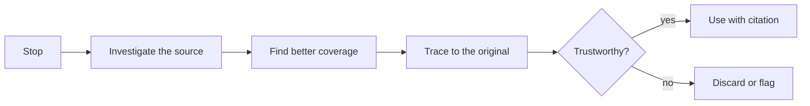

# Source evaluation

## Summary

Source evaluation is judging whether a piece of information can be trusted and how much weight it deserves. Studies of professional fact checkers show that the most efficient method is lateral reading: leave an unfamiliar site quickly and check what independent sources say about it, instead of studying the site itself. Checklists such as CRAAP (currency, relevance, authority, accuracy, purpose) help name the criteria but encourage reading vertically and can be fooled by professional-looking sites. A practical approach combines lateral reading (the SIFT moves), tracing claims to their original source, and judging the type and strength of evidence.

## Prerequisites

[Search strategy](search-strategy.md).

## Core concepts

### Definition

*Source evaluation* is the assessment of the reliability, relevance and bias of an information source, and of the strength of the evidence it presents. Related terms:

- *Primary source:* original material (a study, a dataset, a law, a document, a first-hand account).
- *Secondary source:* an interpretation or summary of primary sources (a news article about a study, a textbook).
- *Tertiary source:* collections of secondary sources (encyclopedias, guides).

*Analogy.* Evaluating a source is like checking a stranger who knocks on your door saying they are from the gas company. Studying their uniform and badge closely (vertical reading) is what a fraudster expects you to do, and a good fake passes. Calling the gas company to ask whether they sent someone (lateral reading) takes a minute and is far more reliable. The analogy breaks because online the "company" you call can also be fake, so you need sources that are independent of each other and have a track record.

### Vertical and lateral reading

- *Vertical reading* judges a site by reading it: the About page, the design, the logos, the references it lists.
- *Lateral reading* leaves the site soon after arriving and opens new tabs to see what other, independent sources say about the site, the author and the claim.

In the study by Wineburg and McGrew (2019), 10 professional fact checkers, 10 PhD historians and 25 Stanford University undergraduates evaluated live websites on social and political topics. The fact checkers read laterally and reached more warranted conclusions in a fraction of the time. Historians and students mostly read vertically and were often misled by professional design, official-sounding names, logos and domains.

### SIFT

Mike Caulfield's *SIFT* method turns lateral reading into four moves:

1. **Stop.** Before reading deeply or sharing, ask whether you know the source and what you want from it.
2. **Investigate the source.** Search for who is behind it, outside the site itself (for example a Wikipedia article or news reports about the organization).
3. **Find better coverage.** Look for trusted reporting or analysis of the same claim, and ignore the original if better sources exist.
4. **Trace claims, quotes and media to the original context.** Follow statistics, quotes and images back to where they first appeared, and check whether they are represented accurately.

Vertical reading stays on the page. Lateral reading, the core of SIFT, leaves it to check the source elsewhere first.

### CRAAP and its limits

The *CRAAP test*, created by Sarah Blakeslee and colleagues at California State University, Chico in 2004, asks about:

- **Currency:** when was it published or updated?
- **Relevance:** does it answer my question?
- **Authority:** who is the author or publisher, and what are their qualifications?
- **Accuracy:** is it supported by evidence, and can it be verified?
- **Purpose:** why does it exist: to inform, sell, persuade, entertain?

The criteria are useful. The criticism, supported by the Wineburg and McGrew findings, is that checklists are applied by looking at the site itself, which a well-made misleading site can satisfy. Use the criteria, but answer them laterally.

### Strength of evidence

Not all sources are equal even when honest:

| Type | Typical strength | Caution |
| --- | --- | --- |
| Systematic reviews and meta-analyses | Strongest for research questions | Quality depends on included studies |
| Randomized controlled trials | Strong for causal claims | Single trials can be wrong or unrepresentative |
| Observational studies | Show associations | Confounding, not proof of causation |
| Official statistics | Strong for counts and trends | Definitions and methods matter |
| Expert opinion and guidelines | Useful synthesis | Can lag behind evidence or reflect interests |
| News reports | Fast, accessible | Often simplify or overstate findings |
| Anecdotes, testimonials | Show what is possible | Not evidence of what is typical |
| Anonymous claims, viral posts | Weakest | Verify before use |

This library's [GUIDELINE](../../../../GUIDELINE.md#8-sources-references-and-verification) applies the same principle: prefer primary sources, cite what you use, separate fact from opinion.

### Red flags

- No identifiable author or organization.
- Claims that sound too good or too alarming, with no source.
- Statistics without a source, date or method.
- Screenshots of documents or posts without a link to the original.
- Strong emotional language and calls to share urgently.
- Domains imitating known organizations.
- The only sources are the site's own other pages.

### Bias and interest

Every source has a perspective. A company's study of its own product, a lobby group's report or an advocacy site may still be accurate, but their interest is a reason to look for independent confirmation. Distinguish *bias* (a systematic slant) from *error* (getting facts wrong).

## Worked example

A viral post claims: "A study shows that working four days a week increases productivity by 40%."

1. **Stop:** strong, round number, no link to the study.
2. **Investigate the source:** the post is from an account selling productivity courses.
3. **Find better coverage:** searching for `"four-day week" productivity study` finds news reports of a 2019 trial at Microsoft Japan that reported a large rise in sales per employee, and reports of larger multi-company trials in the UK and elsewhere with different measures.
4. **Trace the claim:** the 40% figure comes from a company press release about one month-long trial in one subsidiary, measuring sales per employee, not productivity in general. Larger trials reported outcomes such as well-being and retention, with mixed and harder-to-measure productivity effects.
5. **Conclusion:** the claim generalizes one short, company-reported trial to all work. A fair summary: "Some trials report benefits, the strongest evidence concerns well-being and retention, and productivity effects vary by context."

The details of the trials are given as they were widely reported. A real evaluation would read the original reports.

## Trade offs and when to use it

- **Effort versus stakes.** A quick check is enough for low-stakes facts. Health, money, legal and public claims need careful evaluation.
- **Lateral reading versus deep reading.** Use lateral reading to decide whether a source deserves deep reading.
- **Trust in institutions.** Established sources make mistakes, and new sources can be right. Track records matter more than labels.

## Common mistakes

- **Judging a site by its design.** Fix: read laterally.
- **Stopping at a secondary report.** Fix: trace to the original.
- **Treating one study as settled.** Fix: look for reviews and replications.
- **Only searching for confirming sources.** Fix: search for the strongest counterargument.
- **Confusing a source's bias with falsity.** Fix: check the facts independently.

## Practice

1. What is the difference between vertical and lateral reading, and what did Wineburg and McGrew (2019) find?
2. Apply the four SIFT moves to a claim you saw this week.
3. Why can a checklist like CRAAP be fooled by a misleading site?
4. Rank five sources on a health question by strength of evidence and explain your ranking.

## Further reading

- Wineburg, S., & McGrew, S. (2019). Lateral reading and the nature of expertise: Reading less and learning more when evaluating digital information. *Teachers College Record*, 121(11), 1-40. [doi:10.1177/016146811912101102](https://doi.org/10.1177/016146811912101102). The fact checker study.
- Caulfield, M. (2019). SIFT (The Four Moves). [hapgood.us](https://hapgood.us/2019/06/19/sift-the-four-moves/). The SIFT method.
- Blakeslee, S. (2004). The CRAAP test. *LOEX Quarterly*, 31(3). The original checklist.
- Association of College and Research Libraries (2015). Framework for Information Literacy for Higher Education. [ala.org](https://www.ala.org/acrl/standards/ilframework). "Authority is constructed and contextual."

TODO: Read the original reports on the Microsoft Japan trial and the UK four-day week pilot before using the example elsewhere. Confirm the URL and date of the SIFT post.
