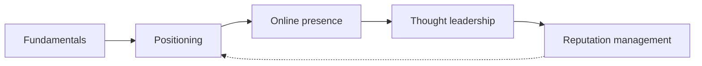

# Personal branding

Deliberately shaping what a professional is known for, by whom, and why they can be trusted: positioning, online presence, thought leadership and reputation. This skill belongs to [Hard skills](../README.md).

## Notes in reading order

1. [Personal branding fundamentals](personal-branding-fundamentals.md): definitions, impression management research, components of a personal brand, authenticity and the employer relationship.
2. [Positioning](positioning.md): what to be known for and for whom, ways to differentiate, the positioning statement and testing it.
3. [Online presence](online-presence.md): profiles, a personal website, consistency, auditing what people find, privacy.
4. [Thought leadership](thought-leadership.md): original insight, channels, building visibility and credibility.
5. [Reputation management](reputation-management.md): monitoring, responding to criticism, fake reviews, legal tools including the right to be forgotten.

## Map of the skill

Each note builds on the one before it, from deciding what to be known for to protecting that reputation.

## How to learn it

Read notes 1 and 2 and write a positioning statement. Audit your presence with note 3 and fix the basics. Then publish regularly with note 4 and set up monitoring with note 5. Career-specific material is in [professional profile](../../../career/job-search/professional-profile.md) and [networking](../../../career/job-search/networking.md).

## Navigation

- Back to [Hard skills](../README.md).
