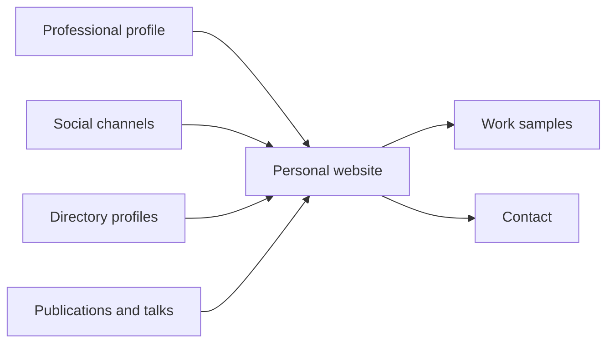

# Online presence

## Summary

Your online presence is everything people find when they look you up: search results for your name, profiles on professional and social platforms, a personal website, published work, and what others write about you. Recruiters, clients and colleagues routinely search before meeting someone, so this presence is often the first impression. A good presence is consistent across channels, shows evidence of your work, makes it easy to contact you, and is deliberately limited in what personal information it exposes. The core is usually a professional profile, a simple personal website or portfolio you control, and a few channels where your audience actually is.

## Prerequisites

[Personal branding fundamentals](personal-branding-fundamentals.md) and [positioning](positioning.md). The profile itself is covered in [professional profile](../../../career/job-search/professional-profile.md).

## Core concepts

### Definition

*Online presence* is the total of information about a person that others can find on the internet, whether created by the person or by others. A *digital footprint* is the trail of data a person leaves online, including content they did not mean to make public.

*Analogy.* Your online presence is like the shop window and the street around your shop. You control the window (your website and profiles), but passers-by also see the street: the sign of a review website, an old poster from a past event, a comment someone wrote on your door. You cannot control the whole street, but you can make the window clear and attractive and keep it up to date. The analogy breaks because online the street is searchable forever, and a poster from ten years ago can appear next to today's window.

### Why it matters

- People search names before hiring, buying, meeting or partnering.
- Profiles are used as selection material: Roulin and Levashina (2019) found that raters judging LinkedIn profiles agreed with each other on visible skills (such as leadership, communication and planning), extraversion and cognitive ability, and that ratings were stable a year later. Less visible traits, such as conscientiousness or emotional stability, could not be judged well from profiles. Profiles are actively judged, and what they show must be visible.
- For freelancers and consultants, the website and profiles do part of the sales work (see [lead generation](../client-acquisition/lead-generation.md)).

### Core elements

| Element | Purpose | Notes |
| --- | --- | --- |
| Professional profile (for example LinkedIn) | Searchable summary of experience and network | See [professional profile](../../../career/job-search/professional-profile.md) and [LinkedIn for professionals](../social-media/linkedin-for-professionals.md) |
| Personal website or portfolio | A home you control, with your work and contact | Own domain, simple, fast, mobile-friendly |
| Work samples | Evidence of competence | Case studies, writing, code repositories, designs (with permission) |
| Selected social channels | Visibility where the audience is | One or two done well |
| Directory and platform profiles | Being found where clients look | Industry directories, freelance platforms, professional bodies |
| Publications and talks | Credibility and search results | Articles, podcasts, conference talks (see [thought leadership](thought-leadership.md)) |

### The personal website

A personal website on your own domain is the only part of the presence you fully control. A simple structure:

1. **Home:** who you help and how, in one sentence (your positioning), with a photo and a clear next step.
2. **Work or case studies:** three to six examples with problem, approach and result.
3. **About:** your story, experience and values, in the first person.
4. **Writing or resources:** optional, for content that shows expertise.
5. **Contact:** a simple way to reach you.

Search engines often show a personal website near the top for searches of a person's name, especially when the name appears in the title and the site is linked from profiles (see [on-page SEO](../search-engine-optimization/on-page-seo.md)).

The personal website at the center of the other elements from the table:

### Consistency

Use the same name form, photo, positioning and key facts across channels. Inconsistent job titles or dates between a website, a profile and a resume look careless and raise doubts.

### Auditing your presence

1. Search your name (in quotes, with and without your city or profession) in a private browser window, on Google and other engines, including images.
2. List what appears on the first two pages.
3. Classify each result: positive, neutral, negative, not you (someone with the same name).
4. Update or remove what you control. Strengthen what helps. For problematic content you do not control, see [reputation management](reputation-management.md).
5. Check privacy settings on social accounts and what is publicly visible.

### Privacy and security

- Do not publish a home address, personal phone number, date of birth or family details unless necessary.
- Separate professional and private accounts, or check what your private accounts show publicly.
- Old content can be taken out of context. Review and archive what no longer represents you.
- Be careful with location data in photos and posts.
- In the EU, you have rights over personal data that others publish about you, within limits (see [reputation management](reputation-management.md#legal-tools)).

## Worked example

An independent translator (Polish and German, legal texts) audits and rebuilds her presence (invented details).

**Audit:** searching her name shows a LinkedIn profile last updated four years ago, an old forum post asking for advice on freelancing, a listing on a translator directory with an old phone number, and a namesake who is a singer.

**Plan:**

1. **Positioning:** "Legal translation Polish and German for law firms and companies".
2. **Website:** own domain with her name, home page with the positioning, three anonymized case studies (contract translation under a tight deadline, a court document set, terminology glossary for a client), a page on her qualifications (sworn translator status), and a contact form.
3. **LinkedIn:** updated headline and about section consistent with the website, link to the website.
4. **Directory:** updated contact details and a link to the website.
5. **Content:** a short article on common errors in translating German contract terms, which appears in search for related queries.
6. **Privacy:** removes the home address from an old invoice template published as an example.

**Result after three months:** her website and profile occupy the top results for her name with her profession, and she receives two inquiries from law firms through the website.

## Trade offs and when to use it

- **Visibility versus privacy.** More presence brings opportunities and exposure.
- **Own website versus platforms only.** Platforms bring audience. A website brings control and permanence. Use both.
- **Breadth versus maintenance.** Each profile needs updating. Fewer, maintained channels are better than many abandoned ones.
- **Personal versus professional.** A human touch builds connection. Oversharing can hurt professionally.

## Common mistakes

- **Never searching your own name.** Fix: audit at least once a year.
- **Abandoned profiles.** Fix: update or close them.
- **No contact path.** Fix: make it easy to reach you.
- **Inconsistent facts across channels.** Fix: one source of truth for dates and titles.
- **Oversharing personal data.** Fix: review what is public.

## Practice

1. Audit your online presence using the five steps and classify the results.
2. Draft the five pages of a personal website for yourself, one sentence each.
3. List personal information you would not want a stranger to find, and check whether it is findable.
4. What did Roulin and Levashina (2019) study, and what does it imply for your profile?

## Further reading

- Roulin, N., & Levashina, J. (2019). LinkedIn as a new selection method: Psychometric properties and assessment approach. *Personnel Psychology*, 72(2), 187-211. [doi:10.1111/peps.12296](https://doi.org/10.1111/peps.12296). Profiles judged in selection.
- Google Search Central. SEO Starter Guide. [developers.google.com](https://developers.google.com/search/docs/fundamentals/seo-starter-guide). Making a personal site findable.
- Regulation (EU) 2016/679 (GDPR). [EUR-Lex](https://eur-lex.europa.eu/eli/reg/2016/679/oj). Rights over personal data.

TODO: Add a dated source on how often recruiters search candidates online.
