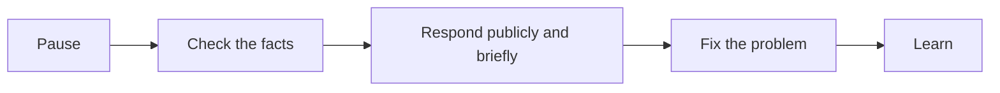

# Reputation management

## Summary

Reputation management is monitoring what is said and shown about you or your business online and offline, strengthening accurate positive information, and responding to inaccurate or damaging content. Most of it is ordinary: keeping profiles and a website current, collecting genuine reviews and recommendations, and responding calmly to criticism. When content is false, defamatory or unlawfully published personal data, legal tools exist: platform reporting, the GDPR right to erasure and its application to search engines after the 2014 Google Spain judgment, and defamation law. Attempts to suppress legitimate criticism, fake reviews and paid "reputation" schemes usually backfire and can be illegal.

## Prerequisites

[Personal branding fundamentals](personal-branding-fundamentals.md) and [online presence](online-presence.md).

## Core concepts

### Definition

*Reputation* is the collective judgment others hold about a person or organization, based on their experience, what they hear and what they read. *Reputation management* is the set of activities to understand, build and protect it. *Online reputation management* (ORM) focuses on search results, reviews and social media.

*Analogy.* A reputation is like a garden that neighbors pass every day. You cannot stop them from talking about it, and one bad season will be remembered. But regular care (results, good relationships), quick action on weeds (responding to problems) and honesty about a bad season make the garden respected over the years. The analogy breaks because online, a single weed can be photographed and shown to people who never saw the garden, so responses must consider audiences far beyond those directly involved.

### Monitoring

- Search your name or business name regularly (see the audit in [online presence](online-presence.md#auditing-your-presence)).
- Set up alerts for your name (for example Google Alerts).
- Watch review platforms relevant to you (Google Business Profile reviews, industry platforms, marketplaces).
- Use social listening for businesses (see [community management](../social-media/community-management.md)).

### Building positive, accurate presence

- Keep your own channels current and consistent.
- Collect genuine recommendations and reviews from satisfied clients (see [referrals and retention](../client-acquisition/referrals-and-retention.md#getting-referrals)). Ask all clients, not only the happiest, so the picture is fair.
- Publish useful work that represents you (see [thought leadership](thought-leadership.md)).

### Responding to criticism

For legitimate criticism (a bad review, a public complaint):

1. **Pause** before responding.
2. **Check the facts.**
3. **Respond publicly, briefly and politely:** acknowledge, apologize where appropriate, explain what you will do, offer a private channel.
4. **Fix the problem** and, if useful, report back.
5. **Learn:** recurring criticism is information.

Do not argue, reveal private details of the person, or threaten. Readers judge the response as much as the complaint.

The response to criticism as a sequence:

### Fake reviews and manipulation

Writing or buying fake positive reviews, or fake negative reviews of competitors, is illegal in the EU under the Unfair Commercial Practices Directive as amended by the Omnibus Directive (2019/2161), and in the US under the FTC rule on consumer reviews and testimonials (16 CFR Part 465, in force since October 2024), which also covers review suppression and fake social media indicators. Platforms remove fake reviews and can penalize accounts. Offering incentives only for positive reviews is also prohibited.

### Legal tools

**Platform reporting.** Most platforms allow reporting of content that breaks their rules (harassment, impersonation, fake reviews, privacy violations). In the EU, the Digital Services Act requires platforms to provide notice and action mechanisms for illegal content and to give reasons for their decisions.

**Right to erasure and search engines.** Under Article 17 of the GDPR, people can ask for personal data to be erased in certain cases, for example when it is no longer necessary or processed unlawfully. In *Google Spain* (Case C-131/12, judgment of 13 May 2014), the Court of Justice of the EU held that search engines can be required to remove links to pages with information about a person that is inadequate, irrelevant or no longer relevant, balancing privacy against the public's interest in the information. This is often called the "right to be forgotten". Search engines provide request forms. Requests about public figures or recent, relevant information are often refused.

**Defamation and personal rights.** False statements of fact that damage reputation can be pursued under national defamation or personal rights law (in Poland, among others, the Civil Code provisions on personal rights). Opinions and true statements are generally protected. Legal action can attract more attention to the content (the *Streisand effect*), so consider it carefully.

This note is educational and is not legal advice.

### Crisis preparation

For professionals and businesses with a public profile: know who to call (lawyer, communications adviser), keep a short statement template, and act quickly with facts when a crisis begins (see [community management](../social-media/community-management.md#crisis-management)).

## Worked example

A physiotherapist finds a one-star review on her clinic's Google profile: "Rude and overpriced. Waited 40 minutes." (invented).

1. **Check facts:** the appointment calendar shows a 35 minute delay that day after an emergency patient. The price was the standard published price.
2. **Public response:** "I am sorry you waited so long on Tuesday. An urgent patient needed immediate care, and we should have told you about the delay and offered to reschedule. We have changed our process so reception now informs patients of delays over 10 minutes. I would like to hear more about your visit, please call me at the clinic."
3. **Private follow-up:** the patient calls, explains they felt rushed in the session. The physiotherapist offers a free follow-up session.
4. **Process change:** delay notifications introduced.
5. **Balance:** the clinic asks all patients (not only satisfied ones) for reviews after their last session, which increases the number of reviews and makes the rating more representative.

## Trade offs and when to use it

- **Responding versus ignoring.** Responding shows care. Responding to trolls feeds them. Respond to legitimate criticism, report abuse.
- **Legal action versus attention.** Legal tools can remove harmful content and can draw more attention to it.
- **Erasure requests** protect privacy and are not a tool to remove legitimate criticism or public interest information.
- **Paid reputation services** may help with monitoring and response, and some use methods that break platform rules or law. Check what they do.

## Common mistakes

- **Not monitoring.** Fix: set up alerts and regular audits.
- **Defensive public replies.** Fix: acknowledge, act, take it private.
- **Fake or incentivized positive reviews.** Fix: ask all clients for honest reviews.
- **Using legal threats against legitimate criticism.** Fix: respond on the merits.
- **Waiting until a crisis to plan.** Fix: prepare contacts and templates.

## Practice

1. Write a public response to a negative review using the five-step approach.
2. What did the Court of Justice decide in Google Spain (C-131/12), and what are the limits of that right?
3. What review practices does the FTC rule (16 CFR Part 465) prohibit?
4. Set up monitoring for your name and list the sources you will check monthly.

## Further reading

- Regulation (EU) 2016/679 (GDPR), Article 17. [EUR-Lex](https://eur-lex.europa.eu/eli/reg/2016/679/oj). The right to erasure.
- Court of Justice of the European Union (2014). Judgment in Case C-131/12, Google Spain and Google. [curia.europa.eu](https://curia.europa.eu/juris/liste.jsf?num=C-131/12). The search engine delisting ruling.
- Federal Trade Commission. Trade regulation rule on the use of consumer reviews and testimonials (16 CFR Part 465). [ftc.gov](https://www.ftc.gov/legal-library/browse/rules/rule-use-consumer-reviews-testimonials). The US ban on fake reviews.
- Directive (EU) 2019/2161 (Omnibus Directive). [EUR-Lex](https://eur-lex.europa.eu/eli/dir/2019/2161/oj). EU rules on fake reviews.
- Regulation (EU) 2022/2065 (Digital Services Act). [EUR-Lex](https://eur-lex.europa.eu/eli/reg/2022/2065/oj). Notice and action on platforms.

TODO: Confirm the URL of the FTC rule page and the CURIA search link.
