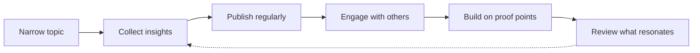

# Thought leadership

## Summary

Thought leadership means becoming a recognized source of useful ideas in a field by publishing original insight: analysis, data, frameworks, lessons from practice and a clear point of view. For a professional it is the most visible part of a personal brand, and for a business it builds trust with buyers before any sales conversation. What separates it from ordinary content is originality and substance: it says something others have not said, backed by experience or evidence, and it is useful to the audience. Speaking, writing, podcasts and newsletters are the main channels. The risk is self-declared "thought leaders" who repeat common wisdom, which damages credibility rather than building it.

## Prerequisites

[Personal branding fundamentals](personal-branding-fundamentals.md), [positioning](positioning.md) and [content marketing fundamentals](../content-marketing/content-marketing-fundamentals.md).

## Core concepts

### Definition

*Thought leadership* is content and activity that offers original, expert insight on a topic, so that the author becomes a trusted reference for an audience. It is earned, not claimed: an audience grants it when ideas prove useful.

*Analogy.* A thought leader is like the experienced hiker on a trail forum whose route descriptions everyone trusts. They did not announce themselves as experts. Over years they posted precise, honest reports, including when a route was worse than expected, and others started asking them before planning a trip. The analogy breaks because online visibility can be bought or gamed in the short term, so the audience increasingly looks for signs of real experience and evidence before trusting.

### What makes content thought leadership

| Ordinary content | Thought leadership |
| --- | --- |
| Summarizes what others say | Adds a new insight, data or perspective |
| Generic advice ("communicate clearly") | Specific, sometimes counterintuitive lessons with reasons |
| No position | A clear point of view, open to debate |
| No evidence | Experience, data, cases, sources |
| Promotes the author | Serves the audience's decisions |

### Sources of original insight

- **First-hand experience:** projects, mistakes, results (anonymized where needed).
- **Original data:** surveys, analyses of your own data, experiments.
- **Synthesis:** connecting research and practice in a way others have not, with sources.
- **Frameworks:** a clear model that helps people decide (for example a checklist or decision tree), tested in practice.
- **Contrarian views** grounded in evidence: explaining why a common practice fails in some conditions.

### Channels

| Channel | Strength | Effort |
| --- | --- | --- |
| Articles and newsletters | Depth, searchable, owned audience (see [email marketing](../content-marketing/email-marketing.md)) | Medium |
| LinkedIn and other social posts | Reach in a professional audience (see [LinkedIn for professionals](../social-media/linkedin-for-professionals.md)) | Low to medium |
| Conference talks and webinars | Credibility, direct contact, recordings | High preparation |
| Podcasts (own or as guest) | Long attention, relationships with hosts | Medium |
| Reports and white papers | Authority, press and links (see [link building](../search-engine-optimization/link-building.md)) | High |
| Books | Strongest credential in some fields | Very high |
| Teaching | Deep credibility, feedback | Medium to high |

### From expertise to visibility

1. **Choose a narrow topic** within your positioning where you have real experience.
2. **Collect insights** in a notebook as you work: questions clients ask, mistakes you see, results that surprised you.
3. **Publish regularly** in one main channel, using a format you can sustain.
4. **Engage** with others' ideas: comment, cite, disagree respectfully.
5. **Build on proof points:** a talk leads to an article, an article leads to an invitation, a report leads to press.
6. **Review** what resonates and deepen it.

The path from expertise to visibility is a loop. Each proof point leads to the next opportunity.

### Credibility and ethics

- **Cite sources** and distinguish data from opinion (see the library's [GUIDELINE](../../../../GUIDELINE.md#8-sources-references-and-verification) for the same principle).
- **Disclose interests** (employer, clients, sponsors) when writing about products or vendors.
- **Admit uncertainty** and update views publicly when evidence changes.
- **Respect confidentiality** of clients and employers.
- **Avoid plagiarism** and disclose substantial use of AI tools where it matters to the audience.

## Worked example

An HR manager in a manufacturing company wants to become known for reducing turnover among production workers (invented details).

1. **Topic:** retention of shift workers in manufacturing.
2. **Original insight:** analysis of exit interview data from her plant over three years shows that most departures happen in the first 90 days and are linked to shift scheduling, not pay.
3. **First piece:** an article "Why new shift workers leave in 90 days, and it is not the pay", with anonymized data, the method, limitations and three changes her plant made.
4. **Channels:** published on LinkedIn and in an HR trade magazine, turned into a talk at a regional HR conference.
5. **Follow-up:** a short guide to analyzing exit interviews, shared in her newsletter.
6. **Outcome after a year:** invitations to two conferences, contact from other plants, an offer to consult part-time.

The example states method and limitations, which is part of what makes the insight credible.

## Trade offs and when to use it

- **Time and consistency.** Thought leadership takes months to years. It suits people with a long-term focus on a field.
- **Originality versus confidentiality.** The best insights often come from work you cannot share fully. Anonymize and generalize.
- **Bold views versus risk.** A clear position attracts attention and criticism. Keep it grounded in evidence.
- **Personal versus company platform.** Publishing under your name builds your brand. Publishing for the employer builds the company's. Agree the arrangement.

## Common mistakes

- **Repeating common wisdom.** Fix: say something you learned that others have not said.
- **No evidence.** Fix: show data, cases or sources.
- **Too broad.** Fix: own a narrow topic first.
- **Irregular publishing.** Fix: choose a sustainable rhythm.
- **Self-promotion disguised as insight.** Fix: serve the audience's decisions first.

## Practice

1. Explain the difference between content marketing and thought leadership in two sentences.
2. List three original insights you could share from your work, with the evidence behind each.
3. Choose one channel and plan six months of publishing.
4. Rewrite a generic piece of advice from your field into a specific, evidence-based lesson.

## Further reading

- Gorbatov, S., Khapova, S. N., & Lysova, E. I. (2018). Personal branding: Interdisciplinary systematic review and research agenda. *Frontiers in Psychology*, 9, 2238. [doi:10.3389/fpsyg.2018.02238](https://doi.org/10.3389/fpsyg.2018.02238). Visibility and expertise in personal branding research.
- Content Marketing Institute. What is content marketing? [contentmarketinginstitute.com](https://contentmarketinginstitute.com/what-is-content-marketing/). The broader context of content.

TODO: Add research on the effects of thought leadership on B2B buyers, with a method and date (much available material comes from vendor surveys).
