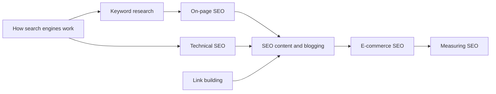

# Search engine optimization

Making pages easy for search engines to find, understand and rank, so that people reach them without paid ads. This skill belongs to [Hard skills](../README.md). The notes draw on Google's documentation and on research.

## Notes in reading order

1. [How search engines work](how-search-engines-work.md): crawling, indexing and ranking, the results page, quality guidelines and spam policies.
2. [Keyword research](keyword-research.md): search intent, volume, competition, long tail, topic clusters and the keyword map.
3. [On-page SEO](on-page-seo.md): content, titles, meta descriptions, headings, URLs, images, internal links and structured data.
4. [Technical SEO](technical-seo.md): crawling and indexing control, status codes, JavaScript, mobile-first indexing and Core Web Vitals.
5. [Link building](link-building.md): PageRank, valuable links, link attributes, link schemes and ways to earn links.
6. [SEO content and blogging](seo-content-and-blogging.md): topic selection, pillar pages, maintenance and AI-generated content.
7. [E-commerce SEO](e-commerce-seo.md): category and product pages, faceted navigation and structured product data.
8. [Measuring SEO](measuring-seo.md): Search Console, organic conversions, volatility and testing SEO changes.

## Map of the skill

The notes follow the path of a page through search: the engine finds it, the page matches a query, and the result is measured.

## How to learn it

Read note 1, then audit a site you can access in Google Search Console with notes 3 and 4. Do keyword research (note 2) for one topic cluster and write or improve its pages (note 6). Use notes 7 and 8 when working on a shop and when reporting results. Searching as a user, rather than optimizing for search, is in [online research](../online-research/README.md).

## Navigation

- Back to [Hard skills](../README.md).
