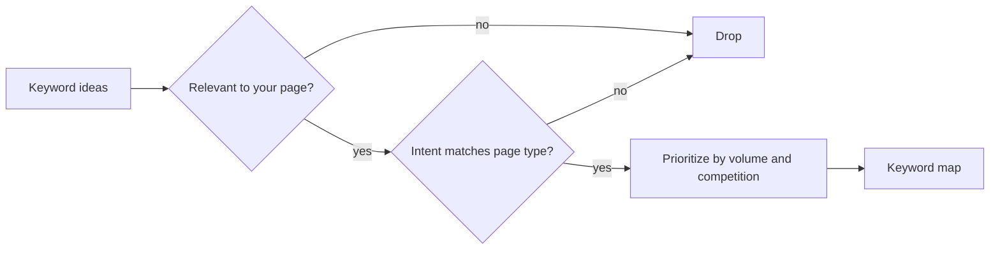
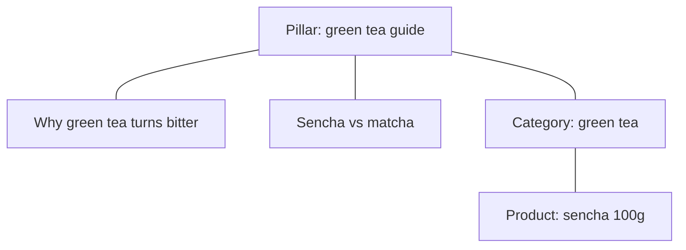

# Keyword research

## Summary

Keyword research is finding the words people type into search engines when they look for what you offer, and deciding which of those queries a site should target with which page. Four factors drive the decision: search volume, competition, relevance and search intent, and intent matters most, because a page that does not match what the searcher wants rarely ranks. Good research starts from customer language, expands it with tools and autocomplete, groups related queries into topics, and checks the actual results page for each target. Volume figures from tools are estimates, often very rough ones.

## Prerequisites

[How search engines work](how-search-engines-work.md). [Customer research](../copywriting/customer-research.md) is a useful source of seed terms.

## Core concepts

### Definition

A *keyword* (or *query*) is a word or phrase a person types or speaks into a search engine. *Keyword research* is the process of discovering the queries relevant to a site, estimating their value and difficulty, and mapping each chosen query to one page. The output is a *keyword map*: a table of target queries, their intent and the page that will serve each.

*Analogy.* Keyword research is like choosing where to open a shop stall in a large market. You want a spot where many people pass (volume), where not every big shop already stands (competition), where people are looking for what you sell (relevance) and where they arrive ready to buy rather than just walking through (intent). The analogy breaks because a market stall has one location, while a website can stand in many "spots" at once, one page per query, as long as each page genuinely fits.

### Search intent

*Search intent* is the goal behind a query. A common classification:

| Intent | The searcher wants to | Example | Page type that tends to rank |
| --- | --- | --- | --- |
| Informational | Learn or solve a problem | "why is my green tea bitter" | Guide, article, video |
| Commercial investigation | Compare options before buying | "best insulated bottle for kids" | Comparison, review, buying guide, category page |
| Transactional | Buy or act now | "buy sencha 100g" | Product or category page |
| Navigational | Reach a specific site | "shopname login" | The site's own page |

The most reliable way to judge intent is to look at the current top results: if they are all product pages, an article will struggle, and vice versa. Take a bridal shop as an example: "ball gown wedding dresses" fits its intent, "work dresses" does not.

### The four factors

1. **Volume.** How many searches per month. Tools such as Google Keyword Planner (free with a Google Ads account, often showing ranges), Ahrefs and Semrush (paid) give estimates. They differ from each other and from reality, and seasonal queries vary through the year.
2. **Competition.** How hard it is to rank. Tools show a *keyword difficulty* score based mostly on the links of top-ranking pages. Check manually: are the top results from very strong sites? Do they answer the query well?
3. **Relevance.** Would your page genuinely satisfy the query? The rule is simple: stick to keywords your products would genuinely satisfy.
4. **Intent.** Does the query show the kind of intent your page can serve?

A query with a lower volume but exact relevance and intent is usually worth more than a large, vague one.

Relevance and intent act as filters, while volume and competition set the priority among the keywords that pass.

### Head and long-tail queries

*Head terms* are short, broad, high-volume queries ("tea"). *Long-tail queries* are longer and more specific ("loose leaf green tea for cold brew"). Individually they have low volume. In a 2023 Backlinko analysis of 306 million keywords from keyword tools, 91.8% of distinct queries were long-tail, but they accounted for only 3.3% of total search volume, because keyword tools miss most rare queries. So long-tail queries are the large majority of distinct searches, while head terms still carry much of the measured volume. Long-tail queries are easier to rank for and often show clearer intent. New sites usually start with long-tail queries.

### Sources of keyword ideas

- **Customer language** from reviews, support emails and interviews.
- **Autocomplete** in Google and Amazon. Amazon's suggestions are product-oriented and include attributes buyers filter by, such as size or price.
- **"People also ask" and related searches** on the Google results page.
- **Competitors' pages** that rank, and tools that show which queries bring them traffic.
- **Google Search Console** for queries your site already appears for.
- **Google Trends** for relative popularity over time and seasonality (see [product validation](../e-commerce/product-validation.md#search-and-trend-data)).

### Related terms and the LSI myth

Many SEO guides recommend "LSI keywords". *Latent semantic indexing* (LSI) is an information retrieval method from the late 1980s. Google's John Mueller stated in 2019 that there is no such thing as LSI keywords in Google. The useful idea behind the advice remains: a thorough page naturally covers the related terms, attributes and sub-questions that searchers care about. For a blender, terms such as "14 speeds", "450 W" and "1.4 l glass jar" that appear across many listings show what buyers compare. Include them because they describe the product, not because of a supposed algorithm.

### Topic clusters and the keyword map

Related queries are grouped into *topics*. One page should serve a cluster of queries with the same intent ("green tea bitter", "why does green tea taste bitter", "green tea too bitter fix"). Two pages targeting the same intent compete with each other, a problem known as *keyword cannibalization*.

A *topic cluster* is a set of pages around one subject: a broad *pillar page* linked to several detailed pages, each linking back. It helps readers and search engines understand the structure (see [SEO content and blogging](seo-content-and-blogging.md)).

A topic cluster on a tea shop example: one pillar page for the broad topic, linked both ways with pages for narrower queries.

### Prioritization

A simple scoring approach for a small site:

- Business value (1 to 3): how close is the query to what you sell?
- Ranking chance (1 to 3): can a page of yours realistically reach the first page?
- Volume (1 to 3): relative within your list.

Multiply or add the scores and start with the top. The weights are a practitioner convention. Adjust them to your situation.

## Worked example

A shop selling loose leaf tea builds a keyword map for its green tea section.

**Seeds** from customer emails: "bitter", "how much tea", "matcha for latte", "sencha".

**Expansion** with autocomplete and Keyword Planner (estimates invented for the example):

| Query | Est. monthly searches | Intent (from SERP) | Top results | Decision |
| --- | --- | --- | --- | --- |
| green tea | 50,000+ | Mixed, mostly informational (health) | Encyclopedias, health sites | Skip, too broad and wrong intent |
| why is my green tea bitter | 900 | Informational | Blogs, tea shops | Target with a guide |
| green tea bitter fix | 300 | Informational | Same as above | Same page as previous |
| matcha for latte | 1,400 | Commercial | Shops, buying guides | Target with a buying guide |
| buy sencha | 500 | Transactional | Shop category pages | Target with the sencha category page |
| sencha vs matcha | 700 | Commercial, comparison | Articles | Target with a comparison article |

**Keyword map.**

| Page | Primary query | Secondary queries |
| --- | --- | --- |
| /guides/green-tea-bitter | why is my green tea bitter | green tea bitter fix, green tea too bitter |
| /guides/matcha-for-latte | matcha for latte | best matcha for latte, latte grade matcha |
| /tea/green/sencha | buy sencha | sencha loose leaf |
| /guides/sencha-vs-matcha | sencha vs matcha | difference sencha matcha |

## Trade offs and when to use it

- **Volume versus intent.** High-volume queries attract visitors who may not buy. Commercial and long-tail queries bring fewer, better visitors.
- **Tool estimates versus reality.** Use tools for relative comparison, then check real data in Search Console after publishing.
- **One page or several.** Combine queries with the same intent. Separate pages only when the intent differs.
- **Research versus doing.** Keyword research can grow endlessly. Map the first 20 to 50 queries, publish, then refine with real data.

## Common mistakes

- **Choosing by volume alone.** Fix: check intent in the actual SERP.
- **Several pages for one intent.** Fix: merge them and redirect.
- **Trusting tool numbers as precise.** Fix: treat them as rough estimates.
- **Writing for keywords instead of readers.** Fix: use the queries to understand needs, then write for people.
- **Never revisiting.** Fix: review Search Console queries every few months.

## Practice

1. Classify the intent of "best running shoes for flat feet", "nike pegasus 41 size 44" and "how to tie running shoes".
2. Why are long-tail queries attractive for a new site?
3. What is keyword cannibalization and how do you fix it?
4. Build a keyword map of five pages for a small business you know.

## Further reading

- Google Ads Help. Use Keyword Planner. [support.google.com](https://support.google.com/google-ads/answer/7337243). The free keyword tool and its estimates.
- Google Search Central. SEO Starter Guide. [developers.google.com](https://developers.google.com/search/docs/fundamentals/seo-starter-guide). Thinking about the words users search for.
- Schwartz, B. (2019). Google: There is no such thing as LSI keywords. Search Engine Roundtable. [seroundtable.com](https://www.seroundtable.com/google-lsi-keywords-27970.html). John Mueller's statement.
- Dean, B. (2023). We analyzed 306M keywords. Backlinko. [backlinko.com](https://backlinko.com/google-keyword-study). Share of long-tail queries in keyword tool data. Vendor data based on keyword tools, not raw search logs.
