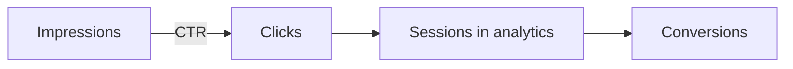
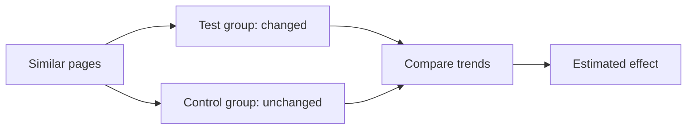

# Measuring SEO

## Summary

Measuring SEO means tracking whether a site is crawled and indexed correctly, how often it appears for target queries, how many searchers click, and what those visitors do afterwards. Google Search Console provides the search side (impressions, clicks, click-through rate and average position per query and page), and web analytics provides the behavior side (engagement and conversions from organic visitors). Rankings fluctuate daily and differ by location and device, so trends over weeks matter more than single positions. Because many things change at once, judging whether a specific SEO change caused a result requires comparison with pages that were not changed.

## Prerequisites

[How search engines work](how-search-engines-work.md) and [measuring content performance](../content-marketing/measuring-content-performance.md).

## Core concepts

### Definition

*SEO measurement* is the collection and interpretation of data about a site's visibility in search results and the value of the resulting traffic. It answers four questions:

1. Can search engines crawl and index the pages that matter? (health)
2. Do the pages appear for the right queries? (visibility)
3. Do searchers click? (attractiveness)
4. Do the visitors do what the business needs? (value)

*Analogy.* Measuring SEO is like running a shop in a large shopping mall. You need to know whether the mall lists your shop in its directory (indexing), how many people walk past your window (impressions), how many come in (clicks) and how many buy (conversions). Counting only how many walk past says little, and counting only sales hides where the problem is. The analogy breaks because the mall changes its floor plan several times a year without telling you, which is what algorithm updates do to rankings.

### Google Search Console

*Google Search Console* is Google's free tool for site owners. Key reports:

- **Performance.** For queries, pages, countries and devices: *impressions* (how often a page appeared in results), *clicks*, *click-through rate* (CTR, clicks divided by impressions) and *average position*. Data is available for about the last 16 months.
- **Page indexing.** How many URLs are indexed and why others are not (for example "Duplicate, Google chose different canonical", "Crawled, currently not indexed", "Excluded by noindex").
- **URL Inspection.** How Google sees a specific URL, including the rendered page and canonical choice.
- **Core Web Vitals** from real-user data.
- **Sitemaps** and **manual actions** (penalties for spam policy violations).

Bing Webmaster Tools provides similar data for Bing.

### Understanding the metrics

- **Impressions** count appearances, even if the result was far down the page and never seen.
- **Average position** is an average over all impressions. A page at position 3 for one query and 40 for another may show an average of 21, which describes neither.
- **CTR** depends strongly on position and on SERP features: an AI summary or ads above the result reduce clicks even if the position is unchanged.
- **Clicks** are the most direct measure of search traffic.

The Search Console metrics form a funnel, while average position describes where impressions happened:

### Organic traffic and conversions in analytics

In web analytics (for example GA4), filter sessions by the channel "Organic Search" and track:

- engaged sessions and engagement rate,
- conversions (key events) such as sign-ups or purchases,
- revenue from organic sessions for shops,
- landing pages: which pages bring organic visitors who convert.

The search side and analytics side do not match exactly. They count different things (clicks versus sessions), and analytics loses visitors who decline tracking consent.

### Rank tracking

Commercial rank trackers check positions for a list of queries daily from chosen locations. They are useful for monitoring competitive queries and detecting sudden drops. Their numbers can differ from Search Console because results are personalized and localized. Use them for trends, not exact positions.

### Algorithm updates and volatility

Google announces some *core updates*, broad changes to ranking systems that roll out over days or weeks, and many smaller changes without announcement. When traffic changes:

1. Check whether it is site-wide or limited to certain pages or queries.
2. Check Search Console for indexing problems or manual actions.
3. Compare the timing with announced updates and with your own changes (redesigns, migrations, content edits).
4. Look at seasonality by comparing with the same period last year.
5. Look at the SERP: did a new feature (AI summary, shopping results) push results down?

### Estimating the effect of SEO changes

SEO changes often coincide with other changes, so before and after comparisons mislead. Better methods:

- **Control groups of pages.** Change a group of similar pages (for example 50 product pages) and compare their trend with a similar group left unchanged.
- **Staggered rollout.** Apply a change to some sections first and others later.
- **SEO split tests** on large sites, using statistical methods designed for page groups rather than users.

These follow the logic of [A/B testing](../copywriting/ab-testing.md), with the difference that the unit of randomization is the page, not the visitor.

A control group comparison isolates the effect of a change from seasonal and algorithm changes that affect all pages:

### Reporting

A monthly SEO report for decision makers:

1. Organic clicks and conversions versus last month and last year.
2. Visibility for target topics (impressions and clicks per cluster).
3. Health: indexing issues, Core Web Vitals, errors.
4. Main changes made and their observed effect.
5. Next actions.

## Worked example

A shop's organic clicks fell 25% in March compared with February.

1. **Seasonality.** Last year, March was 10% lower than February. Seasonal effects explain part of the drop.
2. **Scope.** Search Console shows the drop concentrated in 40 product pages in one category. Other pages are stable.
3. **Indexing.** Page indexing shows those 40 pages now "Duplicate, Google chose different canonical". A theme update in late February added a filter parameter to internal links, creating duplicate URLs, and Google chose parameter URLs as canonical for some products.
4. **Fix.** Restore clean internal links, set canonical tags to the clean URLs, exclude the parameter from crawling.
5. **Verify.** Request reindexing of a sample with URL Inspection. Over four weeks, the pages return to the index under the clean URLs and clicks recover to the seasonal level.

The numbers are invented. The method (seasonality, scope, health, cause, fix, verification) is the point.

## Trade offs and when to use it

- **Daily rankings versus trends.** Daily positions are noisy. Look at weekly and monthly trends.
- **Tool data versus Google data.** Third-party tools estimate. Search Console is closer to reality for your own site but samples and anonymizes rare queries.
- **SEO metrics versus business metrics.** Rankings are a means. Report conversions and revenue alongside visibility.
- **Causality is hard.** Use control groups for important decisions.

## Common mistakes

- **Celebrating impressions.** Fix: look at clicks and conversions.
- **Reading average position as a single ranking.** Fix: analyze by query and page.
- **Panicking at daily fluctuations.** Fix: compare weekly trends and seasonality.
- **Ignoring indexing reports.** Fix: review them monthly.
- **Crediting SEO changes for seasonal gains.** Fix: compare year over year and with control pages.

## Practice

1. Explain why a page can have more impressions and fewer clicks after an algorithm update without losing position.
2. What do the four main metrics in the Search Console Performance report mean?
3. Describe how you would test whether rewriting 50 product descriptions improved organic clicks.
4. Write the five-step diagnosis for a 30% traffic drop on a site you know.

## Further reading

- Google Search Console Help. Performance report (Search results). [support.google.com](https://support.google.com/webmasters/answer/7576553). Definitions of impressions, clicks, CTR and position.
- Google Search Console Help. Page indexing report. [support.google.com](https://support.google.com/webmasters/answer/7440203). Why pages are or are not indexed.
- Google Search Central. Google Search ranking updates. [developers.google.com](https://developers.google.com/search/updates/ranking). The list of announced updates.
