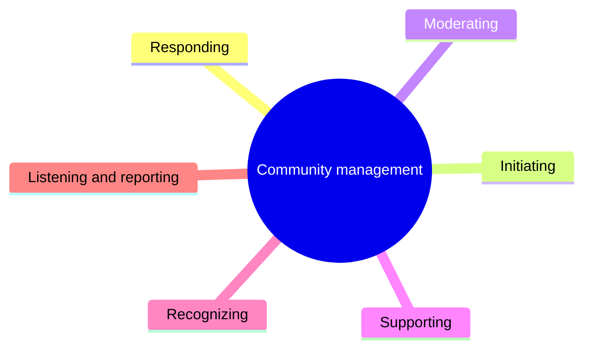
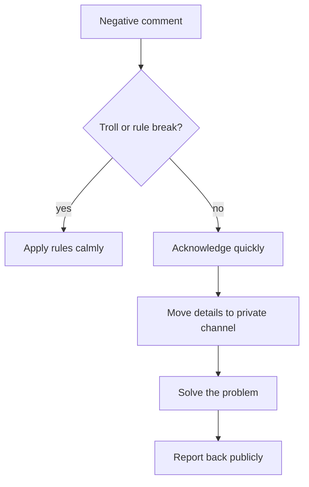

# Community management

## Summary

Community management is the work of building and looking after the relationships around a brand, product or person: replying to comments and messages, starting conversations, moderating, handling complaints and crises in public, and turning engaged members into advocates. It is the "social" part of social media, and the part most often neglected by teams that only publish. Good community management is fast, human, consistent with clear rules, and connected to customer service and product teams. Research on online communities shows that a small share of members create most of the content, so making participation easy and rewarding the active minority matters.

## Prerequisites

[Social media marketing fundamentals](social-media-marketing-fundamentals.md). Service processes are in [customer service and returns](../e-commerce/customer-service-and-returns.md).

## Core concepts

### Definition

A *community* in this context is a group of people who interact with each other and with a brand or person around a shared interest: followers who comment, a Facebook group, a Discord server, a forum, a customer network. *Community management* is the planned activity of growing, engaging, moderating and supporting that group.

*Analogy.* A community manager is like the host of a long-running dinner party. The host welcomes new guests, introduces people who should meet, keeps the conversation going, quietly deals with someone who is rude, and remembers what regular guests care about. Guests come back for the company more than for the food. The analogy breaks because an online community is open to strangers at any hour, and every exchange, including the host's mistakes, can be screenshot and shared beyond the room.

### Types of communities

| Type | Where | Example |
| --- | --- | --- |
| Audience around a brand account | Comments and messages on social platforms | Followers of a shop's Instagram |
| Group or server owned by the brand | Facebook groups, Discord, Slack, own forum | A customer group for a fitness app |
| Communities the brand joins | Existing groups, subreddits, professional forums | A brand expert answering questions in a hobby forum |
| Customer and user communities | Help forums, user groups | Software users helping each other |

### Core activities

1. **Responding:** replying to comments, mentions and messages promptly and personally.
2. **Initiating:** asking questions, running polls, starting discussions, welcoming new members.
3. **Moderating:** applying rules, removing spam and abuse, de-escalating conflicts.
4. **Supporting:** answering product questions or routing them to customer service.
5. **Recognizing:** highlighting helpful members, sharing user content (with permission).
6. **Listening and reporting:** passing insights to product, marketing and service teams.

The six core activities:

### Participation inequality

In many online communities a small share of members create most of the content, while most only read. Jakob Nielsen (2006) summarized this as the "90-9-1 rule": about 90% lurk, 9% contribute occasionally and 1% contribute most of the content. The exact proportions vary and the rule is a heuristic, but skewed participation is consistently observed. Implications:

- Do not judge a community's value only by comments: readers benefit too.
- Make contributing easy (simple questions, polls).
- Recognize and support the most active members, who often answer others' questions.

### Community guidelines

Written *community guidelines* set expectations and make moderation fair. They typically cover:

- the purpose of the community,
- expected behavior (respect, relevance),
- what is not allowed (harassment, hate speech, spam, personal data of others, illegal content),
- how moderation works and what happens on violation,
- how to report problems.

Apply the rules consistently and explain moderation decisions where possible. Platform rules and law also apply. In the EU, platforms must handle notices of illegal content under the Digital Services Act. Communities you run on a platform are subject to its terms.

### Handling negative comments and complaints

A practical approach:

1. **Acknowledge quickly** and without defensiveness.
2. **Move details to a private channel** (message or email) when personal data or account details are involved.
3. **Solve the problem,** then, where appropriate, report back publicly.
4. **Do not delete legitimate criticism.** Deleting it usually makes things worse. Remove only content that breaks the guidelines.
5. **Do not argue with trolls.** Apply the rules calmly.

Handling a negative comment, with the two branches from the list above:

### Crisis management

A *social media crisis* is a rapid surge of negative attention that threatens reputation, for example after a product failure, an offensive post or a viral complaint. Preparation:

- a list of who decides and who speaks,
- approval paths that work within hours,
- holding statements for likely scenarios,
- pausing scheduled posts and ads when a crisis starts.

During a crisis: acknowledge, give facts as they are known, say what you are doing, update regularly, and correct mistakes openly.

### Response targets

Many customers expect replies on social media within hours. Set realistic targets per channel (for example first response within 4 business hours), staff for them, and say on the profile when the team is available.

## Worked example

A brand of running shoes runs a Facebook group of 8,000 customers (invented numbers).

**Situation:** a batch of one model has soles separating after a few weeks. Posts with photos appear in the group and are shared outside it.

**Response:**

1. Within two hours, a pinned post from the community manager: "We have seen your posts about sole separation on the Pace 3, bought in March and April. We are investigating with our factory. If this happened to you, send us a message with your order number and we will replace the shoes. We will update this post by Friday."
2. Each affected member receives a personal reply and a replacement.
3. Scheduled promotional posts and ads for the model are paused.
4. On Friday, an update explains the cause (an adhesive problem in one production batch), the affected batch numbers and the free replacement program.
5. The community manager thanks members who reported the issue and later shares how the factory process was changed.

**Outcome:** complaints peak and fall within a week. Members later recommend the brand in the group because of how the problem was handled. Whether this leaves members more loyal than before is uncertain (see the evidence on the service recovery paradox in [customer service and returns](../e-commerce/customer-service-and-returns.md#the-service-recovery-idea)).

## Trade offs and when to use it

- **Own community versus joining existing ones.** An own group gives control and data, and needs constant effort to stay alive. Existing communities already have members, and you are a guest.
- **Strict versus light moderation.** Strict moderation keeps discussion useful and can feel controlling. Light moderation keeps energy and risks toxicity.
- **Speed versus accuracy in crises.** Respond quickly with what you know, then update.
- **Automation.** Saved replies and bots help scale, and can feel cold. Keep a human tone and an easy path to a person.

## Common mistakes

- **Publishing without replying.** Fix: plan time for responses every day.
- **Deleting criticism.** Fix: respond and solve. Remove only rule violations.
- **No guidelines.** Fix: write them before problems arise.
- **Arguing in public.** Fix: acknowledge, move to private, solve.
- **Ignoring the silent majority.** Fix: remember that most members read without posting.

## Practice

1. List the six core activities of community management.
2. What is participation inequality, and what does it mean for how you run a community?
3. Write community guidelines of no more than ten points for a group you could run.
4. Draft a first response to a viral complaint about a late delivery.

## Further reading

- Nielsen, J. (2006). The 90-9-1 rule for participation inequality in social media and online communities. Nielsen Norman Group. [nngroup.com](https://www.nngroup.com/articles/participation-inequality/). Skewed participation.
- Kraut, R. E., & Resnick, P. (2012). *Building Successful Online Communities: Evidence-Based Social Design*. MIT Press. Research-based design of online communities.
- Regulation (EU) 2022/2065 (Digital Services Act). [EUR-Lex](https://eur-lex.europa.eu/eli/reg/2022/2065/oj). Rules on illegal content and moderation on platforms.

TODO: Add research on customer expectations for social media response times, with a date and method.
