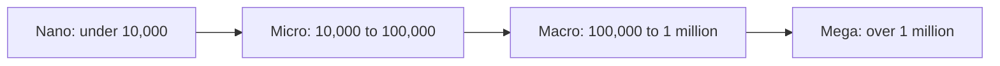

# Influencer marketing

## Summary

Influencer marketing is working with people who have the attention and trust of an audience, called creators or influencers, to reach that audience with a message about a product. It works because recommendations from a familiar person carry more trust than brand ads, and it fails when the fit between creator, audience and product is weak or when the audience feels deceived. The law in the EU and the US requires that paid and other material connections are disclosed clearly, and both brands and creators can be liable. Choosing creators by audience fit and engagement quality, not by follower counts, and agreeing clear terms are the core of the skill.

## Prerequisites

[Social media marketing fundamentals](social-media-marketing-fundamentals.md) and [persuasion principles](../copywriting/persuasion-principles.md) for social proof and liking.

## Core concepts

### Definition

An *influencer* (or *creator*) is a person who has built an audience on one or more platforms and can affect that audience's opinions or purchases. *Influencer marketing* is a collaboration in which a brand provides payment, free products, commission or other benefits in exchange for content or mentions by the creator. Common forms:

- sponsored posts or videos,
- product seeding (sending free products without guaranteed coverage),
- affiliate partnerships (commission per sale through a link or code),
- ambassador programs (longer relationships),
- content licensing (the brand uses the creator's content in its own ads, often called whitelisting or partnership ads).

*Analogy.* Working with an influencer is like being introduced by a mutual friend. A stranger's sales pitch gets polite attention at best. The same product mentioned by a friend whose taste you trust gets a real hearing. The analogy breaks when the friend is secretly paid and does not say so: then the introduction is a deception, and when the audience finds out, it damages both the friend and the product. That is why the law requires disclosure.

### Why it works

The mechanisms are the persuasion principles of liking, social proof and authority (see [persuasion principles](../copywriting/persuasion-principles.md)), together with *parasocial relationships*: the one-sided sense of familiarity viewers develop with media figures they watch regularly, first described by Horton and Wohl (1956). Research on influencer marketing has grown quickly. A systematic review by Vrontis, Makrides, Christofi and Thrassou (2021) covered this literature and identified source credibility, attractiveness, congruence between influencer and brand, and parasocial interaction as recurring drivers of effects.

### Tiers

Practitioners group creators by following, for example nano (under 10,000), micro (10,000 to 100,000), macro (100,000 to 1 million) and mega (over 1 million). The thresholds are conventions and vary. Smaller creators often have more engaged, niche audiences and lower fees. Larger creators give reach and less targeting.

The four tiers in order of following. The thresholds are conventions and vary between practitioners.

### Choosing creators

| Criterion | What to check |
| --- | --- |
| Audience fit | Who follows them (age, country, interests), from audience data the creator shares |
| Content fit | Do they already talk about topics close to your product? Style and values |
| Engagement quality | Real comments and conversations, not just counts. Watch for sudden follower jumps and generic comments that suggest bought followers |
| Credibility | Do they recommend only what they use? Past sponsorships and how the audience reacted |
| Professionalism | Communication, deadlines, ability to share results |
| Safety | Past controversies, content that conflicts with your brand |

### Agreements

A written agreement should cover:

- deliverables (formats, number of posts, platforms, dates),
- creative freedom and approval (brief, key messages, what must not be claimed),
- disclosure obligations,
- payment, commission or product,
- usage rights (can the brand reuse the content in ads, for how long),
- exclusivity (no competitor promotion for a period),
- reporting (reach, clicks, sales, screenshots of statistics).

### Disclosure: the law

**EU.** The Unfair Commercial Practices Directive (2005/29/EC) treats undisclosed commercial content as misleading. Its Annex I lists as always unfair "using editorial content in the media to promote a product where a trader has paid for the promotion without making that clear". The European Commission's guidance and national authorities apply this to influencers. In Poland, the competition and consumer protection authority (UOKiK) published recommendations on labeling advertising content by influencers in 2022. The Audiovisual Media Services Directive also covers some video creators.

**US.** The FTC's Guides Concerning the Use of Endorsements and Testimonials in Advertising (16 CFR Part 255), revised in June 2023, require that any *material connection* between an endorser and a brand (payment, free products, family or employment relationship, affiliate commission) is disclosed *clearly and conspicuously*, meaning difficult to miss and easily understandable by ordinary consumers. Advertisers can be liable for deceptive endorsements even when the endorser is not.

**Practical disclosure:**

- Use clear words such as "Ad", "Advertisement", "Paid partnership with [brand]" or the local equivalent, at the start of the post or video, not hidden among hashtags or behind "more".
- In video, say it and show it.
- Use the platform's paid partnership label, but do not rely on it alone if it is easy to miss.
- Free products count as a material connection.

### Measuring results

- Reach and views of the creator's content,
- engagement and comments (quality, questions about the product),
- clicks on tracked links and use of unique discount codes,
- sales from codes and links,
- content reused in ads and its performance,
- longer-term effects (search interest in the brand, follower growth).

Discount codes undercount, because some buyers search for the brand later without the code. Combine several signals.

## Worked example

A small brand of natural deodorants plans a campaign with micro creators in Poland (invented numbers).

1. **Shortlist:** 20 creators who post about natural cosmetics and sustainable living, 15,000 to 60,000 followers, mostly women 20 to 40 in Poland according to shared statistics.
2. **Screening:** remove 6 with signs of bought followers (sudden jumps, generic comments) and 3 with frequent competitor promotions.
3. **Offer:** free products plus a fee per post and 10% commission through a personal code. Creators may give an honest opinion. The brief lists claims that must not be made (for example "prevents disease").
4. **Disclosure:** each post starts with "Reklama" (advertisement) or uses the platform's paid partnership label plus a spoken mention.
5. **Results after one month:** 11 creators published. Codes generated 380 orders. The brand also saw a rise in search for its name. Two creators' audiences asked many questions about ingredients, which the brand turns into an FAQ.

## Trade offs and when to use it

- **Trust versus control.** Creator content is trusted because it is not the brand's voice. Strict scripts reduce that trust.
- **Reach versus fit.** Large creators bring reach. Niche creators bring relevance and often better results per cost.
- **Short campaigns versus long relationships.** Repeated mentions by a creator are more credible than a single paid post.
- **Brand safety.** A creator's later behavior reflects on the brand. Agreements should include termination conditions.

## Common mistakes

- **Choosing by follower count.** Fix: check audience fit and engagement quality.
- **Hidden or vague disclosure.** Fix: clear labels at the start.
- **Rigid scripts.** Fix: give key messages and let creators speak in their own voice.
- **No usage rights in the contract.** Fix: agree rights before reusing content.
- **Measuring only codes.** Fix: combine codes, links and brand search.

## Practice

1. Name five forms of influencer collaboration.
2. What do the FTC's 2023 revised Endorsement Guides mean by "clear and conspicuous"?
3. Which provision of EU law makes undisclosed paid content always unfair?
4. Write a one page brief for a creator, including disclosure, key messages and forbidden claims.

## Further reading

- Federal Trade Commission. Guides Concerning the Use of Endorsements and Testimonials in Advertising (16 CFR Part 255), revised 2023. [ftc.gov](https://www.ftc.gov/legal-library/browse/federal-register-notices/guides-concerning-use-endorsements-testimonials-advertising). The US rules.
- Federal Trade Commission. Disclosures 101 for social media influencers. [ftc.gov](https://www.ftc.gov/business-guidance/resources/disclosures-101-social-media-influencers). Practical guidance.
- Directive 2005/29/EC on unfair commercial practices, Annex I point 11. [EUR-Lex](https://eur-lex.europa.eu/eli/dir/2005/29/oj). The EU ban on undisclosed paid editorial content.
- UOKiK (26 September 2022). Rekomendacje Prezesa UOKiK dotyczące oznaczania treści reklamowych przez influencerów w mediach społecznościowych. [uokik.gov.pl](https://uokik.gov.pl/). Polish guidance on labeling (in Polish).
- Horton, D., & Wohl, R. R. (1956). Mass communication and para-social interaction. *Psychiatry*, 19(3), 215-229. [doi:10.1080/00332747.1956.11023049](https://doi.org/10.1080/00332747.1956.11023049). The concept of parasocial relationships.
- Vrontis, D., Makrides, A., Christofi, M., & Thrassou, A. (2021). Social media influencer marketing: A systematic review, integrative framework and future research agenda. *International Journal of Consumer Studies*, 45(4), 617-644. [doi:10.1111/ijcs.12647](https://doi.org/10.1111/ijcs.12647). Review of the research.
