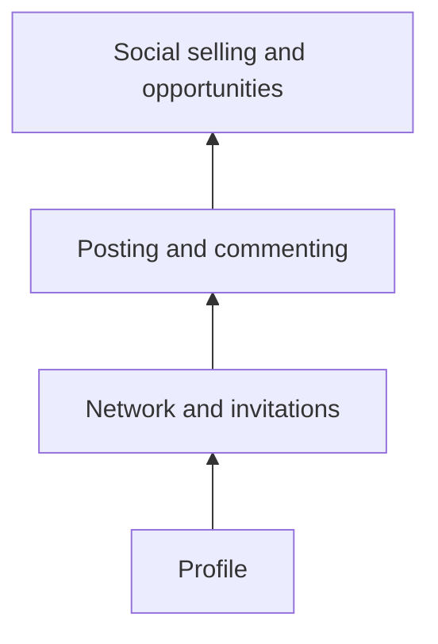

# LinkedIn for professionals

## Summary

LinkedIn is the largest professional social network and works as a public resume, a professional network and a publishing platform at the same time. For individuals it supports job search, networking, client acquisition and building a reputation in a field. For companies it is the main social channel for B2B marketing and employer branding. The profile is the foundation (its home note in this library is [professional profile](../../../career/job-search/professional-profile.md)). On top of it, value comes from posting useful content regularly, engaging thoughtfully with others, and personal outreach that gives a reason to connect. Three mistakes are common: not writing your own summary, a bad photo, and generic invitations.

## Prerequisites

[Professional profile](../../../career/job-search/professional-profile.md) for the profile itself, and [social media marketing fundamentals](social-media-marketing-fundamentals.md).

## Core concepts

### Definition

*LinkedIn* is a social network owned by Microsoft since 2016, focused on professional identity and relationships. LinkedIn states that it has more than one billion members in more than 200 countries and territories, and Microsoft reported about 1.3 billion in 2026 (checked 2026-10 in secondary summaries). Members are registered accounts, not active users. Its main elements:

- **Personal profile:** headline, photo, about section, experience, skills, recommendations.
- **Network:** connections (mutual) and followers (one-way).
- **Feed and posts:** text, images, documents (carousels), video, polls, articles and newsletters.
- **Company pages** and **showcase pages.**
- **Groups,** events and messaging.
- **Jobs** and recruiter tools, **Sales Navigator** for sales prospecting, and **advertising** (see [paid social advertising](paid-social-advertising.md)).

*Analogy.* LinkedIn is like a permanent professional conference. Your profile is your name badge and the short bio in the program. Posting is giving short talks in the hallway. Commenting is joining other people's conversations. Messages are the coffee you suggest after a good discussion. The analogy breaks because a conference ends after three days, while LinkedIn runs continuously and every hallway talk stays searchable.

### Profile basics (summary)

The full treatment is in [professional profile](../../../career/job-search/professional-profile.md). In brief:

- **Headline** that says what you do and for whom, not only a job title.
- **Photo** that is clear, recent and authentic. A bad photo or no photo is a common mistake.
- **About section** written in your own voice, in the first person. Write the summary as your genuine self, because the third person creates distance from the audience.
- **Experience** with results, consistent with your resume.
- **Recommendations** from others, which carry more weight than self-description.

### Networking and invitations

Generic invitations are the third common mistake. A personal note with a reason to connect gets more acceptances and starts a real relationship:

> "Hello Marta, I enjoyed your post on reducing returns in fashion e-commerce. I run a small shop with the same problem and would like to follow your work."

Principles from networking research and practice (see [networking](../../../career/job-search/networking.md)):

- **Give before asking:** share, comment, introduce.
- **Weak ties** (acquaintances) are often the source of new information, such as job openings (Granovetter, 1973). A large-scale experiment on LinkedIn by Rajkumar and colleagues (2022) found that moderately weak ties were the most useful for job mobility.
- **Quality over quantity:** a smaller network of relevant people beats thousands of random connections.

A profile, a network and regular activity work together. Each layer depends on the one below it.

### Posting

Content that tends to work on LinkedIn, according to practitioner experience:

- lessons from your work, with specific details,
- practical how-tos and frameworks for your field,
- short case studies with results (with permission),
- honest reflections on mistakes,
- commentary on news in your field with a clear point of view.

Format tips: a first line that works as a headline, short paragraphs, one idea per post, a question that invites expert replies. Document posts (carousels) and native video are common formats. Links in the main post are believed by many practitioners to reduce reach; LinkedIn has not confirmed a rule.

### Commenting

Thoughtful comments on others' posts are a low-effort way to become visible to their audiences and build relationships. A useful comment adds an example, a question or a different angle, not just "Great post".

### Company pages

Company pages support employer branding, product news and B2B content. Organic reach of company pages is usually lower than that of individuals. Many B2B companies encourage employees and founders to post as themselves (with guidelines on confidentiality).

### Social selling

*Social selling* is using social networks to find, understand and build relationships with potential customers before selling. On LinkedIn it combines a credible profile, content that shows expertise, research on prospects and personal outreach (see [outreach and prospecting](../client-acquisition/outreach-and-prospecting.md)). LinkedIn publishes a "Social Selling Index" for Sales Navigator users. It is LinkedIn's own measure, not an independent one.

### Privacy and confidentiality

- Your profile is public data. Do not publish personal data you do not want strangers to have.
- Do not post confidential information about employers or clients.
- Check privacy settings, including visibility of connections and activity.
- Scraping and automation tools that act on your account can break LinkedIn's terms and lead to restrictions.

## Worked example

A freelance UX designer wants clients among e-commerce companies within six months.

1. **Profile:** headline "UX designer for online shops | I make checkouts people finish". About section in the first person, with two short case studies. Photo updated.
2. **Content:** two posts a week. Pillar topics: checkout mistakes, mobile product pages, before and after redesigns (with client permission), lessons from user testing.
3. **Commenting:** 15 minutes a day on posts by e-commerce managers and founders, adding concrete observations.
4. **Invitations:** 10 personal invitations a week to e-commerce managers who engaged with relevant content, each with a specific reason.
5. **Conversation:** after a few exchanges, offer a free 20 minute checkout review to five companies, with no obligation.
6. **Measure:** profile views from the target industry, connection acceptance rate, conversations started, review calls held, projects won.

All targets and activities are an illustrative plan.

## Trade offs and when to use it

- **Visibility versus time.** Regular posting and commenting take time each week. Choose a sustainable rhythm.
- **Personal brand versus employer.** Visibility helps your career and should respect your employer's policies (see [personal branding fundamentals](../personal-branding/personal-branding-fundamentals.md)).
- **Automation versus authenticity.** Mass automated messages are easy and damage reputation and may break platform terms.
- **LinkedIn versus other channels.** Strong for B2B and professional services, weaker for many consumer products.

## Common mistakes

- **Third-person, generic about section.** Fix: write as yourself, with specifics.
- **Poor or missing photo.** Fix: a clear, recent, authentic photo.
- **Generic invitations.** Fix: one sentence with a real reason.
- **Selling in the first message.** Fix: start a conversation, offer value.
- **Posting only self-promotion.** Fix: teach and share lessons.

## Practice

1. What are the three common mistakes on LinkedIn named in this note, and how do you fix each?
2. Write a connection invitation with a specific reason to someone in your field.
3. Draft a LinkedIn post that teaches one lesson from your work in under 150 words.
4. What did the Rajkumar et al. (2022) experiment find about tie strength and job mobility?

## Further reading

- LinkedIn Help. [linkedin.com/help](https://www.linkedin.com/help/linkedin). Official guidance on profiles, posting and privacy.
- Granovetter, M. S. (1973). The strength of weak ties. *American Journal of Sociology*, 78(6), 1360-1380. [doi:10.1086/225469](https://doi.org/10.1086/225469). Weak ties and information.
- Rajkumar, K., Saint-Jacques, G., Bojinov, I., Brynjolfsson, E., & Aral, S. (2022). A causal test of the strength of weak ties. *Science*, 377(6612), 1304-1310. [doi:10.1126/science.abl4476](https://doi.org/10.1126/science.abl4476). A large experiment on LinkedIn.
- Roulin, N., & Levashina, J. (2019). LinkedIn as a new selection method: Psychometric properties and assessment approach. *Personnel Psychology*, 72(2), 187-211. [doi:10.1111/peps.12296](https://doi.org/10.1111/peps.12296). Profiles as an assessment tool.

TODO: Confirm the 1.3 billion figure in Microsoft's investor materials.
