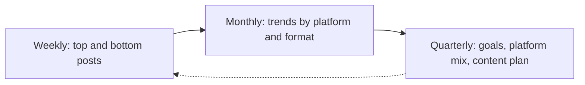

# Social media analytics

## Summary

Social media analytics is measuring what happens with your social content and accounts, and connecting it to goals: how many people saw a post, how they reacted, whether they visited your site and whether they bought or signed up. Platforms report reach, impressions, engagement and audience data, each with their own definitions, and web analytics shows what social visitors do afterwards. Engagement rates can be calculated in several ways, so comparisons are only meaningful with the same formula. Likes and follower counts are easy to collect and often weakly related to business results, so each goal needs its own metric.

## Prerequisites

[Social media marketing fundamentals](social-media-marketing-fundamentals.md) and [measuring content performance](../content-marketing/measuring-content-performance.md).

## Core concepts

### Definition

*Social media analytics* is the collection and interpretation of data about social media activity: performance of posts and ads, audience characteristics, conversations about a brand, and the effect on business outcomes.

*Analogy.* Social media analytics is like the scoreboard and the match statistics in sport. The score (sales, leads) is what counts. Possession, shots and passes (reach, engagement) help explain the score and show what to train, but a team can dominate possession and lose. The analogy breaks because sports statistics use agreed definitions, while each platform defines its numbers differently and changes them over time.

### Core metrics

| Metric | Meaning | Note |
| --- | --- | --- |
| Reach | Number of unique accounts that saw the content | Usually estimated |
| Impressions or views | Number of times content was displayed or played | One person can count several times. Definitions of a video "view" differ by platform |
| Engagements | Likes, comments, shares, saves, clicks | Platforms count different actions |
| Engagement rate | Engagements divided by a base | See below |
| Video retention | Average watch time, completion rate | Key signal for video distribution |
| Link clicks | Clicks to your website | Compare with sessions in web analytics |
| Follower growth | Net new followers | Weak signal on its own |
| Conversions | Sign-ups or purchases from social traffic | Needs tracking on the site |
| Response time | Time to reply to messages and comments | Service quality |
| Sentiment | Share of positive, neutral and negative mentions | Automated sentiment tools make errors with sarcasm and context |

### Engagement rate formulas

Different bases give different numbers:

- by reach: engagements / reach,
- by impressions: engagements / impressions,
- by followers: engagements / followers.

The follower-based rate was common when feeds showed posts mostly to followers. With recommendation feeds, reach-based rates are usually more meaningful. Always state the formula and use the same one when comparing.

### Platform analytics and web analytics

- **Platform analytics** (for example Meta Business Suite, TikTok analytics, LinkedIn page and post analytics, YouTube Studio) show reach, engagement, audience demographics and content performance.
- **Web analytics** shows what visitors from social media do on your site. Tag links with campaign parameters (UTM) so visits are attributed correctly.
- **Social listening tools** track mentions of your brand, competitors and topics across platforms and the web.

Social media often influences purchases that later happen through other channels (search, direct visits). Last-click reports undervalue it. Holdout tests and brand search trends help estimate the effect (see [measuring content performance](../content-marketing/measuring-content-performance.md#incrementality)).

### Matching metrics to goals

| Goal | Primary metric | Supporting |
| --- | --- | --- |
| Awareness | Reach among the target audience | Video views, follower growth, brand search |
| Engagement | Engagement rate (stated formula), comments, saves, shares | Retention |
| Traffic | Link clicks, sessions from social | Engaged sessions |
| Leads and sales | Conversions, cost per conversion | Revenue, conversion rate of social visitors |
| Service | Response time, resolution rate | Sentiment |

### Analysis routine

1. **Weekly:** top and bottom posts by the primary metric, response times.
2. **Monthly:** trends per platform and format, what themes and hooks worked, conversions from social.
3. **Quarterly:** compare with goals, decide on platform mix and content pillars.

Look for patterns across several posts, not single outliers. One viral post says little about what will work next.

The analysis routine on three time scales:

### Pitfalls

- **Vanity metrics:** likes and followers that do not lead to goals.
- **Bought followers and engagement:** inflate numbers, harm real reach, and buying fake indicators of social media influence is prohibited by the FTC rule on consumer reviews and testimonials in the US.
- **Small numbers:** percentages on a few hundred views are noisy.
- **Changing definitions:** platforms change how they count. Note changes when comparing over time.
- **Privacy:** audience data is aggregated. Do not try to identify individuals from analytics.

## Worked example

A bookshop reviews three months of Instagram (invented numbers).

| Format | Posts | Avg reach | Avg engagements | Engagement rate by reach | Link clicks (in bio) |
| --- | --- | --- | --- | --- | --- |
| Reels: "3 books if you liked X" | 12 | 8,400 | 520 | 6.2% | 310 |
| Photo of new arrivals | 18 | 1,100 | 70 | 6.4% | 40 |
| Carousels: staff reviews | 10 | 2,300 | 230 | 10.0% | 95 |

**Interpretation:** carousels have the highest engagement rate, but Reels reach far more people and bring the most clicks. New arrival photos have a decent rate on a small reach and bring few clicks. Web analytics shows 90 orders from Instagram sessions, most after visits from Reels.

**Decision:** keep Reels as the main reach format, turn the best staff reviews into Reels, reduce new arrival photos to stories.

## Trade offs and when to use it

- **Depth versus effort.** A small team can track a few metrics in platform tools. Larger programs justify dashboards and listening tools.
- **Rates versus totals.** Rates help compare posts, totals show impact. Look at both.
- **Platform data versus own data.** Platforms report generously. Your own sales data is the final check.

## Common mistakes

- **Comparing engagement rates with different formulas.** Fix: state and keep one formula.
- **Celebrating followers.** Fix: tie metrics to goals.
- **Untagged links.** Fix: use campaign parameters.
- **Judging by one viral post.** Fix: look at patterns.
- **Ignoring service metrics.** Fix: track response time.

## Practice

1. Calculate engagement rate by reach and by followers for a post with 300 engagements, 6,000 reach and 20,000 followers. Why do they differ so much?
2. Choose a primary metric for each of the five goals in the table.
3. Why does last-click attribution undervalue social media?
4. Review the last ten posts of an account you know and write one conclusion and one decision.

Hints: question 1: 5% by reach, 1.5% by followers.

## Further reading

- Meta Business Help Center. About Meta Business Suite insights. [facebook.com/business/help](https://www.facebook.com/business/help/). Definitions of reach and impressions on Meta platforms.
- LinkedIn Help. LinkedIn page analytics. [linkedin.com/help](https://www.linkedin.com/help/linkedin). Definitions for LinkedIn.
- Federal Trade Commission (2024). Trade regulation rule on the use of consumer reviews and testimonials (16 CFR Part 465). [ftc.gov](https://www.ftc.gov/legal-library/browse/rules/rule-use-consumer-reviews-testimonials). Includes the ban on fake indicators of social media influence.

TODO: Link the specific help pages for each platform's metric definitions, which change often, and confirm the URL of the FTC rule page.
