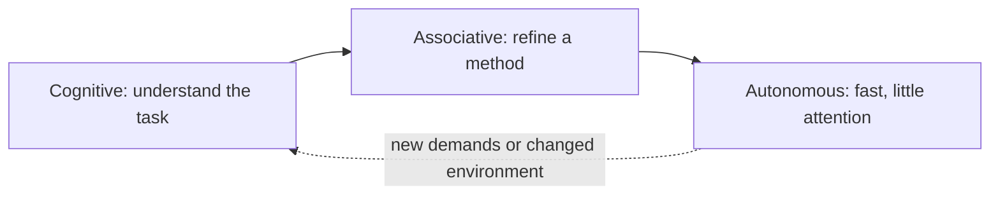
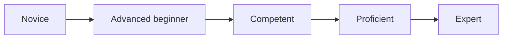

# Skill acquisition

## Summary

Skill acquisition is the process by which slow, effortful, error-prone performance becomes fast, accurate and largely automatic through practice. Classic models describe three stages: a cognitive stage in which you think through each step, an associative stage in which errors drop and steps join together, and an autonomous stage in which the skill runs with little attention. Progress is fastest at the start and slows down, so improvement follows a curve of diminishing returns, and it stops altogether when practice becomes routine without feedback. Knowing these stages helps you choose what to do at each point: understand first, then practice with feedback, then push into harder conditions.

## Prerequisites

[What is a skill](what-is-a-skill.md) for the difference between knowledge and skill.

## Core concepts

### Definition

*Skill acquisition* is the change in a person's capability to perform a task that results from practice and experience and lasts beyond the practice session. The last part is important: performance during practice can be misleading. Psychologists distinguish *performance* (how well you do right now) from *learning* (the relatively permanent change that shows in later retention and transfer tests). Conditions that make practice look smooth, such as repeating the same item many times in a row, can produce good performance today and poor learning tomorrow.

*Analogy.* Learning to drive a car shows the whole process. In the first lesson you think about every movement: mirror, signal, clutch, gear, and you cannot talk at the same time. After some weeks the movements join into sequences and you make fewer mistakes, though you still need to concentrate in traffic. After a year you drive home while talking and barely remember the trip. The analogy holds for the three stages and for the shift of attention. It breaks for cognitive skills that never become fully automatic, such as writing a strategy document, where experts get faster at parts of the task but still need deliberate thought for the whole.

### The three stages of Fitts and Posner

Paul Fitts and Michael Posner (*Human Performance*, 1967) described three overlapping stages:

1. **Cognitive stage.** The learner tries to understand what the task requires. Performance is slow, inconsistent and full of errors. Attention is fully occupied. Instructions, demonstrations and worked examples help most here.
2. **Associative stage.** The learner has a working method and refines it. Errors fall, steps link into larger units, and the learner starts to detect their own mistakes. Practice with specific feedback helps most here.
3. **Autonomous stage.** Performance is fast, consistent and needs little attention, which frees the mind for other things (strategy, the audience, the unusual case). Improvement continues but slowly. Further gains need deliberately harder practice.

The three stages run in order, and attention demand falls at each step.

### Proceduralization in ACT theory

John Anderson's ACT theory (1982) explains the mechanism behind the stages. At first, skill rests on *declarative knowledge*: facts and instructions you hold in working memory and apply step by step, like following a recipe. With practice, these are converted into *procedural knowledge*: condition-action rules ("if the headline has no benefit, add one") that fire directly. Two processes do this:

- *Proceduralization*: a rule no longer needs to be retrieved from memory and interpreted. It is applied directly.
- *Composition*: sequences of rules merge into larger ones, so several steps become one.

The result is faster, less effortful performance. The cost is that procedural knowledge is harder to put into words and harder to change. That is why experts are often poor at explaining what they do, and why unlearning a bad habit is harder than learning a new method.

### The Dreyfus model

Hubert and Stuart Dreyfus (1980, 1986) described five stages from the learner's point of view, based on studies of pilots, chess players and drivers:

| Stage | How the person decides | Example in sales calls |
| --- | --- | --- |
| Novice | Follows context-free rules | Follows a script line by line |
| Advanced beginner | Starts to recognize situational aspects from experience | Notices when a prospect is in a hurry |
| Competent | Chooses a plan and feels responsible for the outcome | Plans the call around a goal and adjusts |
| Proficient | Sees the situation as a whole, still decides analytically | Senses the call is going wrong, thinks about why |
| Expert | Sees and acts intuitively, analyzes only when needed | Responds naturally, steps back only when surprised |

The model is descriptive and has been influential in nursing and professional education (Benner, 1984). It is less tested as a predictive model than the cognitive theories above. Use it to understand why rules help beginners and hinder experts.

The Dreyfus stages, from rule following to intuition:

### The learning curve

Improvement with practice is fast at first and then slows. Across many tasks, the time to complete a task falls roughly as a power or exponential function of the number of practice trials. Newell and Rosenbloom (1981) called this the *power law of practice*. Later analyses of individual learners found that an exponential function often fits individual data better, and that the power law appears when curves are averaged across people (Heathcote, Brown and Mewhort, 2000). For practical purposes the shape is the same: the first hours bring large gains, later hours bring small ones.

Two consequences follow:

- **Early plateaus are rarely the limit.** If progress stops early, the practice method is usually the problem, not talent.
- **Late gains need different practice.** Once a skill is automatic, more of the same repetition adds little. Gains then require harder tasks, specific feedback and attention to weaknesses, which is the core of [deliberate practice](deliberate-practice.md).

### Arrested development

Ericsson (2006) pointed out that most people stop improving once their performance is acceptable, even if they keep doing the task for years. When a skill becomes automatic, you no longer attend to it, so you no longer notice errors or try alternatives. Years of experience then do not equal growing skill. Studies in medicine have found, for example, that physicians with more years in practice do not always perform better and sometimes perform worse on measures of quality of care (Choudhry, Fletcher and Soumerai, 2005). The remedy is to keep some practice effortful and measured.

### Feedback

*Feedback* is information about the result or the quality of an action. Two kinds matter:

- *Knowledge of results* tells you the outcome (the email got a 2% reply rate).
- *Knowledge of performance* tells you about the process (your opening sentence was about you, not the reader).

Feedback helps most when it is specific, timely and focused on the task. It does not always help: in a meta-analysis of 607 effect sizes, Kluger and DeNisi (1996) found that feedback interventions improved performance on average, but in more than a third of cases they reduced it, especially when the feedback drew attention to the person ("you are not a natural writer") instead of the task. In motor learning, very frequent feedback can also create dependence on it, so learners do better when feedback is gradually reduced.

### Variability and specificity of practice

Practice in varied conditions (different products, audiences, formats) usually produces better retention and transfer than repeating one fixed version, even though it feels harder and looks worse during practice. At the same time, practice should resemble the conditions of real use. These two principles are reconciled by varying the surface details while keeping the core task the same.

## Worked example

A marketing assistant wants to learn to write effective cold emails for a B2B service. The plan follows the stages.

**Cognitive stage (week 1 to 2).**

- Read the notes on [outreach and prospecting](hard-skills/client-acquisition/outreach-and-prospecting.md) and [copywriting fundamentals](hard-skills/copywriting/copywriting-fundamentals.md).
- Study 20 real cold emails the team has sent, with their reply rates. Mark what the best ones share.
- Write emails with a checklist open: one reader, one problem, one specific proof, one small request.

**Associative stage (week 3 to 8).**

- Write five emails per day to real prospects, using the checklist less and less.
- Once a week, a senior colleague marks three emails with two specific comments each (knowledge of performance).
- Track reply rates per variant (knowledge of results). Results from fewer than about 100 sends per variant are noisy, so the weekly review focuses on the senior colleague's comments.

**Autonomous stage (month 3 onward).**

- Emails now take 5 minutes instead of 25. The risk is that they become routine and stop improving.
- To keep improving, the assistant picks harder targets (a new industry, a more senior role), writes for them, and asks for feedback only on the new parts.

Numbers in the example are illustrative.

## Trade offs and when to use it

- **Instructions versus discovery.** Beginners learn faster from worked examples and clear instructions. Experts can learn more from open problems. Giving beginners open problems too early overloads them.
- **Fluency during practice versus learning.** Blocked repetition feels efficient but produces weaker retention than mixed and spaced practice (see [learning techniques](learning-techniques.md)).
- **Automaticity versus flexibility.** Automatic skills free attention but resist change. When the environment changes (a new search engine algorithm, a new platform), deliberately bring the skill back into conscious attention.
- **The stage models are simplifications.** Stages overlap, and different parts of one skill can be at different stages.

## Common mistakes

- **Mistaking performance during practice for learning.** Fix: test yourself after a delay, in a new context.
- **Staying with instructions too long.** Fix: once you can perform the steps, practice without the checklist and use it only to review.
- **Stopping at "good enough".** Fix: keep some practice at the edge of your ability, with feedback.
- **Feedback about the person.** Fix: give and request feedback on specific actions and results.

## Practice

1. Name the three stages of Fitts and Posner and the kind of support that helps most at each.
2. What are proceduralization and composition in Anderson's theory?
3. Why can experience without feedback lead to arrested development?
4. According to Kluger and DeNisi (1996), in roughly what share of cases did feedback interventions reduce performance, and what kind of feedback was most risky?
5. Choose a skill you use daily and design one practice task that brings it back from the autonomous stage into conscious attention.

Hints: question 4 concerns attention drawn to the self instead of the task.

## Further reading

- Fitts, P. M., & Posner, M. I. (1967). *Human Performance*. Brooks/Cole. The three-stage model.
- Anderson, J. R. (1982). Acquisition of cognitive skill. *Psychological Review*, 89(4), 369-406. [doi:10.1037/0033-295X.89.4.369](https://doi.org/10.1037/0033-295X.89.4.369). Proceduralization and composition.
- Dreyfus, H. L., & Dreyfus, S. E. (1986). *Mind over Machine*. Free Press. The five-stage model.
- Newell, A., & Rosenbloom, P. S. (1981). Mechanisms of skill acquisition and the law of practice. In J. R. Anderson (Ed.), *Cognitive Skills and Their Acquisition* (pp. 1-55). Erlbaum. The power law of practice.
- Heathcote, A., Brown, S., & Mewhort, D. J. K. (2000). The power law repealed: The case for an exponential law of practice. *Psychonomic Bulletin & Review*, 7(2), 185-207. [doi:10.3758/BF03212979](https://doi.org/10.3758/BF03212979). Why averaged curves look like power functions.
- Kluger, A. N., & DeNisi, A. (1996). The effects of feedback interventions on performance. *Psychological Bulletin*, 119(2), 254-284. [doi:10.1037/0033-2909.119.2.254](https://doi.org/10.1037/0033-2909.119.2.254). When feedback helps and when it hurts.
- Ericsson, K. A. (2006). The influence of experience and deliberate practice on the development of superior expert performance. In K. A. Ericsson et al. (Eds.), *The Cambridge Handbook of Expertise and Expert Performance* (pp. 685-706). Cambridge University Press. Arrested development and automaticity.
- Choudhry, N. K., Fletcher, R. H., & Soumerai, S. B. (2005). Systematic review: The relationship between clinical experience and quality of health care. *Annals of Internal Medicine*, 142(4), 260-273. [doi:10.7326/0003-4819-142-4-200502150-00008](https://doi.org/10.7326/0003-4819-142-4-200502150-00008). Experience does not always mean better performance.
- Benner, P. (1984). *From Novice to Expert*. Addison-Wesley. The Dreyfus model applied to nursing.
