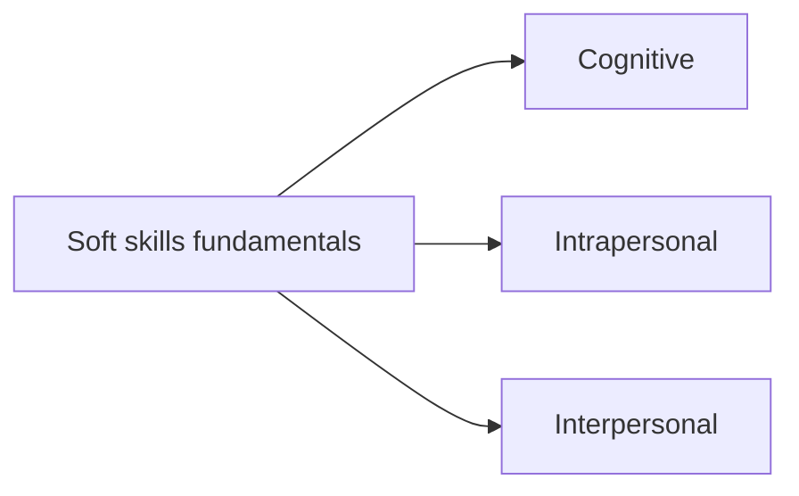

# Soft skills

Transferable skills that govern how a person thinks, manages themselves and works with others, and that apply in almost any role. This subfield belongs to [Skills](../README.md). Notes follow the three domains of the US National Research Council report *Education for Life and Work* (2012): cognitive, intrapersonal and interpersonal (verified against the report's summary, 2026-10).

## Notes in reading order

1. [Soft skills fundamentals](soft-skills-fundamentals.md): definitions, origin of the term, the three domains, relation to personality, evidence of importance, measurement and how soft skills develop.

## Subfields

The subfields follow the three domains of the framework.

- [Cognitive](cognitive/README.md): critical thinking, problem solving, decision making, forecasting, planning, flexibility, memory, metacognition and folk laws.
- [Intrapersonal](intrapersonal/README.md): time management, prioritization, procrastination, attention, flow and deep work.
- [Interpersonal](interpersonal/README.md): communication, listening, nonverbal communication, feedback, negotiation, mediation, trust, leadership, public speaking and storytelling.

## Planned topics

- Cognitive: creativity, reasoning and logic
- Interpersonal: teamwork, conflict management, empathy
- Intrapersonal: work ethic, balance and self-care

Related notes elsewhere: negotiation of pay in [salary and offer negotiation](../../career/job-search/salary-and-offer-negotiation.md), relationships in [networking](../../career/job-search/networking.md), coaching in [coaching techniques for career](../../career/methods/coaching-techniques-for-career.md).

## Navigation

- Back to [Skills](../README.md).
