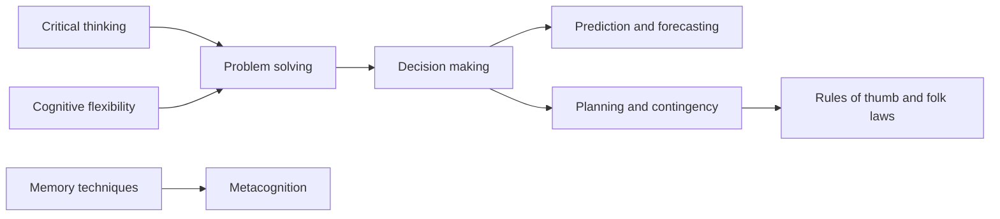

# Cognitive soft skills

Skills of thinking, reasoning and learning. This subfield belongs to [Soft skills](../README.md) and covers the cognitive domain of the US National Research Council framework. Notes link to the research on judgment and memory in [cognitive psychology](../../../../social-sciences/psychology/cognitive-psychology/README.md).

## Map of the subfield

## Notes in reading order

1. [Critical thinking](critical-thinking.md): evaluating claims and arguments, and how it is taught.
2. [Structured problem solving](problem-solving.md): define, generate, choose, act and verify.
3. [Decision making](decision-making.md): satisficing, intuition, decision trees and the value of process.
4. [Prediction and forecasting](prediction-and-forecasting.md): probabilities, calibration and the Brier score.
5. [Planning and contingency planning](planning-and-contingency.md): the planning fallacy, pre-mortems and contingency plans.
6. [Cognitive flexibility and adaptability](cognitive-flexibility.md): switching perspectives and adapting to change.
7. [Memory and memorization techniques](memory-techniques.md): working memory limits, mnemonics and retrieval practice.
8. [Metacognition and learning to learn](metacognition.md): monitoring and controlling one's own learning.
9. [Rules of thumb and folk laws](rules-of-thumb-and-folk-laws.md): Parkinson, Hofstadter, Murphy and others, with their status.

## Planned topics

- Creativity
- Reasoning and logic
