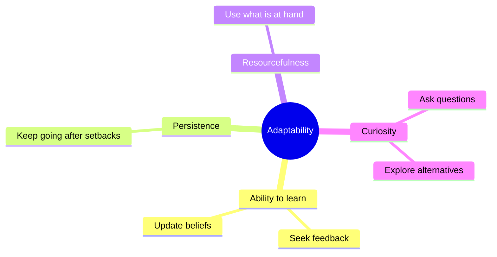

# Cognitive flexibility and adaptability

## Summary

Cognitive flexibility is the ability to switch between ideas, rules or perspectives and to adapt to new demands. It is one of the three core executive functions, with inhibition and working memory. Adaptability is the wider skill of adjusting thinking, emotion and behavior to changing situations, and it includes learning quickly, persisting, being resourceful and staying curious. Both can be trained through varied practice, and rigidity is the failure mode.

*This note is educational.*

## Prerequisites

- [Einstellung effect](../../../../social-sciences/psychology/cognitive-psychology/einstellung-effect.md).

## Core concepts

### Definition

Diamond (2013) reviews executive functions and describes three core ones: inhibition (including self-control), working memory and cognitive flexibility, which is the ability to change perspectives, to adjust to changed demands and to think "outside the box". Dennis and Vander Wal (2010) defined cognitive flexibility as the ability to perceive difficult situations as controllable, to see multiple explanations and to generate alternative solutions, and built a self-report inventory with two parts: alternatives and control.

*Mental agility* is the everyday term for the quick use of flexibility, such as changing strategy when a plan fails.

### Analogy

Cognitive flexibility is like a driver who can take a detour. A rigid driver keeps to the planned road even when it is closed, and a flexible one reads the signs and changes route. The limit of the analogy is that the flexible driver must still know the destination.

### Components of adaptability

| Component | Practice |
| --- | --- |
| Ability to learn | Seek feedback and change behavior |
| Persistence | Break big problems into steps and continue |
| Resourcefulness | Ask what else could do the job |
| Curiosity | Ask "what if" and "why not" questions |

### Rigidity

*Cognitive rigidity* is the failure to adjust: sticking with the first plan, a familiar solution or a set belief after it stops working. Fatigue, stress and strong expertise in a narrow area can increase it.

### Training

| Method | Idea |
| --- | --- |
| Varied practice | Practice the same skill in different contexts |
| Perspective taking | Argue for the other side |
| Reframing | State the problem in different words |
| Constraint changes | Solve the same task with a rule changed |
| Reflection | After a task ask what would have been done with a different method |

## Worked example

A project manager plans an event in a city, and the venue cancels three days before.

| Rigid response | Flexible response |
| --- | --- |
| Keep calling the venue and hope | List the needs (capacity, location, date) |
| Delay the decision | Generate three alternatives: a nearby hotel, a smaller room with streaming, a new date |
| Blame the venue | Choose one against the needs and tell the guests |

The flexible response separates the goal from the method, which is the key move.

## Trade offs and when to use it

Flexibility helps in change and uncertainty. Too much switching harms deep work and consistency, so match it to the situation: stable processes need discipline, new problems need flexibility.

## Common mistakes

- **Changing plans constantly.** Flexibility is not inconsistency.
- **Confusing flexibility with a lack of principles.** Values can stay fixed while methods change.
- **Waiting until a crisis to practice.** Train in small ways first.

## Practice

1. Name the three core executive functions.
2. What is cognitive rigidity?
3. Give one training method.

### Answers

1. Inhibition, working memory and cognitive flexibility.
2. Failing to adjust, for example staying with a first plan after it stops working.
3. For example varied practice or perspective taking.

## Further reading

- Diamond, A. (2013). Executive Functions. *Annual Review of Psychology*, 64(1), 135-168. [DOI](https://doi.org/10.1146/annurev-psych-113011-143750). A review of executive functions including cognitive flexibility.
- Dennis, J. P. and Vander Wal, J. S. (2009). The Cognitive Flexibility Inventory: Instrument Development and Estimates of Reliability and Validity. *Cognitive Therapy and Research*, 34(3), 241-253. [DOI](https://doi.org/10.1007/s10608-009-9276-4). Introduces a self-report inventory of cognitive flexibility.
