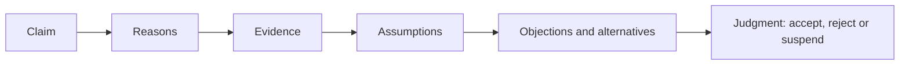

# Critical thinking

## Summary

Critical thinking is the careful evaluation of claims and arguments in order to decide what to believe or do. It combines skills (analyzing arguments, weighing evidence, spotting fallacies) with dispositions (open-mindedness, willingness to revise). Reviews find that it can be taught, with modest average effects, and that it transfers across domains best when the course teaches it explicitly, uses real problems and includes dialogue. Debate is a good training format, because it forces the weighing of both sides.

*This note is educational.*

## Prerequisites

- [Heuristics and cognitive biases](../../../../social-sciences/psychology/cognitive-psychology/heuristics-and-biases.md).

## Core concepts

### Definition

*Critical thinking* is purposeful, reflective judgment about what to believe or do. Halpern (1998) proposes a four-part model for teaching it so that it transfers: build the disposition to think critically, teach specific skills, structure learning so that the skills carry over to new contexts, and encourage metacognitive monitoring (checking one's own thinking).

### Analogy

Critical thinking is like quality control in a factory: a claim is inspected before it is allowed into the stock of beliefs. The limit of the analogy is that the inspector is the same person as the factory, and shares its biases.

### The elements of an argument

| Check | Question |
| --- | --- |
| Claim | What exactly is being asserted? |
| Evidence | What supports it, and how good is the source? |
| Logic | Does the conclusion follow from the reasons? |
| Alternatives | What else could explain the evidence? |
| Bias | Do I want it to be true? Who gains if I believe it? |

Common fallacies include ad hominem (attacking the person), straw man (misstating the view), false dilemma (offering only two options), appeal to authority (using a status as proof) and post hoc reasoning (assuming that what follows a cause was caused by it).

### Evidence on teaching

Abrami and colleagues (2015) meta-analyzed interventions and found a positive, moderate average effect on critical thinking skills. Effects were larger when the course included dialogue (discussion or debate), authentic problems, and mentoring, and when critical thinking was taught explicitly and not only as a by-product of other subjects.

### Debate as practice

In debate, a person argues a position and must answer objections. Good habits: state the opponent's view in a form they accept before answering it, separate facts from values, and argue against the strongest version.

## Worked example

A headline says: "People who drink coffee live longer, so coffee extends life."

| Check | Result |
| --- | --- |
| Claim | Coffee causes longer life |
| Evidence | An observational association |
| Alternatives | Healthier people may drink more coffee, or coffee drinkers may differ in income and smoking |
| Better evidence | Randomized trials or studies that adjust for confounders |
| Judgment | Suspend: the association does not show cause |

The example shows the step from association to cause, which is the most common gap in news claims.

## Trade offs and when to use it

Critical thinking takes time, so use it in proportion to the stakes. Too much skepticism leads to rejecting good evidence and to cynicism. Applied to one's own beliefs, it is harder than applied to others'.

## Common mistakes

- **Applying skepticism only to disliked claims.** Apply it to your own.
- **Treating fallacy names as a trump card.** Naming a fallacy does not prove the conclusion false.
- **Confusing criticism with negativity.** The aim is to judge well.

## Practice

1. Name the four parts of Halpern's (1998) model.
2. Which teaching features increased effects in Abrami and colleagues (2015)?
3. What is a straw man?

### Answers

1. Disposition, skills, structure for transfer and metacognitive monitoring.
2. Dialogue, authentic problems and mentoring, with explicit instruction.
3. Misstating an opponent's view so that it is easy to attack.

## Further reading

- Halpern, D. F. (1998). Teaching critical thinking for transfer across domains: Disposition, skills, structure training, and metacognitive monitoring. *American Psychologist*, 53(4), 449-455. [DOI](https://doi.org/10.1037/0003-066X.53.4.449). A model for teaching critical thinking so that it transfers.
- Abrami, P. C., Bernard, R. M., Borokhovski, E. et al. (2015). Strategies for Teaching Students to Think Critically. *Review of Educational Research*, 85(2), 275-314. [DOI](https://doi.org/10.3102/0034654314551063). A meta-analysis of strategies for teaching critical thinking.
