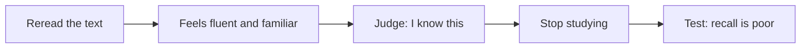

# Metacognition and learning to learn

## Summary

Metacognition is thinking about one's own thinking: knowing what you know, judging how well you understand something and controlling how you study. John Flavell introduced the term in 1979. Learners often misjudge their own understanding, since material that feels familiar does not mean it is known, and poor judgments lead to poor study choices. Learning to learn means improving this monitoring and control, together with choosing effective strategies.

*This note is educational.*

## Prerequisites

- [Learning techniques](../../learning-techniques.md).

## Core concepts

### Definition

Flavell (1979) described metacognition as knowledge about cognition (what I know about myself as a learner, about tasks and about strategies) and regulation of cognition (planning, monitoring and evaluating). *Monitoring* is judging how well one understands. *Control* is acting on that judgment, for example by deciding what to restudy.

### Analogy

Metacognition is a dashboard in a car: the engine can run well and the driver cannot know the speed or the fuel without it. The limit of the analogy is that the dashboard of a learner is itself unreliable, and gives readings that feel right and are wrong.

### The illusion of knowing

Fluency of rereading is mistaken for learning. A self-test gives a more honest reading. Dunlosky and colleagues (2013) show that the techniques that feel the least comfortable, such as practice testing and spaced practice, are often the most effective.

### Strategies of a metacognitive learner

| Phase | Questions |
| --- | --- |
| Plan | What is the goal? What do I already know? Which strategy fits? |
| Monitor | Can I explain this without notes? Where am I stuck? |
| Evaluate | What worked? What will I change next time? |

### The zone of proximal development

Learning is most efficient on tasks just beyond current ability, where help is useful. This idea is described in the note on the [zone of proximal development](../../../../social-sciences/education-and-learning/zone-of-proximal-development.md). Metacognition helps to pick such tasks.

### Meta-learning

Meta-learning is learning how to learn: trying methods, measuring results and keeping what works. Practical forms are a study log, a regular review of what was learned and one change at a time in method. The "five-hour rule" popularized for knowledge workers, which sets aside about an hour a day for learning, is a time-management habit and is not a research finding.

## Worked example

A student studies a chapter and wants to know if she is ready.

| Step | Action |
| --- | --- |
| 1 | Close the book and write what she remembers in five minutes |
| 2 | Compare with the chapter: she missed two of six key ideas |
| 3 | Restudy only those ideas, and explain them aloud |
| 4 | Test again after two days |
| 5 | Note in a log: self-test found gaps that rereading hid |

The self-test replaces a feeling with evidence, and the restudy is targeted.

## Trade offs and when to use it

Metacognitive habits cost time and pay off in all later learning. Beginners may need guidance to judge their understanding, since they lack the knowledge to see their gaps. Too much monitoring can distract from the task.

## Common mistakes

- **Trusting fluency.** Familiar does not mean known.
- **Restudying everything.** Restudy the gaps.
- **Skipping evaluation.** Without it, the strategy never improves.

## Practice

1. What are monitoring and control?
2. Why is rereading a poor guide to learning?
3. What is one way to test understanding?

### Answers

1. Monitoring is judging how well one understands, and control is acting on that judgment, for example by restudying.
2. It makes material feel familiar, which is mistaken for knowing it.
3. Close the book and recall or explain the ideas, then compare with the source.

## Further reading

- Flavell, J. H. (1979). Metacognition and cognitive monitoring: A new area of cognitive-developmental inquiry. *American Psychologist*, 34(10), 906-911. [DOI](https://doi.org/10.1037/0003-066X.34.10.906). The paper that defined metacognition.
- Dunlosky, J., Rawson, K. A., Marsh, E. J. et al. (2013). Improving Students’ Learning With Effective Learning Techniques. *Psychological Science in the Public Interest*, 14(1), 4-58. [DOI](https://doi.org/10.1177/1529100612453266). Rates ten learning techniques by evidence.
