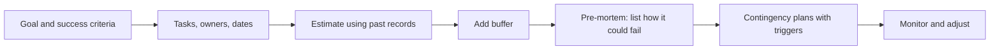

# Planning and contingency planning

## Summary

Plans fail mostly because people underestimate how long tasks take and ignore what can go wrong. The planning fallacy describes the first, and the pre-mortem technique and contingency plans address the second. A good plan has a clear goal, steps with owners and dates, a buffer for the unexpected and pre-agreed responses to the most likely failures. Estimates improve when they are based on the record of similar past tasks and not only on the details of the current one.

*This note is educational.*

## Prerequisites

- [Decision making](decision-making.md).

## Core concepts

### Definition

The *planning fallacy* is the tendency to underestimate the time, cost and risk of future actions while overestimating their benefits. Buehler, Griffin and Ross (1994) showed that people predict that they will finish tasks sooner than they do, even when they know that similar tasks took longer before, because they focus on a plan for the task and not on past experience. A *contingency plan* is a prepared response to a possible event that would disrupt the main plan. A *pre-mortem* imagines that the project has already failed and asks why.

### Analogy

Planning is like drawing a route on a map before a trip. A good map also marks the places where the road floods and shows the alternative roads. The limit of the analogy is that on a road trip the map is accurate, and in a project the map is an estimate.

### Steps



### Pre-mortem

Mitchell, Russo and Pennington (1989) found that people who imagine that an event has already happened generate more reasons for it than people who consider whether it might happen. The pre-mortem uses this effect: team members assume that the project failed, and write reasons independently, which are then collected and ranked.

### Contingency plan elements

| Element | Example |
| --- | --- |
| Risk | The key supplier delivers late |
| Trigger | No confirmation by day 5 |
| Response | Order from the backup supplier |
| Owner | Purchasing lead |
| Cost and time | 10% higher price, 2 days |

### Folk laws

Murphy's law ("anything that can go wrong will") is a joke with a point: failures are more likely than a plan assumes, so plan for them. Hofstadter's law is covered in [rules of thumb and folk laws](rules-of-thumb-and-folk-laws.md). The Stoic habit of *premeditatio malorum* (rehearsing misfortune in advance) is an old form of the pre-mortem (see [Stoicism](../../../../humanities/philosophy/ancient-philosophy/stoicism.md)).

## Worked example

A person estimates a task at 12 days. Four earlier tasks were estimated at 5, 10, 3 and 8 days and took 8, 13, 6 and 10 days.

```python
# Python 3.12. Hofstadter's law as a planning rule: scale a gut estimate by past overruns.
past = [(5, 8), (10, 13), (3, 6), (8, 10)]            # (estimated days, actual days) of four earlier tasks
ratio = sum(a for _, a in past) / sum(e for e, _ in past)
new_estimate = 12
print("average overrun factor:", round(ratio, 2))
print("adjusted estimate:", round(new_estimate * ratio, 1), "days")
```

Output:

```text
average overrun factor: 1.42
adjusted estimate: 17.1 days
```

Past tasks took 42% longer than estimated, so the 12-day estimate is raised to 17 days. Four tasks is a small sample, and a larger record gives a better factor. The method is the outside view: use the record of similar cases.

## Trade offs and when to use it

Planning in detail is worth it for complex, costly or irreversible work. Over-planning wastes time and plans lose value as conditions change, so plan in short horizons with review. Contingency plans for every risk are not possible, so prepare for the few that are likely or severe.

## Common mistakes

- **Planning for the best case.** Use the typical case and a buffer.
- **Estimating from the plan alone.** Compare with past tasks.
- **Listing risks without responses.** A risk needs a trigger and an action.

## Practice

1. What is the planning fallacy?
2. How does a pre-mortem work?
3. Which elements make up a contingency plan?

### Answers

1. Underestimating the time, cost and risk of future actions, despite past experience.
2. The team assumes that the project failed, and each member independently writes reasons for it.
3. Risk, trigger, response, owner and cost or time.

## Further reading

- Buehler, R., Griffin, D. and Ross, M. (1994). Exploring the "planning fallacy": Why people underestimate their task completion times. *Journal of Personality and Social Psychology*, 67(3), 366-381. [DOI](https://doi.org/10.1037/0022-3514.67.3.366). Shows the planning fallacy.
- Mitchell, D. J., Edward Russo, J. and Pennington, N. (1989). Back to the future: Temporal perspective in the explanation of events. *Journal of Behavioral Decision Making*, 2(1), 25-38. [DOI](https://doi.org/10.1002/bdm.3960020103). The experiments that led to the pre-mortem technique.
