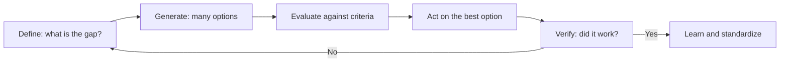

# Structured problem solving

## Summary

Structured problem solving is a stepwise method for dealing with problems: define the problem, generate options, choose, act and check the result. The psychological model of D'Zurilla and Goldfried (1971) and Polya's classic four steps for mathematics share this shape. The value of a structure is that it stops people from jumping to a solution before the problem is clear, and from stopping at the first idea. The hardest step in practice is usually the definition of the problem.

*This note is educational.*

## Prerequisites

- [Critical thinking](critical-thinking.md).

## Core concepts

### Definition

A *problem* is a gap between the current state and a desired state, with no obvious way to close it. D'Zurilla and Goldfried (1971) described problem solving as a set of five stages: general orientation (seeing problems as normal and solvable), problem definition and formulation, generating alternatives, decision making, and solution verification. Polya (1945) gave four steps: understand the problem, devise a plan, carry out the plan and look back.

### Analogy

Solving a problem is like navigating: first fix where you are and where you want to be, then compare routes, then go and check the landmarks. The limit of the analogy is that, with real problems, the destination itself can change as you learn more.

### The process

### Tools

| Tool | Use |
| --- | --- |
| Problem statement | One sentence: current state, desired state, measure |
| Five whys | Ask "why" repeatedly to reach a root cause |
| Issue tree | Split the problem into non-overlapping parts |
| Brainstorming with limits | Generate options before judging them |
| Decision matrix | Score options against weighted criteria |
| Pilot | Test at small scale before a full roll-out |

### Cognitive obstacles

Fixation on a familiar method (see [Einstellung effect](../../../../social-sciences/psychology/cognitive-psychology/einstellung-effect.md)), solving the wrong problem and stopping at the first acceptable idea are common. Define the problem in several ways, and ask someone with a different view.

## Worked example

A team's reports are always late.

| Step | Result |
| --- | --- |
| Define | Reports are on time in 40% of weeks, target 90% |
| Five whys | Late because data arrives late, because Finance sends it on Thursday, because their system exports only after close, because the close takes 2 days |
| Generate | Ask for a partial export; change the report day; automate the export |
| Evaluate | Partial export: cheap and fast; automate: slow and costly |
| Act and verify | Partial export for four weeks, on time in 85% of weeks |
| Standardize | Document the new schedule |

The root cause was in another team's process. A solution aimed at the team's own writing speed would have missed it.

## Trade offs and when to use it

Use a full structure for problems that are costly, recurring or unclear. For small problems, a short version is enough. Structure can become a ritual: the aim is clearer thinking, not filled templates.

## Common mistakes

- **Jumping to solutions.** Define the problem first.
- **Treating symptoms.** Look for causes.
- **Skipping verification.** A solution that is not checked may not work.

## Practice

1. Name the five stages of D'Zurilla and Goldfried (1971).
2. What does the five whys method do?
3. Why define the problem in several ways?

### Answers

1. General orientation, problem definition, generating alternatives, decision making and verification.
2. It follows a chain of causes to a root cause by asking why repeatedly.
3. A different framing can show causes and options that the first framing hides.

## Further reading

- D'Zurilla, T. J. and Goldfried, M. R. (1971). Problem solving and behavior modification. *Journal of Abnormal Psychology*, 78(1), 107-126. [DOI](https://doi.org/10.1037/h0031360). The original model of problem-solving as a coping skill.
- Polya, G. (1945). *How to Solve It*. Princeton University Press. A classic four-step method for solving problems: understand, plan, carry out, look back.
