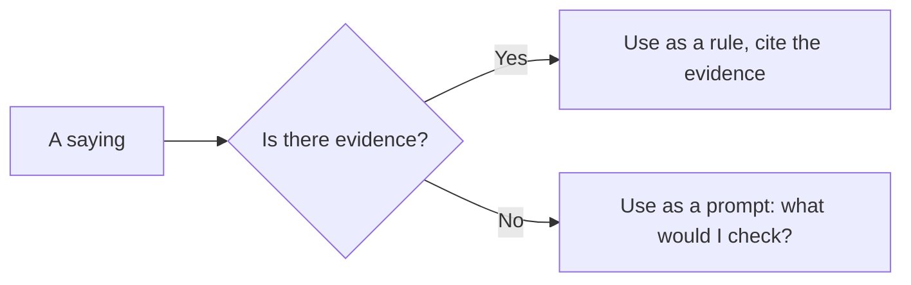

# Rules of thumb and folk laws

## Summary

Many short sayings are named after people and used as laws of work and life: Parkinson's law, Hofstadter's law, Murphy's law, Hanlon's razor and others. Most of them started as jokes or observations, have no formal proof and describe tendencies, not rules. A few match solid research, such as the planning fallacy behind Hofstadter's law. This note lists the common ones, with their origin and an honest status, so that they can be used as prompts for thinking and not quoted as facts.

*This note is educational.*

## Prerequisites

No prior notes are needed.

## Core concepts

### Definition

A *folk law* is a short, memorable statement about how things tend to go, often named after its author or a famous case. It is useful when it prompts a check of one's own plans, and misleading when it is treated as a theorem.

### Analogy

Folk laws are like proverbs: they compress experience into a sentence that is easy to recall. Like proverbs, they come in contradicting pairs and fit some situations. The limit of the analogy is that these sayings are sometimes testable, and a few have been.

### The common ones

| Law | Statement | Origin and status |
| --- | --- | --- |
| Parkinson's law | Work expands to fill the time available | Humorous essay by C. N. Parkinson (1955), about bureaucracies. Plausible, and not tested as a law |
| Hofstadter's law | It always takes longer than you expect, even when you take into account Hofstadter's law | Hofstadter (1979). Matches the planning fallacy, which is well documented |
| Murphy's law | Anything that can go wrong will go wrong | Folk saying. Use it as a reminder to plan for failure |
| Hanlon's razor | Do not attribute to malice what is adequately explained by neglect or error | Folk saying with disputed origin. A useful default in conflict, though malice does exist |
| Pareto principle | A small share of causes gives a large share of results | An empirical pattern, see [essentialism](../../../personal-growth/essentialism.md) |
| Lindy effect | The longer a non-perishable thing has survived, the longer it is expected to last | Popularized by Taleb (2012). A heuristic for ideas and books, and not for living things |
| Kidlin's law | If you write the problem down clearly, you have half solved it | Folk saying. Matches the advice to define a problem before solving it |
| Falkland's law | When it is not necessary to make a decision, it is necessary not to make a decision | Attributed to Lord Falkland. A reminder to avoid premature commitment |
| Segal's law | A man with a watch knows what time it is, and a man with two watches is never sure | Folk saying about conflicting information |
| Dunning-Kruger effect | Low performers overestimate themselves | A research finding with a statistical caveat, see [Dunning-Kruger effect](../../../../social-sciences/psychology/cognitive-psychology/dunning-kruger-effect.md) |

Other "laws" from science are in their own fields: Benford's law (the distribution of leading digits in many data sets), Liebig's law of the minimum (growth is limited by the scarcest resource) and Shelford's law of tolerance (organisms have ranges of tolerance). They are quantitative statements with evidence, and different in kind from the sayings above.

### A popular rule: the 40% rule

The "40% rule" is a popular saying that when the mind says you are done, you have used only about 40% of your capacity. It comes from the memoirs and talks of an athlete and is not a research result. It is a motivational image, and fatigue and injury are real limits.

### Using the sayings

## Worked example

A manager plans a project and uses the sayings as checks.

| Saying | Check |
| --- | --- |
| Hofstadter | Multiply the estimate by the factor from past projects (see [planning and contingency](planning-and-contingency.md)) |
| Murphy | List the three most likely failures and a response to each |
| Parkinson | Set a deadline for each stage, so that work does not stretch |
| Hanlon | When a colleague misses a deadline, ask about their workload before assuming bad will |
| Kidlin | Write the problem statement in one sentence before the meeting |

Each saying becomes a short action.

## Trade offs and when to use it

The sayings are cheap and memorable, and good for team conversation. They can make weak ideas look like laws, and can be used to shut down discussion ("Parkinson's law says so"). Treat them as hypotheses.

## Common mistakes

- **Quoting a saying as proof.** It is an observation or a joke.
- **Believing contradicting sayings at once.** Many come in pairs.
- **Taking Hanlon's razor as a denial of malice.** It is a default.

## Practice

1. What does Hofstadter's law say, and what research supports it?
2. Which law is an empirical pattern, Pareto or Murphy?
3. What is the Lindy effect, and for what is it not suitable?

### Answers

1. Tasks take longer than expected even when you allow for this. The planning fallacy supports it.
2. Pareto, which has been observed in many data sets.
3. The longer a non-perishable thing has survived, the longer it is expected to last. It is not suitable for living things.

## Further reading

- Hofstadter, D. R. (1979). *Godel, Escher, Bach: An Eternal Golden Braid*. Basic Books. The book in which Hofstadter's law about the duration of tasks first appeared.
- Parkinson, C. N. (1955). Parkinson's law. *The Economist*, 19 November 1955. The humorous essay that stated that work expands to fill the time available.
- Taleb, N. N. (2012). *Antifragile: Things That Gain from Disorder*. Random House. Defines antifragility and the Lindy effect.
- Buehler, R., Griffin, D. and Ross, M. (1994). Exploring the "planning fallacy": Why people underestimate their task completion times. *Journal of Personality and Social Psychology*, 67(3), 366-381. [DOI](https://doi.org/10.1037/0022-3514.67.3.366). Shows the planning fallacy.
