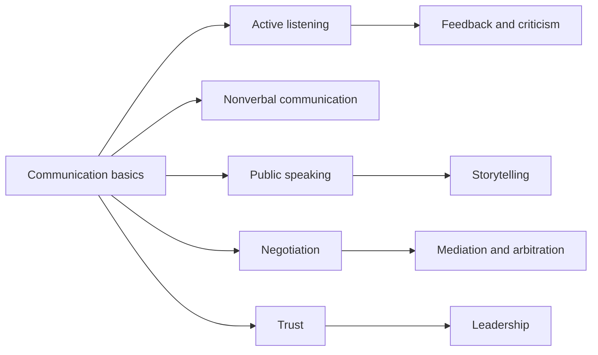

# Interpersonal soft skills

Skills of working with other people: communicating, listening, giving feedback, negotiating, building trust and leading. This subfield belongs to [Soft skills](../README.md) and covers the interpersonal domain of the US National Research Council framework. Networking is in [career](../../../career/job-search/networking.md), and the study of attraction and relationships is in [close relationships](../../../../social-sciences/psychology/close-relationships/README.md).

## Map of the subfield

## Notes in reading order

1. [Communication basics](communication-basics.md): the model, the four forms and filler words.
2. [Active listening](active-listening.md): behaviors and what an experiment found.
3. [Nonverbal communication and body language](nonverbal-communication.md): channels, the 7-38-55 myth, lie detection and power posing.
4. [Feedback, criticism and assertiveness](feedback-and-criticism.md): giving and receiving feedback, and speaking up respectfully.
5. [Negotiation](negotiation.md): interests, BATNA and the biases of negotiators.
6. [Mediation and arbitration](mediation-and-arbitration.md): neutral third parties and binding decisions.
7. [Trust](trust.md): ability, benevolence and integrity.
8. [Leadership](leadership.md): styles, evidence and adapting to the situation.
9. [Public speaking](public-speaking.md): preparing, delivering and reviewing a talk.
10. [Storytelling](storytelling.md): components, the story arc and narrative transportation.

## Planned topics

- Teamwork and collaboration
- Conflict management
- Empathy
