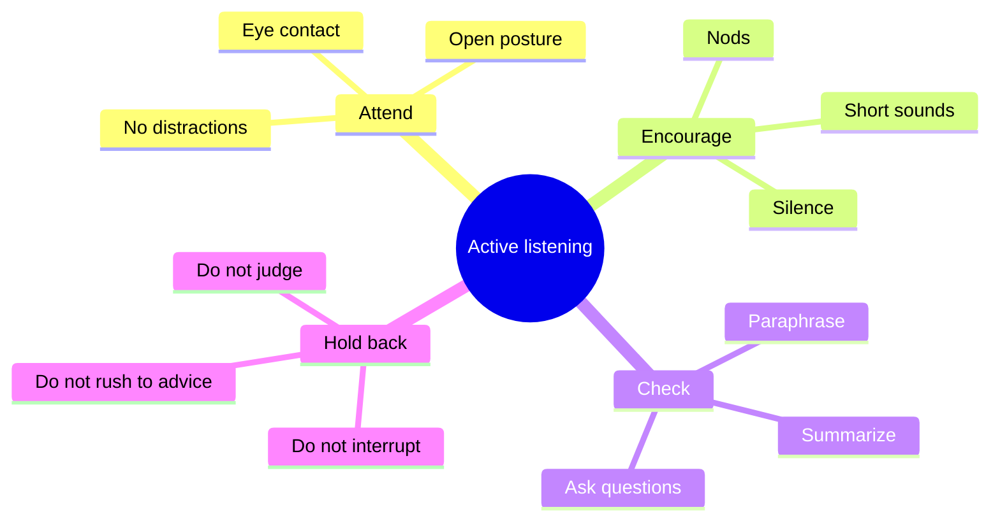

# Active listening

## Summary

Active listening is a way of listening in which the listener gives full attention, shows that they are listening, checks understanding and holds back judgment and advice. It is widely taught in counseling, management and conflict resolution. In an experiment, speakers whose listeners paraphrased and asked for elaboration felt more understood than speakers who received advice or simple acknowledgment, and satisfaction and attraction differed little. A reliable core is attention, curiosity and checking understanding.

*This note is educational.*

## Prerequisites

- [Communication basics](communication-basics.md).

## Core concepts

### Definition

*Active listening* is listening with the aim of understanding the speaker, together with signals to the speaker that this is happening. It contrasts with *passive listening* (hearing without engagement) and with *listening to reply*, where the listener prepares a response while the other is still talking.

### Analogy

Active listening is like holding a ladder for someone: the person climbs, and your job is to keep steady and not to climb for them. The limit of the analogy is that the speaker can also ask the holder for a view.

### Behaviors

| Behavior | Example |
| --- | --- |
| Paraphrase | "So the deadline moved up, and you are worried about the review?" |
| Open question | "What would help most?" |
| Summarize | "To sum up, you want X and are worried about Y" |
| Reflect feeling | "That sounds frustrating" |
| Silence | Leave space after a pause |

### Evidence

Weger and colleagues (2014) randomly assigned 115 participants to talk about a personal problem with a trained listener who gave active listening responses (paraphrasing and asking for elaboration), advice or simple acknowledgment. Participants who received active listening felt more understood than those who received advice or acknowledgment. Conversational satisfaction and the attractiveness of the listener were slightly higher for both active listening and advice than for acknowledgment, and did not differ between active listening and advice. The effects on satisfaction and attraction were small, and the study used short interactions with strangers.

## Worked example

A colleague says: "I cannot keep up with this project. Nothing I do is enough."

| Response | Type | Likely effect |
| --- | --- | --- |
| "Just make a list and start" | Advice too early | Speaker feels dismissed |
| "I am sure it is fine" | Reassurance | Speaker feels unheard |
| "It sounds like you are overloaded. What part feels heaviest?" | Reflect and ask | Speaker explains and clarifies |
| (After the answer) "So the unclear scope is the problem. Do you want ideas or just to talk?" | Summarize and ask | Speaker chooses |

The last two keep the focus on the speaker and check what help is wanted.

## Trade offs and when to use it

Active listening is valuable in conflict, coaching, feedback and when emotions are high. In quick, factual exchanges it can feel stiff. Scripted paraphrasing can sound artificial, so keep it natural.

## Common mistakes

- **Planning your reply while the other talks.** Listen first.
- **Giving advice too soon.** Ask what is wanted.
- **Overusing paraphrase.** It can sound like a technique.
- **Faking attention.** Phones and screens signal otherwise.

## Practice

1. Name three active listening behaviors.
2. Why can early advice backfire?
3. What did Weger and colleagues (2014) find about feeling understood?

### Answers

1. For example paraphrasing, open questions and summarizing.
2. The speaker may feel dismissed, and the advice may not match the need.
3. Speakers who received active listening responses felt more understood than speakers who received advice or simple acknowledgment.

## Further reading

- Weger, H., Castle Bell, G., Minei, E. M. et al. (2014). The Relative Effectiveness of Active Listening in Initial Interactions. *International Journal of Listening*, 28(1), 13-31. [DOI](https://doi.org/10.1080/10904018.2013.813234). Tests whether active listening improves initial interactions.
