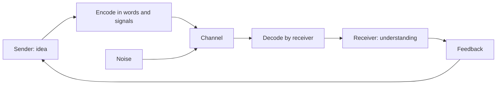

# Communication basics

## Summary

Communication is the exchange of meaning between people through words, voice, body and writing. A message is only communicated when the receiver understands what the sender intended, and misunderstandings arise at each step. Good communicators choose the channel for the purpose, check understanding and keep the message clear. Filler words such as "um" and "like" are normal in speech, and a few strategies reduce them when they distract.

*This note is educational.*

## Prerequisites

No prior notes are needed.

## Core concepts

### Definition

*Communication* is the process by which a sender encodes a message, sends it through a channel, and a receiver decodes it, with feedback in return. *Noise* is anything that distorts the message: unclear wording, distraction, emotion, differences in background. Communication has four main forms:

| Form | Channel | Strength | Weakness |
| --- | --- | --- | --- |
| Verbal | Spoken words | Fast, with feedback | Not recorded |
| Non-verbal | Tone, face, posture, gesture | Shows emotion and attitude | Easy to misread (see [nonverbal communication](nonverbal-communication.md)) |
| Written | Text | Precise and recorded | Slower feedback, no tone |
| Visual | Images, charts, diagrams | Shows structure and numbers | Needs careful design |

### Analogy

A message is like a parcel sent through the post: it can be packed well and still be damaged or misread at the destination. A tracking number (feedback) shows whether it arrived. The limit of the analogy is that a parcel keeps its content, and a message is rebuilt in the receiver's mind.

### The model

### Principles

- **Know the purpose.** Inform, persuade, ask or connect.
- **Know the audience.** Their knowledge, goals and time.
- **Lead with the point.** State the main message first, then support.
- **Be concrete.** Examples and numbers beat abstractions.
- **Check understanding.** Ask the receiver to say it back, or ask a question about it.
- **Choose the channel.** Use writing for details and records, talk for sensitive or complex matters.

### Filler words

Filler words ("um", "uh", "like", "you know") are small sounds or phrases that fill pauses. They are common in natural speech and can signal thinking. Too many can distract or reduce the listener's perception of the speaker's confidence, and a few have no effect.

Ways to reduce them:

| Method | How |
| --- | --- |
| Pause | Replace the filler with a short silence |
| Slow down | Speaking more slowly leaves time to think |
| Prepare | Know the first sentence of each point |
| Record and listen | Hearing yourself raises awareness |
| Replace the habit | Take a breath when you feel a filler coming |

## Worked example

An unclear request: "Can you look at the thing for the client soon?"

| Element | Unclear | Clear |
| --- | --- | --- |
| What | "the thing" | "the pricing sheet for Acme" |
| Why | missing | "so that I can send the offer" |
| When | "soon" | "by Thursday noon" |
| Check | none | "Does that work with your schedule?" |

Rewritten: "Could you review the pricing sheet for Acme by Thursday noon, so that I can send the offer? Does that fit your schedule?" The rewrite names the object, the reason, the time and invites feedback.

## Trade offs and when to use it

Clear communication takes more effort at the start and saves much time later. Too much detail loses the reader. The right amount depends on the audience's knowledge.

## Common mistakes

- **Assuming the message was understood.** Check.
- **Burying the main point.** Lead with it.
- **Using vague words.** "Soon" and "good" mean different things.
- **Using email for conflict.** Tone is lost.

## Practice

1. What is noise in communication?
2. Why lead with the main point?
3. Name two ways to reduce filler words.

### Answers

1. Anything that distorts the message on its way, such as unclear wording or distraction.
2. The reader or listener then knows what the details are for.
3. For example pause instead of using a filler, or slow down.

## Further reading

- Mehrabian, A. and Ferris, S. R. (1967). Inference of attitudes from nonverbal communication in two channels. *Journal of Consulting Psychology*, 31(3), 248-252. [DOI](https://doi.org/10.1037/h0024648). The study from which the misquoted 7-38-55 rule comes.
- Weger, H., Castle Bell, G., Minei, E. M. et al. (2014). The Relative Effectiveness of Active Listening in Initial Interactions. *International Journal of Listening*, 28(1), 13-31. [DOI](https://doi.org/10.1080/10904018.2013.813234). Tests whether active listening improves initial interactions.
