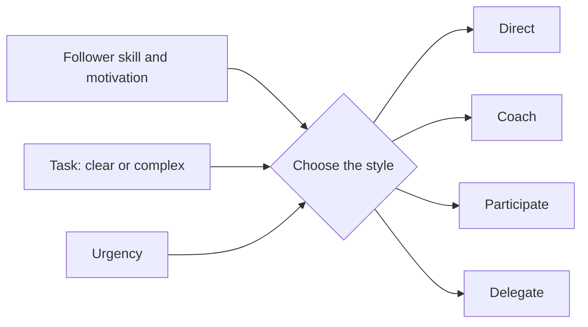

# Leadership

## Summary

Leadership is the process of influencing a group toward a shared goal. Research separates leadership from management (managing complexity and leading change) and has studied it through traits, behaviors, styles and situations. Early experiments by Kurt Lewin compared autocratic, democratic and laissez-faire leadership. A meta-analysis found that transformational leadership and contingent reward are related to leader effectiveness and follower satisfaction, while laissez-faire leadership is related to worse results. No single style is best everywhere.

*This note is educational.*

## Prerequisites

- [Trust](trust.md).
- [Communication basics](communication-basics.md).

## Core concepts

### Definition

*Leadership* is the process of influencing others to understand and agree on what needs to be done and how to do it, and of facilitating individual and collective effort to accomplish shared objectives. *Management* focuses on planning, organizing and controlling, and leadership on direction, alignment and motivation. The same person often does both.

### Analogy

A leader is like the captain and the navigator at once: choosing the destination, reading the conditions and keeping the crew working together. The limit of the analogy is that on a ship the chain of command is fixed, and leaders of teams often lead people who do not report to them.

### Core components

| Component | Meaning |
| --- | --- |
| Vision and direction | A clear picture of where the group is going and why |
| Communication | Sharing the direction and listening |
| Trust and credibility | Followers believe the leader's word and competence |
| Motivation | Aligning tasks with followers' goals and needs |
| Decision making | Deciding with the right input at the right speed |
| Development of others | Coaching and delegation |

### Styles

Lewin, Lippitt and White (1939) created experimental groups of boys led by adults acting in three styles: *authoritarian* (the leader decides), *democratic* (decisions are shared) and *laissez-faire* (little guidance). The democratic groups showed more cooperation and, in the absence of the leader, kept working. The authoritarian groups showed more aggression or apathy and stopped working without the leader. The sample was small and the setting artificial.

| Style | Description | Fits |
| --- | --- | --- |
| Authoritarian | Leader decides | Emergencies, clear tasks, novices |
| Democratic | Shared decisions | Complex problems, skilled teams |
| Laissez-faire | Hands off | Highly skilled and motivated experts |
| Transformational | Inspires through vision, individual attention and challenge | Change, high engagement |
| Transactional | Clear exchange: reward for results | Defined tasks, performance management |

### Evidence

Judge and Piccolo (2004) meta-analyzed studies of transformational and transactional leadership. Transformational leadership and contingent reward (a transactional behavior) were positively related to follower job satisfaction, follower leader satisfaction, motivation and leader effectiveness, and laissez-faire leadership was negatively related to them.

### Situational view

Good leaders adjust their behavior to the follower and the task, and keep the values constant.

### Steps to improve

- Get feedback from the team on your leadership (see [feedback and criticism](feedback-and-criticism.md)).
- Practice listening before deciding.
- Clarify goals and priorities regularly.
- Delegate with a clear outcome and support.
- Model the behavior that you ask for.
- Find a mentor and learn from cases.

## Worked example

A new team lead has two people. Mia is new and unsure, and Jon is an experienced specialist.

| Person | Need | Approach |
| --- | --- | --- |
| Mia | Direction and confidence | Give clear tasks, check in often, praise progress |
| Jon | Autonomy and challenge | Agree on the outcome, delegate the method, meet on request |

The same leader acts differently with each, and is consistent in values: clear expectations and respect.

## Trade offs and when to use it

Leadership skills improve with practice and reflection. Styles are tendencies, not types, and leaders who use only one style struggle when conditions change. Charisma is not required, and a leader's reliability and care matter more for trust.

## Common mistakes

- **Equating leadership with title.** It is influence.
- **Using one style everywhere.** Adapt to the situation.
- **Avoiding decisions.** Laissez-faire leadership relates to worse results.
- **Ignoring follower needs.** Motivation depends on them.

## Practice

1. Name the three styles in Lewin's experiment.
2. How did Judge and Piccolo (2004) find laissez-faire leadership to relate to outcomes?
3. What is the difference between leadership and management?

### Answers

1. Authoritarian, democratic and laissez-faire.
2. Negatively related to follower satisfaction, motivation and leader effectiveness.
3. Management focuses on planning, organizing and controlling, and leadership on direction, alignment and motivation.

## Further reading

- Lewin, K., Lippitt, R. and White, R. K. (1939). Patterns of Aggressive Behavior in Experimentally Created “Social Climates”. *The Journal of Social Psychology*, 10(2), 269-299. [DOI](https://doi.org/10.1080/00224545.1939.9713366). The experiments on authoritarian, democratic and laissez-faire group climates.
- Judge, T. A. and Piccolo, R. F. (2004). Transformational and Transactional Leadership: A Meta-Analytic Test of Their Relative Validity. *Journal of Applied Psychology*, 89(5), 755-768. [DOI](https://doi.org/10.1037/0021-9010.89.5.755). A meta-analysis of transformational and transactional leadership.
- Mayer, R. C., Davis, J. H. and Schoorman, F. D. (1995). An Integrative Model of Organizational Trust. *The Academy of Management Review*, 20(3), 709. [DOI](https://doi.org/10.5465/amr.1995.9508080335). The integrative model of organizational trust.
