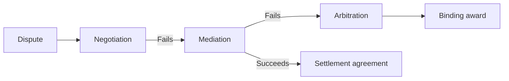

# Mediation and arbitration

## Summary

Mediation and arbitration are two ways of resolving a dispute without going to court. In mediation, a neutral third party helps the sides reach their own agreement and has no power to decide. In arbitration, a neutral third party hears the case and decides, and the decision is usually binding. Mediation keeps control with the parties and tends to preserve relationships, and arbitration gives a final answer. Both can be done online.

*This note is educational. It is not legal advice. Rules differ by country and by contract.*

## Prerequisites

- [Negotiation](negotiation.md).

## Core concepts

### Definition

*Mediation* is a voluntary, confidential process in which a neutral mediator facilitates communication and helps the parties to find a solution that they accept. The mediator does not impose a result. *Arbitration* is a process in which parties submit a dispute to one or more arbitrators who issue an award, which is binding when the parties have agreed so. Wall and Lynn (1993) reviewed research on mediation and found that mediation often leads to agreement and that parties are often satisfied with it, with outcomes that depend on the mediator's tactics and the conflict.

### Analogy

Mediation is like a guide who helps two hikers agree on a route, and arbitration is like a referee who rules on which route is allowed. The limit of the analogy is that a referee in a sport applies fixed rules, while arbitrators apply law or the agreement of the parties.

### Comparison

| Aspect | Negotiation | Mediation | Arbitration | Court |
| --- | --- | --- | --- | --- |
| Third party | None | Mediator, no power to decide | Arbitrator, decides | Judge, decides |
| Control of outcome | Parties | Parties | Arbitrator | Judge |
| Binding | Only if agreed | Only if a settlement is signed | Usually yes | Yes |
| Privacy | Yes | Yes | Usually | Usually public |
| Typical cost and speed | Low and fast | Moderate | Moderate to high | High and slow |

### Mediation process

A mediator typically opens with ground rules, lets each side tell its story, finds interests and issues, holds joint and private sessions, helps to generate options and drafts an agreement if the sides reach one. Mediators avoid judging who is right.

### Arbitration process

The parties agree to arbitrate, usually in a clause in a contract, and choose the arbitrator or the rules of an institution. Each side presents arguments and evidence, and the arbitrator issues a written award. The UNCITRAL Model Law (2006 version) is the basis of the arbitration laws of many countries. Court review of the award is limited.

### Online and international settings

*E-mediation* is mediation by video or messages. It lowers cost and travel, and has limits in reading nonverbal cues and in confidentiality of the technology. The Singapore Convention on Mediation (2018) lets parties enforce international commercial settlements from mediation in states that have joined it.

## Worked example

A small business and a supplier dispute an unpaid invoice of 12,000.

| Step | Event |
| --- | --- |
| 1 | Direct talks fail: positions 12,000 against 8,000 |
| 2 | They agree to mediation, and share the cost of one session |
| 3 | The mediator finds that the buyer's real issue is late and partial delivery, and the supplier's issue is cash flow |
| 4 | Agreement: pay 10,500 in two instalments, with a credit for the delay and a new delivery schedule |
| 5 | They sign and the relationship continues |

If mediation had failed, the contract clause would send the dispute to arbitration with a binding award. The numbers are an illustration.

## Trade offs and when to use it

Mediation suits disputes that need an ongoing relationship, privacy and flexible solutions. It fails when a party is not willing to compromise or when there is a power imbalance that the mediator cannot manage. Arbitration suits commercial disputes that need a final and private decision, and it limits appeal. Check the contract before a dispute arises, since an arbitration clause may exclude court.

## Common mistakes

- **Treating a mediator as a judge.** The mediator has no power to decide.
- **Signing an arbitration clause without reading it.** It limits the right to go to court.
- **Expecting a mediated settlement to be self-enforcing.** It needs to be written and signed.

## Practice

1. What is the main difference between mediation and arbitration?
2. Why is mediation good for continuing relationships?
3. What does the Singapore Convention on Mediation do?

### Answers

1. A mediator helps the parties decide, and an arbitrator decides.
2. The parties keep control and find an outcome that they accept, which preserves the relationship.
3. It lets parties enforce international commercial settlements from mediation in the states that have joined it.

## Further reading

- Wall, J. A. and Lynn, A. (1993). Mediation. *Journal of Conflict Resolution*, 37(1), 160-194. [DOI](https://doi.org/10.1177/0022002793037001007). A review of research on mediation.
- UNCITRAL (2006). UNCITRAL Model Law on International Commercial Arbitration (1985, with amendments as adopted in 2006). United Nations Commission on International Trade Law. [Link](https://uncitral.un.org/en/texts/arbitration/modellaw/commercial_arbitration). The model text that many countries use as the basis of their arbitration laws.
- UNCITRAL (2018). United Nations Convention on International Settlement Agreements Resulting from Mediation (Singapore Convention on Mediation). United Nations Commission on International Trade Law. [Link](https://uncitral.un.org/en/texts/mediation/conventions/international_settlement_agreements). The treaty that lets parties enforce international commercial settlements reached by mediation.
- Fisher, R. and Ury, W. (1981). *Getting to Yes: Negotiating Agreement Without Giving In*. Houghton Mifflin. The source of principled negotiation, interests versus positions and BATNA.
