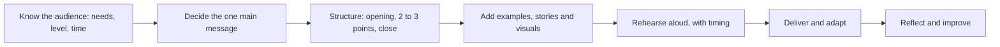

# Public speaking

## Summary

Public speaking is delivering a prepared talk to an audience, and it is a skill that improves with preparation and practice. Most people feel nervous before speaking, and anxiety can be managed by preparation, rehearsal and reframing the nerves. A talk is built around one main message, a clear structure and an audience who needs something. The common claim that people fear public speaking more than death is not supported by a replication in which death ranked higher.

*This note is educational.*

## Prerequisites

- [Communication basics](communication-basics.md).
- [Nonverbal communication and body language](nonverbal-communication.md).

## Core concepts

### Definition

*Public speaking* is communication of a message to a live audience for a purpose: to inform, persuade, motivate or entertain. It differs from conversation in structure and in the one-way flow, and it adds nerves, since the audience is watching.

### Fear

Dwyer and Davidson (2012) examined the claim that public speaking is the most common fear, ahead of death. In their survey of 815 students, death ranked above public speaking when the students ranked fears, and public speaking was still selected by about 60% of students as a fear. Nervousness is common and normal. A useful reframing is that the physical signs of nerves (fast heart rate, alertness) are similar to those of excitement, and the energy can be used. The illusion of transparency (see [egocentric biases](../../../../social-sciences/psychology/social-psychology/egocentric-biases.md)) means that nerves are less visible than they feel.

### Analogy

A talk is like a guided tour: the guide knows the route, tells the group where they are going, stops at a few important places and gets them to the end. The limit of the analogy is that an audience cannot interrupt a tour guide's route, and in a talk, you also read their reactions.

### Preparation

| Element | Guidance |
| --- | --- |
| Audience | What do they know, want and doubt? |
| Intention | What should they know, feel or do after the talk? |
| Opening | A question, a story or a fact that shows why it matters |
| Body | Two or three points, each with an example |
| Close | Repeat the main message and state the action |
| Slides | Few words, one idea per slide |

### Delivery

- **Voice.** Vary pace and pitch, pause before key points, speak from the diaphragm and project.
- **Body.** Stand steady, use open gestures, move with purpose and keep eye contact with different parts of the audience.
- **Filler words.** Replace them with pauses (see [communication basics](communication-basics.md)).
- **Questions.** Repeat the question, answer briefly and check that it was answered.

### Retrospection

After a talk, review it: record it if possible, note what worked and one thing to change, and ask a trusted listener for specific feedback. Improvement comes from the cycle of preparing, delivering and reviewing.

## Worked example

A 10-minute talk to colleagues on a new process.

| Part | Time | Content |
| --- | --- | --- |
| Opening | 1 min | A short story of the problem that the process solves |
| Point 1 | 3 min | What changes, with one example |
| Point 2 | 3 min | Why it saves time, with a number |
| Point 3 | 1.5 min | What to do next week |
| Close | 1.5 min | The main message and a request |

The talk rehearsed twice aloud with a timer, and the speaker has the first and last sentences memorized. Nerves are expected and the structure carries the speaker.

## Trade offs and when to use it

Preparing every word can sound stiff, and improvising can ramble. A common compromise is to memorize the opening and the close and use notes for the middle. For severe anxiety, cognitive behavioral approaches and graded practice have good support (see [cognitive behavioral therapy](../../../../social-sciences/psychology/clinical-and-counseling/cognitive-behavioral-therapy.md)).

## Common mistakes

- **Too many points.** Limit to two or three.
- **Slides as a script.** They compete with the speaker.
- **Not rehearsing aloud.** Silent reading hides timing problems.
- **Ignoring the audience.** Adapt to their reaction.

## Practice

1. What did Dwyer and Davidson (2012) find about death and public speaking?
2. Why limit a talk to two or three points?
3. What is retrospection?

### Answers

1. When students ranked their fears, death ranked above public speaking.
2. Audiences remember a few points, and more dilutes the main message.
3. Reviewing a talk after delivery to find what worked and what to change.

## Further reading

- Dwyer, K. K. and Davidson, M. M. (2012). Is Public Speaking Really More Feared Than Death?. *Communication Research Reports*, 29(2), 99-107. [DOI](https://doi.org/10.1080/08824096.2012.667772). Checks the claim that public speaking is feared more than death.
- Gilovich, T., Savitsky, K. and Medvec, V. H. (1998). The illusion of transparency: Biased assessments of others' ability to read one's emotional states. *Journal of Personality and Social Psychology*, 75(2), 332-346. [DOI](https://doi.org/10.1037/0022-3514.75.2.332). The illusion of transparency: people overestimate how well others read their feelings.
