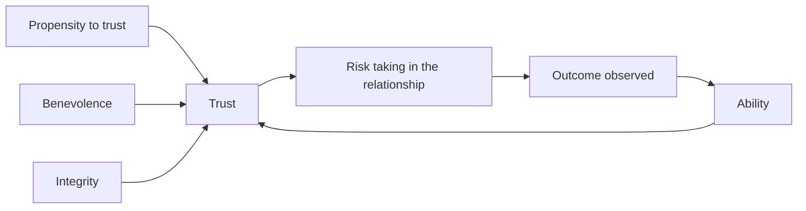

# Trust

## Summary

Trust is the willingness to be vulnerable to another party on the expectation that they will act in one's interest. The integrative model of Mayer, Davis and Schoorman (1995) says that trust in a person rests on three perceived qualities: ability, benevolence and integrity. A meta-analysis shows that trust in leaders is linked to job performance, citizenship behavior and commitment. Trust is built slowly by consistent action and lost quickly by a breach.

*This note is educational.*

## Prerequisites

- [Communication basics](communication-basics.md).

## Core concepts

### Definition

Mayer, Davis and Schoorman (1995) define *trust* as the willingness of a party to be vulnerable to the actions of another party based on the expectation that the other will perform a particular action important to the trustor, irrespective of the ability to monitor or control that party. *Trustworthiness* is the set of qualities that give reason to trust:

| Factor | Meaning |
| --- | --- |
| Ability | Skills and competence in the relevant area |
| Benevolence | Care for the trustor's interests, beyond self-interest |
| Integrity | Adherence to principles the trustor finds acceptable |

The model also includes the trustor's *propensity* to trust, a general disposition that matters most early in a relationship.

### Analogy

Trust is like a bank balance that is built by small deposits and can be drained by a single large withdrawal. The limit of the analogy is that trust is not a scalar, and a person may be trusted in one area and not in another.

### How trust develops

When trust leads to risk taking and the outcome is good, trust grows. A breach lowers perceived integrity or benevolence, and repair needs a sincere apology, an explanation, a change of behavior and time.

### Evidence

Dirks and Ferrin (2002) meta-analyzed research on trust in leadership and found that trust was related to job performance, organizational citizenship behavior, job satisfaction, organizational commitment and intention to quit, with stronger links to attitudes than to performance.

### Practical rules

| Rule | Why |
| --- | --- |
| Keep promises, big and small | Builds integrity |
| Be consistent | Predictability supports trust |
| Be honest, including about mistakes | Integrity |
| Show competence and say what you do not know | Ability |
| Show care for others' interests | Benevolence |
| Share information and credit | Signals good intent |
| Repair breaches fast | Limits damage |

Trust should not be total: verify claims proportionally to the stakes.

## Worked example

A new manager wants to build trust with a team.

| Week | Action | Factor |
| --- | --- | --- |
| 1 | Meets each person, listens, asks what blocks them | Benevolence |
| 2 | Promises to fix a tool problem by Friday, and does | Integrity |
| 4 | Admits a wrong estimate in a meeting and changes the plan | Integrity, ability |
| 8 | Gives credit to the team in front of senior leaders | Benevolence |

Small kept promises provide evidence that the team can use.

## Trade offs and when to use it

High trust lowers the cost of control and speeds cooperation. Blind trust is risky, so scale it to the stakes. Trust is partly cultural, and signals of trustworthiness differ.

## Common mistakes

- **Breaking small promises.** They build the record.
- **Hiding mistakes.** It damages integrity when found.
- **Equating likeability with trustworthiness.** They are different.

## Practice

1. Name the three factors of trustworthiness.
2. What did Dirks and Ferrin (2002) find?
3. How can a breach be repaired?

### Answers

1. Ability, benevolence and integrity.
2. Trust in leaders is related to performance, citizenship, satisfaction, commitment and intention to quit, with stronger links to attitudes.
3. With a sincere apology, an explanation, a change in behavior and time.

## Further reading

- Mayer, R. C., Davis, J. H. and Schoorman, F. D. (1995). An Integrative Model of Organizational Trust. *The Academy of Management Review*, 20(3), 709. [DOI](https://doi.org/10.5465/amr.1995.9508080335). The integrative model of organizational trust.
- Dirks, K. T. and Ferrin, D. L. (2002). Trust in leadership: Meta-analytic findings and implications for research and practice. *Journal of Applied Psychology*, 87(4), 611-628. [DOI](https://doi.org/10.1037/0021-9010.87.4.611). A meta-analysis of trust in leadership.
