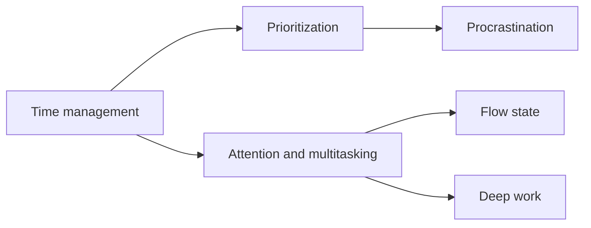

# Intrapersonal soft skills

Skills of managing oneself: time, attention, effort and motivation. This subfield belongs to [Soft skills](../README.md) and covers the intrapersonal domain of the US National Research Council framework. Related notes on habits, goals and self-regulation are in [personal growth](../../../personal-growth/README.md).

## Map of the subfield

## Notes in reading order

1. [Time management](time-management.md): planning, scheduling and buffers, and what the evidence supports.
2. [Prioritization](prioritization.md): matrices, the mere urgency effect and the four Ds.
3. [Procrastination](procrastination.md): causes, the mood repair view and responses.
4. [Attention and multitasking](attention-and-multitasking.md): the cost of switching, interruptions and FOMO.
5. [Flow state](flow-state.md): challenge, skill and the conditions of absorption.
6. [Deep work and deep dives](deep-work.md): protecting focused blocks and studying a topic in depth.

## Planned topics

- Work ethic and accountability
- Balance and self-care
